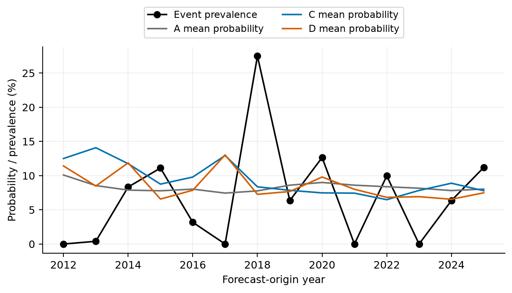
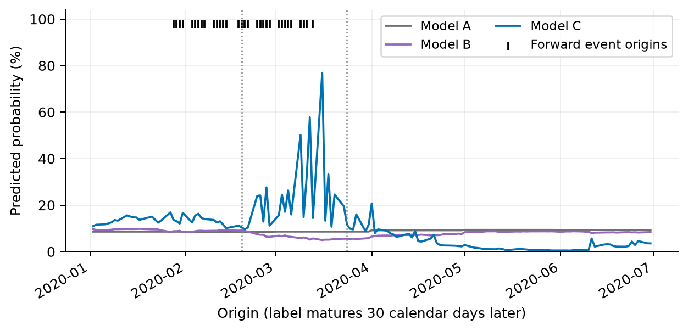

# H6 failure analysis

**EXPLORATORY DIAGNOSTICS — PENDING INDEPENDENT COAUTHOR REVIEW**

Fixed plan committed as `7ad9187` before computations. Original v2 models, parameters, source data and reported findings remain unchanged. Evaluation: 3520 origins2012–2025,168 monthly refits. All rates are decimals unless marked percent. New diagnostics use full-chronology circular block63 bootstrap,1000 draws,seed1729; fixed blocks21/126 sensitivities are retained. Historical resampling, overlapping labels and sparse stress cells do not establish causality or independent scientific acceptance.

C’s excess Brier loss is exactly -0.00178893171 from event days plus 0.00428618316 from non-event days = 0.00249725145. It improves the event contribution but raises the much more numerous non-event contribution. This supports over-warning / calibration cost under imbalance; it contradicts an explanation that C never learns anything about events. The all-zero probability diagnostic has Brier244/3520 = 0.0693181818, worse than A and C; prevalence imbalance alone therefore does not explain the advanced model’s excess loss. The hindsight constant prevalence achieves p(1−p), an oracle diagnostic and never an executable replacement.

| model | prevalence | mean_probability | brier | event_contribution | nonevent_contribution | reliability | resolution | within_bin_residual |
| --- | --- | --- | --- | --- | --- | --- | --- | --- |
| A | 0.0693181818 | 0.0829652846 | 0.0652801557 | 0.0587845118 | 0.00649564395 | 0.000497749389 | 0.000176914961 | 0.00044614983 |
| B | 0.0693181818 | 0.0866956493 | 0.0660108732 | 0.0587431569 | 0.00726771632 | 0.00145697902 | 0.00051449894 | 0.000555221669 |
| C | 0.0693181818 | 0.0942675267 | 0.0677774072 | 0.0569955801 | 0.0107818271 | 0.00305824251 | 0.000125194155 | 0.000331187346 |
| D | 0.0693181818 | 0.0855576503 | 0.0702763453 | 0.0600282125 | 0.0102481328 | 0.00504899687 | 0.000299369225 | 0.00101354619 |

Brier = fixed-bin reliability − resolution + prevalence uncertainty + within-bin residual. Keeping the residual makes the identity exact; reliability cannot be read as the whole loss. All ten bins, including empty bins, are retained. Probability calibration errors here are OOS diagnostics, never probability transformations.

| model | metric | estimate | ci95 | valid_draws |
| --- | --- | --- | --- | --- |
| A | roc_auc | 0.322309294 | [0.1962088005108806, 0.4665142516476421] | 1000 |
| A | average_precision | 0.0497810302 | [0.028532471261784178, 0.0887808897300212] | 1000 |
| B | roc_auc | 0.321606217 | [0.22455099645077192, 0.43697609895449585] | 1000 |
| B | average_precision | 0.0467203694 | [0.02650263049103493, 0.07426585669145465] | 1000 |
| C | roc_auc | 0.508438169 | [0.38780478815891406, 0.6226173301548354] | 1000 |
| C | average_precision | 0.0690058194 | [0.03599152368779542, 0.12402461226814329] | 1000 |
| D | roc_auc | 0.391651779 | [0.2676607633239028, 0.4990134375745909] | 1000 |
| D | average_precision | 0.0535726657 | [0.03128738479696892, 0.08683094461187074] | 1000 |

C’s whole-sample ROC-AUC is approximately chance and AP is close to prevalence. Its stronger ranking than A/B does not establish useful absolute discrimination. Mean probabilities exceed full-sample event rates; period-specific calibration reverses during the shock. Both ranking and calibration fail, with wide dependence-aware intervals.

| model | policy | alerts | tp | fp | fn | precision | recall | recall_ci_low | recall_ci_high |
| --- | --- | --- | --- | --- | --- | --- | --- | --- | --- |
| A | retrospective_group_budget | 352 | 0 | 352 | 244 | 0 | 0 | 0 | 0 |
| A | saved_train_quantile | 3520 | 244 | 3276 | 0 | 0.0693181818 | 1 | 1 | 1 |
| B | retrospective_group_budget | 352 | 1 | 351 | 243 | 0.00284090909 | 0.00409836066 | 0 | 0.0376678621 |
| B | saved_train_quantile | 653 | 32 | 621 | 212 | 0.0490045942 | 0.131147541 | 0.035344697 | 0.278067258 |
| C | retrospective_group_budget | 352 | 14 | 338 | 230 | 0.0397727273 | 0.0573770492 | 0 | 0.144068722 |
| C | saved_train_quantile | 562 | 37 | 525 | 207 | 0.0658362989 | 0.151639344 | 0.0552105026 | 0.278708211 |
| D | retrospective_group_budget | 352 | 8 | 344 | 236 | 0.0227272727 | 0.0327868852 | 0.00584379984 | 0.0759590299 |
| D | saved_train_quantile | 411 | 14 | 397 | 230 | 0.0340632603 | 0.0573770492 | 0.0216415305 | 0.0969395485 |

The retrospective budget selects ceil(.1N) high scores using future evaluation ranks. Subgroup budgets in the complete tables re-rank within that hindsight subgroup and are a different descriptive allocation; the false-negative table also retains the original whole-sample budget. The saved monthly training-90th-percentile rule is executable but uses varying alert fractions. A alerts everywhere because of ties, so its100% recall has no selectivity. No new threshold was introduced. Zero-event group recall retains the original utility’s zero convention; it is undefined for interpretation and its uncertainty is null.

| group | n | events | prevalence | prevalence_ci_low | prevalence_ci_high | mean_probability | brier | brier_ci_low | brier_ci_high |
| --- | --- | --- | --- | --- | --- | --- | --- | --- | --- |
| 2020_pre | 32 | 15 | 0.46875 | 0 | 1 | 0.134810752 | 0.362033427 | 0.0162586686 | 0.78002193 |
| 2020_onset | 24 | 17 | 0.708333333 | 0 | 1 | 0.24045616 | 0.507940938 | 0.137771052 | 0.722513104 |
| 2020_normalize | 69 | 0 | 0 | 0 | 0 | 0.0391883792 | 0.00310449697 | 0.000465468317 | 0.0130686143 |
| 2020_late | 128 | 0 | 0 | 0 | 0 | 0.0478855243 | 0.00322915362 | 0.00065551789 | 0.00536336091 |
| vix_low | 1432 | 121 | 0.0844972067 | 0.0399994448 | 0.137079922 | 0.105796924 | 0.0821896367 | 0.046522402 | 0.124738063 |
| vix_mid | 1706 | 104 | 0.060961313 | 0.0267033887 | 0.10120777 | 0.0861118451 | 0.0610615394 | 0.0321825922 | 0.0957289777 |
| vix_high | 382 | 19 | 0.0497382199 | 0.00210113164 | 0.13529461 | 0.0874703954 | 0.0437432656 | 0.00932351489 | 0.103690651 |
| shock_down | 191 | 6 | 0.0314136126 | 0.00531570389 | 0.0616187091 | 0.115645884 | 0.0421311919 | 0.0203585572 | 0.0671228455 |
| shock_stable | 2983 | 199 | 0.0667113644 | 0.0381417486 | 0.099569317 | 0.090682589 | 0.0654892218 | 0.0416504535 | 0.0927166057 |
| shock_up | 346 | 39 | 0.112716763 | 0.0448937211 | 0.196297343 | 0.113373316 | 0.101662044 | 0.0508654561 | 0.163046596 |

Low-IVAR origins have121/1432 events (8.450%), versus19/382 (4.974%) in VIX>=25. This supports selection by the relative-event denominator: high implied risk raises the required realized variance. It does not prove low IVAR causes shocks, and104 events occur at intermediate VIX. Rising VIX origins have39/346 events (11.272%), falling VIX6/191 (3.141%); these are current five-session movements, not future shock predictors. Ratio>3 and realized-volatility false-negative summaries are fully retained in the linked tables.

The2020 pre window contains15 forward events among32 origins; onset contains17/24, while normalization and late2020 contain no events under this ratio definition. Those labels include the NEXT30 days: an origin before Feb19 can contain March stress in its target. This is target chronology, not advance knowledge of a crisis. C’s onset mean probability24.046% substantially undershoots70.833% event prevalence, but its Brier0.507941 beats A0.594255. Saved C alerts catch12/17 onset events (17 alerts) versus7/15 pre events (18 alerts); warnings improve after volatility has risen. Contradicting a blanket shock-failure explanation, C improves2020 loss versus A; the decline in event prevalence during high-IVAR normalization also makes high risk and ratio events different concepts. Tiny overlapping shock groups produce very broad intervals; do not count17 events as17 independent shocks.

| model | feature | min | median | max | first | last | sign_changes |
| --- | --- | --- | --- | --- | --- | --- | --- |
| B | log_ivar | -0.411383781 | -0.143460129 | 0.0223160997 | -0.407365065 | -0.119782107 | 2 |
| C | log_ivar | -1.47675119 | -0.540231026 | -0.250131731 | -1.37736363 | -0.453354575 | 0 |
| C | log_rv21 | -1.18410398 | 0.0376913448 | 0.847090552 | -0.919632324 | 0.0402425028 | 1 |
| C | log_rv63 | -1.28889937 | -0.935463814 | -0.42215908 | -1.20895128 | -0.902756182 | 0 |
| C | log_downside21 | -0.412558012 | -0.187582442 | 0.456195409 | 0.115202571 | -0.174038973 | 5 |
| C | negative_return | 0.147655004 | 0.200189079 | 0.31597064 | 0.311767379 | 0.166991575 | 0 |
| C | log_garch | 0.435969452 | 1.32431963 | 2.91925547 | 2.85464006 | 1.19751851 | 0 |
| D | log_ivar | 0.00457388318 | 0.076449767 | 0.165891002 | 0.0935160192 | 0.0554942173 | 0 |
| D | log_rv21 | 0 | 0.122710896 | 0.279485456 | 0.0946290207 | 0.251343722 | 4 |
| D | log_rv63 | 0.212705124 | 0.377349582 | 0.693264026 | 0.606190484 | 0.312522489 | 0 |
| D | log_downside21 | 0.142289875 | 0.249872925 | 0.436909784 | 0.17882046 | 0.202132484 | 0 |
| D | negative_return | 0.0268440161 | 0.0493186669 | 0.111622881 | 0.0268440161 | 0.076853746 | 0 |
| D | log_garch | 0 | 0.0977912137 | 0.384382282 | 0 | 0.101653342 | 7 |

These are the168 original refits; coefficient ranges are descriptive, not confidence intervals for independent estimates. Standardized coefficients change with training scales; raw coefficients and every scaler/intercept are retained. C’s IVAR coefficient remains negative and GARCH positive, while trailing21 changes sign, supporting changing conditional association and correlated-feature allocation. Stable signs contradict a universal coefficient-instability explanation. No coefficient is changed.

Annual prevalence and predicted rates; all years shown, association only.

Event marks denote origins of future30-day outcomes; they are not events known at origin.

| group | model | n | events | brier | mean_probability | roc_auc | average_precision |
| --- | --- | --- | --- | --- | --- | --- | --- |
| full | A | 3520 | 244 | 0.0652801557 | 0.0829652846 | 0.322309294 | 0.0497810302 |
| full | B | 3520 | 244 | 0.0660108732 | 0.0866956493 | 0.321606217 | 0.0467203694 |
| full | C | 3520 | 244 | 0.0677774072 | 0.0942675267 | 0.508438169 | 0.0690058194 |
| full | D | 3520 | 244 | 0.0702763453 | 0.0855576503 | 0.391651779 | 0.0535726657 |
| year_2012 | A | 250 | 0 | 0.0102215177 | 0.100958213 | — | — |
| year_2012 | B | 250 | 0 | 0.0151847526 | 0.12241511 | — | — |
| year_2012 | C | 250 | 0 | 0.0209315938 | 0.12503025 | — | — |
| year_2012 | D | 250 | 0 | 0.0198853284 | 0.114146605 | — | — |
| year_2013 | A | 252 | 1 | 0.0105914097 | 0.0854369975 | 0.631474104 | 0.00961538462 |
| year_2013 | B | 252 | 1 | 0.0135874508 | 0.101465126 | 0.64940239 | 0.0112359551 |
| year_2013 | C | 252 | 1 | 0.0269312193 | 0.140829732 | 0.342629482 | 0.00602409639 |
| year_2013 | D | 252 | 1 | 0.0143445034 | 0.0848430852 | 0.163346614 | 0.00471698113 |
| year_2014 | A | 252 | 21 | 0.076564728 | 0.0788714277 | 0.367243867 | 0.0814944121 |
| year_2014 | B | 252 | 21 | 0.0767228286 | 0.0842605134 | 0.370645228 | 0.0653578419 |
| year_2014 | C | 252 | 21 | 0.0813202185 | 0.117520539 | 0.416821274 | 0.069483352 |
| year_2014 | D | 252 | 21 | 0.0978870241 | 0.118690348 | 0.564935065 | 0.113178882 |
| year_2015 | A | 252 | 28 | 0.100310881 | 0.0778361081 | 0.21875 | 0.0980508207 |
| year_2015 | B | 252 | 28 | 0.10008861 | 0.0805547617 | 0.34901148 | 0.0908047642 |
| year_2015 | C | 252 | 28 | 0.0986932198 | 0.0875796907 | 0.644451531 | 0.146091181 |
| year_2015 | D | 252 | 28 | 0.104795086 | 0.0657650517 | 0.128507653 | 0.0772690034 |
| year_2016 | A | 252 | 8 | 0.0331461474 | 0.0802716744 | 0.232838115 | 0.0341836735 |
| year_2016 | B | 252 | 8 | 0.0338001795 | 0.0876609094 | 0.524590164 | 0.035681381 |
| year_2016 | C | 252 | 8 | 0.0380441044 | 0.0979247885 | 0.481045082 | 0.0317329715 |
| year_2016 | D | 252 | 8 | 0.0349754529 | 0.0786522793 | 0.522540984 | 0.0568125 |
| year_2017 | A | 251 | 0 | 0.00554861497 | 0.0744608522 | — | — |
| year_2017 | B | 251 | 0 | 0.00661641884 | 0.0810924954 | — | — |
| year_2017 | C | 251 | 0 | 0.0180841956 | 0.129444888 | — | — |
| year_2017 | D | 251 | 0 | 0.0220804373 | 0.130332589 | — | — |
| year_2018 | A | 251 | 69 | 0.239012612 | 0.0777078507 | 0.375617136 | 0.293221666 |
| year_2018 | B | 251 | 69 | 0.238919087 | 0.0790846952 | 0.345676063 | 0.206198722 |
| year_2018 | C | 251 | 69 | 0.236984317 | 0.0836930044 | 0.53256888 | 0.268823839 |
| year_2018 | D | 251 | 69 | 0.245947359 | 0.0726925456 | 0.323379519 | 0.221305251 |
| year_2019 | A | 252 | 16 | 0.0601977003 | 0.0860337577 | 0.094279661 | 0.0611973775 |
| year_2019 | B | 252 | 16 | 0.0601924718 | 0.0905287799 | 0.497086864 | 0.0626308 |
| year_2019 | C | 252 | 16 | 0.0622142502 | 0.0785361552 | 0.303760593 | 0.0465035891 |
| year_2019 | D | 252 | 16 | 0.0618705098 | 0.0768057333 | 0.127383475 | 0.0466349154 |
| year_2020 | A | 253 | 32 | 0.112933904 | 0.0900132655 | 0.0347143665 | 0.0939270615 |
| year_2020 | B | 253 | 32 | 0.113303652 | 0.0811235529 | 0.525735294 | 0.20888881 |
| year_2020 | C | 253 | 32 | 0.0964553128 | 0.0747756409 | 0.925622172 | 0.51538232 |
| year_2020 | D | 253 | 32 | 0.116565458 | 0.0980139259 | 0.568863122 | 0.154163554 |
| year_2021 | A | 252 | 0 | 0.00740666324 | 0.086045035 | — | — |
| year_2021 | B | 252 | 0 | 0.00707004167 | 0.0839709501 | — | — |
| year_2021 | C | 252 | 0 | 0.00622484976 | 0.0743956708 | — | — |
| year_2021 | D | 252 | 0 | 0.00664578962 | 0.0800387533 | — | — |
| year_2022 | A | 251 | 25 | 0.0901415893 | 0.0837778274 | 0.166371681 | 0.0758657193 |
| year_2022 | B | 251 | 25 | 0.0897140862 | 0.0743256987 | 0.709734513 | 0.218080205 |
| year_2022 | C | 251 | 25 | 0.0957317852 | 0.0648252145 | 0.211504425 | 0.0621749005 |
| year_2022 | D | 251 | 25 | 0.0916464149 | 0.068301289 | 0.501238938 | 0.104533255 |
| year_2023 | A | 250 | 0 | 0.00666478721 | 0.0816258419 | — | — |
| year_2023 | B | 250 | 0 | 0.00722444296 | 0.0848382338 | — | — |
| year_2023 | C | 250 | 0 | 0.00676322248 | 0.078373109 | — | — |
| year_2023 | D | 250 | 0 | 0.004946898 | 0.06921528 | — | — |
| year_2024 | A | 252 | 16 | 0.0598545471 | 0.0781563181 | 0.105932203 | 0.0695652174 |
| year_2024 | B | 252 | 16 | 0.0597429478 | 0.0828027988 | 0.503972458 | 0.0620577008 |
| year_2024 | C | 252 | 16 | 0.0591085881 | 0.088910326 | 0.69279661 | 0.101760076 |
| year_2024 | D | 252 | 16 | 0.0578064804 | 0.0654378913 | 0.816472458 | 0.422102623 |
| year_2025 | A | 250 | 28 | 0.101070896 | 0.080350882 | 0.0324967825 | 0.0861134386 |
| year_2025 | B | 250 | 28 | 0.101755847 | 0.0797496725 | 0.198841699 | 0.0689621913 |
| year_2025 | C | 250 | 28 | 0.10127806 | 0.0779530319 | 0.54456242 | 0.125609223 |
| year_2025 | D | 250 | 28 | 0.10423012 | 0.0748930007 | 0.396235521 | 0.110533257 |
| 2012_2016 | A | 1258 | 58 | 0.0462240837 | 0.0846489965 | 0.179820402 | 0.0299939016 |
| 2012_2016 | B | 1258 | 58 | 0.0479287389 | 0.0952281302 | 0.235215517 | 0.0284625062 |
| 2012_2016 | C | 1258 | 58 | 0.053235347 | 0.113759109 | 0.447126437 | 0.0383032142 |
| 2012_2016 | D | 1258 | 58 | 0.0544323155 | 0.0923849315 | 0.335337644 | 0.0359049878 |
| 2017_2021 | A | 1259 | 117 | 0.0849828794 | 0.0828685912 | 0.328666906 | 0.0718368561 |
| 2017_2021 | B | 1259 | 117 | 0.0851829939 | 0.0831633564 | 0.368322182 | 0.0735649842 |
| 2017_2021 | C | 1259 | 117 | 0.0839333153 | 0.0881292044 | 0.585492538 | 0.135619049 |
| 2017_2021 | D | 1259 | 117 | 0.0905735862 | 0.0915660387 | 0.299092909 | 0.0649879417 |
| 2022_2025 | A | 1003 | 69 | 0.0644494573 | 0.0809748831 | 0.278729479 | 0.0546422826 |
| 2022_2025 | B | 1003 | 69 | 0.0646246571 | 0.080427749 | 0.355444869 | 0.0492852193 |
| 2022_2025 | C | 1003 | 69 | 0.0657371514 | 0.0775254897 | 0.463519846 | 0.0690188686 |
| 2022_2025 | D | 1003 | 69 | 0.0646707254 | 0.0694526843 | 0.514430686 | 0.0748290458 |
| 2020_pre | A | 32 | 15 | 0.395948173 | 0.0857049559 | 0.133333333 | 0.394543651 |
| 2020_pre | B | 32 | 15 | 0.393857563 | 0.0920662029 | 0.062745098 | 0.309636692 |
| 2020_pre | C | 32 | 15 | 0.362033427 | 0.134810752 | 0.450980392 | 0.478770001 |
| 2020_pre | D | 32 | 15 | 0.433251969 | 0.165500968 | 0.0509803922 | 0.344608454 |
| 2020_onset | A | 24 | 17 | 0.594254506 | 0.0858248863 | 0.264705882 | 0.631127451 |
| 2020_onset | B | 24 | 17 | 0.614522129 | 0.0642478975 | 1 | 1 |
| 2020_onset | C | 24 | 17 | 0.507940938 | 0.24045616 | 0.319327731 | 0.610881535 |
| 2020_onset | D | 24 | 17 | 0.591430186 | 0.172908728 | 0.025210084 | 0.525603963 |
| 2020_normalize | A | 69 | 0 | 0.00846922371 | 0.0920073919 | — | — |
| 2020_normalize | B | 69 | 0 | 0.00619518157 | 0.0781351108 | — | — |
| 2020_normalize | C | 69 | 0 | 0.00310449697 | 0.0391883792 | — | — |
| 2020_normalize | D | 69 | 0 | 0.00848978326 | 0.0762104769 | — | — |
| 2020_late | A | 128 | 0 | 0.00824571582 | 0.0908007052 | — | — |
| 2020_late | B | 128 | 0 | 0.00692486896 | 0.0831630329 | — | — |
| 2020_late | C | 128 | 0 | 0.00322915362 | 0.0478855243 | — | — |
| 2020_late | D | 128 | 0 | 0.00661623668 | 0.0788528117 | — | — |
| vix_low | A | 1432 | 121 | 0.0778853786 | 0.0800791934 | 0.309394129 | 0.0633677494 |
| vix_low | B | 1432 | 121 | 0.0788429929 | 0.0898580415 | 0.267286974 | 0.0534691025 |
| vix_low | C | 1432 | 121 | 0.0821896367 | 0.105796924 | 0.404107646 | 0.0647682924 |
| vix_low | D | 1432 | 121 | 0.0869156237 | 0.0931209394 | 0.358482894 | 0.0635182191 |
| vix_mid | A | 1706 | 104 | 0.0583964883 | 0.0847392841 | 0.310657351 | 0.0441309873 |
| vix_mid | B | 1706 | 104 | 0.0591324582 | 0.0870554267 | 0.280460722 | 0.0390112951 |
| vix_mid | C | 1706 | 104 | 0.0610615394 | 0.0861118451 | 0.485324834 | 0.0557440282 |
| vix_mid | D | 1706 | 104 | 0.061045464 | 0.0794358601 | 0.350913522 | 0.0446558789 |
| vix_high | A | 382 | 19 | 0.0487693118 | 0.0858617228 | 0.454327969 | 0.0601123787 |
| vix_high | B | 382 | 19 | 0.0486260056 | 0.0732340639 | 0.190807598 | 0.030281254 |
| vix_high | C | 382 | 19 | 0.0437432656 | 0.0874703954 | 0.869508482 | 0.271401751 |
| vix_high | D | 382 | 19 | 0.0491256563 | 0.084544938 | 0.681093229 | 0.0973795684 |
| shock_down | A | 191 | 6 | 0.0332654801 | 0.0821690173 | 0.287387387 | 0.026337422 |
| shock_down | B | 191 | 6 | 0.0338859843 | 0.084762216 | 0.232432432 | 0.0225930971 |
| shock_down | C | 191 | 6 | 0.0421311919 | 0.115645884 | 0.358558559 | 0.0268560125 |
| shock_down | D | 191 | 6 | 0.0364500216 | 0.0830498888 | 0.443243243 | 0.0363327413 |
| shock_stable | A | 2983 | 199 | 0.0631598945 | 0.0831565906 | 0.29245094 | 0.0456998322 |
| shock_stable | B | 2983 | 199 | 0.0638495364 | 0.0878662032 | 0.323548417 | 0.0451358605 |
| shock_stable | C | 2983 | 199 | 0.0654892218 | 0.090682589 | 0.49978701 | 0.0612495758 |
| shock_stable | D | 2983 | 199 | 0.0683352574 | 0.0851120063 | 0.369074178 | 0.0496165978 |
| shock_up | A | 346 | 39 | 0.10123259 | 0.0817555198 | 0.495155767 | 0.130322071 |
| shock_up | B | 346 | 39 | 0.102378277 | 0.0776711511 | 0.35371252 | 0.0877948603 |
| shock_up | C | 346 | 39 | 0.101662044 | 0.113373316 | 0.574208636 | 0.161583051 |
| shock_up | D | 346 | 39 | 0.105684129 | 0.0907840621 | 0.498120772 | 0.118624302 |
| outcome_ratio_le1 | A | 2964 | 0 | 0.00699986848 | 0.0833565834 | — | — |
| outcome_ratio_le1 | B | 2964 | 0 | 0.00784342569 | 0.0873901847 | — | — |
| outcome_ratio_le1 | C | 2964 | 0 | 0.0116630305 | 0.0947129468 | — | — |
| outcome_ratio_le1 | D | 2964 | 0 | 0.0112361414 | 0.0874966365 | — | — |
| outcome_ratio_1_1.5 | A | 312 | 0 | 0.00678543756 | 0.082254769 | — | — |
| outcome_ratio_1_1.5 | B | 312 | 0 | 0.00748220413 | 0.0857507529 | — | — |
| outcome_ratio_1_1.5 | C | 312 | 0 | 0.0108423363 | 0.0897941575 | — | — |
| outcome_ratio_1_1.5 | D | 312 | 0 | 0.00887661634 | 0.0792946439 | — | — |
| outcome_ratio_1.5_3 | A | 156 | 156 | 0.846958966 | 0.0797028532 | — | 1 |
| outcome_ratio_1.5_3 | B | 156 | 156 | 0.844662736 | 0.080971127 | — | 1 |
| outcome_ratio_1.5_3 | C | 156 | 156 | 0.833073327 | 0.0886828272 | — | 1 |
| outcome_ratio_1.5_3 | D | 156 | 156 | 0.858286496 | 0.0743515249 | — | 1 |
| outcome_ratio_gt3 | A | 88 | 88 | 0.849953214 | 0.078088131 | — | 1 |
| outcome_ratio_gt3 | B | 88 | 88 | 0.852369608 | 0.0768005403 | — | 1 |
| outcome_ratio_gt3 | C | 88 | 88 | 0.803011397 | 0.105025244 | — | 1 |
| outcome_ratio_gt3 | D | 88 | 88 | 0.879620622 | 0.0623196762 | — | 1 |
| outcome_variance_down | A | 786 | 0 | 0.00700649456 | 0.0834594053 | — | — |
| outcome_variance_down | B | 786 | 0 | 0.00747243413 | 0.085534321 | — | — |
| outcome_variance_down | C | 786 | 0 | 0.013256353 | 0.0998590479 | — | — |
| outcome_variance_down | D | 786 | 0 | 0.0114623462 | 0.0867771957 | — | — |
| outcome_variance_stable | A | 2116 | 35 | 0.0208362214 | 0.0832216791 | 0.476721356 | 0.0168148345 |
| outcome_variance_stable | B | 2116 | 35 | 0.0218427239 | 0.0876255668 | 0.258927713 | 0.0105881928 |
| outcome_variance_stable | C | 2116 | 35 | 0.0251555303 | 0.0935228534 | 0.433857349 | 0.0139628428 |
| outcome_variance_stable | D | 2116 | 35 | 0.0241491531 | 0.0837973627 | 0.399032059 | 0.0144582057 |
| outcome_variance_up | A | 618 | 209 | 0.291568931 | 0.0814589583 | 0.305290064 | 0.256350601 |
| outcome_variance_up | B | 618 | 209 | 0.291692131 | 0.0849886893 | 0.303482645 | 0.2430666 |
| outcome_variance_up | C | 618 | 209 | 0.283054818 | 0.0897057031 | 0.566816018 | 0.385697697 |
| outcome_variance_up | D | 618 | 209 | 0.303015734 | 0.0900337114 | 0.290122951 | 0.242416516 |

Full uncertainty and false-negative severity: [score table](tables/quant_failure/h6_scores.csv), [alerts](tables/quant_failure/h6_alerts.csv), [severity](tables/quant_failure/h6_false_negatives.csv), [paired losses](tables/quant_failure/h6_contrasts.csv), [reliability bins](tables/quant_failure/h6_bins.csv), [ranking intervals](tables/quant_failure/score_ranking.csv), [calibration intervals](tables/quant_failure/score_calibration.csv).

Primary result SHA `165ee888a84dd8df8a406490ac81b67667eee7906e0cb98c4c579cd6672ac80d`; independent audit SHA `444073f5f35454dfa6c38d7d775bee60f1af37c840694f1da08659724dfef8f7`. Full provenance, all input hashes and exact tables are in [results](../data/manifests/quant_failure_results_v1.json) and [audit](../data/manifests/quant_failure_independent_audit_v1.json). Reproduction and interpretation limits: [synthesis](quant_failure_mechanisms.md).
