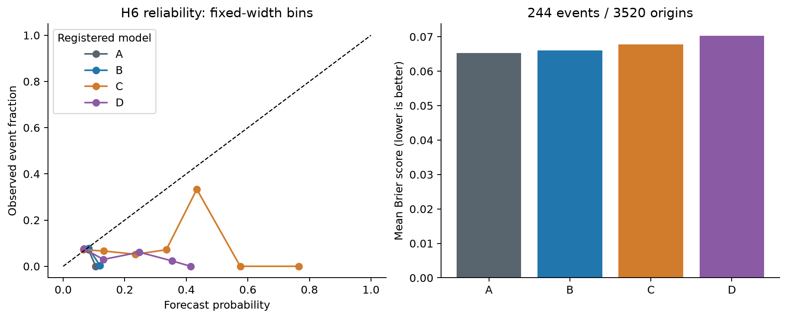

# H6: dangerous underestimation probabilities

**EXPLORATORY — POST H1–H5 RESULT SELECTION — PENDING INDEPENDENT REVIEW**

Executed 3520 common origins2012–2025, 244 events, prevalence0.0693181818; 168 first-origin monthly refits per fitted model, zero failed fits. Training2007 onward, five-year warm-up; exact30-calendar-day maturity enforced. See registered model definitions and all refit parameters in the sanitized JSON. The threshold was selected after H1–H5.

| model | Brier | log loss | ROC-AUC | PR AP | TP10% | FP10% | precision10% | recall10% | FNR10% |
|---|---|---|---|---|---|---|---|---|---|
| A | 0.0652801557 | 0.256879993 | 0.322309294 | 0.0497810302 | 0 | 352 | 0 | 0 | 1 |
| B | 0.0660108732 | 0.260949141 | 0.321606217 | 0.0467203694 | 1 | 351 | 0.00284090909 | 0.00409836066 | 0.995901639 |
| C | 0.0678094484 | 0.264043936 | 0.508383124 | 0.0687674355 | 13 | 339 | 0.0369318182 | 0.0532786885 | 0.946721311 |
| D | 0.0702740192 | 0.275796026 | 0.39192075 | 0.0535994077 | 8 | 344 | 0.0227272727 | 0.0327868852 | 0.967213115 |

A is the strongest simple Brier benchmark. C has worse Brier by3.87%; D is worse by7.65%. Neither clears the registered5% improvement gate. D's deterioration survives the four-test Holm family; C's direction is unfavorable but uncertain. Improved C ROC ranking does not rescue probability quality. At the fixed retrospective10% budget, C detects13/244 events with339 false alarms; the event-rate benchmark detects none in its highest historical-rate months. This unusual benchmark ranking reflects temporal prevalence changes, not a code-selected threshold. No event threshold/model was retuned. These forecasts do not provide reliable practical early warnings.

| pair | Brier difference | HAC63 CI | raw p | Holm p | relative reduction | bootstrap CI | recall gain | recall CI |
|---|---|---|---|---|---|---|---|---|
| C − A | 0.00252929267 | [-0.0003019868412150327, 0.005360572187762466] | 0.0799609922 | 0.159921984 | -0.0387451997 | [-0.10923634504680077, 0.004889170173454327] | 0.0532786885 | [0.0, 0.137188578569445] |
| C − B | 0.00179857518 | [-0.0009682981053007373, 0.004565448470351672] | 0.202644715 | 0.202644715 | -0.0272466504 | [-0.08856494356843085, 0.016075840141888263] | 0.0491803279 | [-0.004227046222578612, 0.1353254193243562] |
| D − A | 0.00499386349 | [0.0015823892370759075, 0.008405337734206505] | 0.00411667647 | 0.0164667059 | -0.0764989518 | [-0.14626620772138768, -0.035087877728770894] | 0.0327868852 | [0.005045601647543396, 0.07633657182512145] |
| D − B | 0.00426314599 | [0.0009217192260286317, 0.00760457276375728] | 0.0123978847 | 0.0371936541 | -0.0645824814 | [-0.12912698468013298, -0.026867148631978345] | 0.0286885246 | [-0.005260560378670614, 0.07142857142857142] |

Relative reduction positive favors the advanced model; paired loss difference negative favors it. Percentile circular-block63 intervals1000 draws, seed1729. HAC21 sensitivity and all exact values are in JSON. Recall-gain intervals re-rank each bootstrap sample and do not represent a live policy.

| model | intercept | slope | HAC CI | optimizer success | gradient max | live alert fraction | live precision | live recall | p>=.5 recall |
|---|---|---|---|---|---|---|---|---|---|
| A | -26.9485804 | -10.0132725 | [[-45.488280377383376, -8.408880405004119], [-17.54730371214217, -2.4792413181689383]] | True | 4.40633591e-08 | 1 | 0.0693181818 | 1 | 0 |
| B | -14.2801176 | -4.84789506 | [[-20.17889523671064, -8.381339918917917], [-7.229311938153076, -2.46647817859331]] | False | 5.57579362e-07 | 0.185511364 | 0.0490045942 | 0.131147541 | 0 |
| C | -2.25662113 | 0.143132778 | [[-3.8188493017124356, -0.6943929657494825], [-0.459193788974583, 0.7454593447590518]] | True | 3.16321691e-10 | 0.161647727 | 0.065026362 | 0.151639344 | 0 |
| D | -5.38502507 | -1.08228408 | [[-8.720273452832267, -2.0497766961071866], [-2.316648480139445, 0.15208031669804933]] | True | 3.23597562e-08 | 0.116761364 | 0.0340632603 | 0.0573770492 | 0 |

Calibration slope/intercept are OOS diagnostics, not fitted probability correction. Ideal intercept0/slope1. Optimizer status and gradient are reported even if precision-loss prevents a success flag. Inconstant rates create calibration instability. Training-score90th-percentile live alerts can exceed/fall below10%; A ties at its event-rate threshold and therefore alerts every origin, an explicitly poor live operational rule. The exact10% budget is an evaluation allocation only. Empty reliability bins are omitted from plots but retained with n=0 in JSON.

| period | N | events | model | Brier | recall10% |
|---|---|---|---|---|---|
| 2012_2016 | 1258 | 58 | A | 0.0462240837 | 0 |
| 2012_2016 | 1258 | 58 | B | 0.0479287389 | 0 |
| 2012_2016 | 1258 | 58 | C | 0.0532181774 | 0 |
| 2012_2016 | 1258 | 58 | D | 0.054432318 | 0.0517241379 |
| 2017_2021 | 1259 | 117 | A | 0.0849828794 | 0 |
| 2017_2021 | 1259 | 117 | B | 0.0851829939 | 0.0854700855 |
| 2017_2021 | 1259 | 117 | C | 0.0840623166 | 0.11965812 |
| 2017_2021 | 1259 | 117 | D | 0.0905694552 | 0.0256410256 |
| 2020 | 253 | 32 | A | 0.112933904 | 0 |
| 2020 | 253 | 32 | B | 0.113303652 | 0.3125 |
| 2020 | 253 | 32 | C | 0.0965470976 | 0.40625 |
| 2020 | 253 | 32 | D | 0.11656528 | 0.09375 |
| 2022 | 251 | 25 | A | 0.0901415893 | 0 |
| 2022 | 251 | 25 | B | 0.0897140862 | 0.24 |
| 2022 | 251 | 25 | C | 0.0956974464 | 0 |
| 2022 | 251 | 25 | D | 0.0916464149 | 0.04 |
| 2022_2025 | 1003 | 69 | A | 0.0644494573 | 0.0579710145 |
| 2022_2025 | 1003 | 69 | B | 0.0646246571 | 0 |
| 2022_2025 | 1003 | 69 | C | 0.065709207 | 0.0869565217 |
| 2022_2025 | 1003 | 69 | D | 0.0646677443 | 0.0724637681 |

Generated from `h6.json`, SHA-256 `503bd9c72063964ad9a0b2ef3d6cad66b9835daf5cb694745e9b76ecca9f235c`. Exact forecasts, refit parameters/scaling and source identity are preserved in `outputs/quant_extension/v1/`; sanitized result metadata is committed in `data/manifests/quant_extension_h6.json`. Reproduction instructions: `docs/quant_extension_reproduction.md`. Independent scientific review PENDING.
