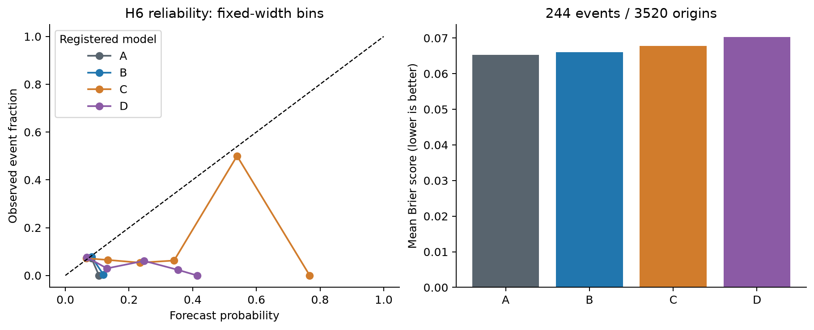

# H6: dangerous underestimation probabilities

**EXPLORATORY — POST H1–H5 RESULT SELECTION — PENDING INDEPENDENT REVIEW**

Current evidence is **v2**, after the registered calendar-information correction. Version1 affected comparisons are **INVALIDATED_FOR_STRICT_AS_OF_CALENDAR**, preserved unchanged in original manifests and `outputs/quant_extension/v1/` with original report copies. No model setting or practical threshold was changed; see `paper/quant_extension_calendar_amendment.md`.

Executed 3520 common origins 2012–2025, 244 events, prevalence 0.0693181818; 168 first-origin monthly refits per fitted model, zero failed fits. Training2007 onward, five-year warm-up; exact30-calendar-day maturity enforced. See registered model definitions and all refit parameters in the sanitized JSON. The threshold was selected after H1–H5.

| model | Brier | log loss | ROC-AUC | PR AP | TP10% | FP10% | precision10% | recall10% | FNR10% |
|---|---|---|---|---|---|---|---|---|---|
| A | 0.0652801557 | 0.256879993 | 0.322309294 | 0.0497810302 | 0 | 352 | 0 | 0 | 1 |
| B | 0.0660108732 | 0.260949141 | 0.321606217 | 0.0467203694 | 1 | 351 | 0.00284090909 | 0.00409836066 | 0.995901639 |
| C | 0.0677774072 | 0.2639753 | 0.508438169 | 0.0690058194 | 14 | 338 | 0.0397727273 | 0.0573770492 | 0.942622951 |
| D | 0.0702763453 | 0.275809487 | 0.391651779 | 0.0535726657 | 8 | 344 | 0.0227272727 | 0.0327868852 | 0.967213115 |

Strongest simple Brier benchmark: A. C Brier change versus A: 3.825%; D: 7.653% (positive is deterioration). Practical5% improvement gate passed: False. At the fixed retrospective 10% budget, C detects 14/244 events with 338 false alarms. The historical-rate benchmark's retrospective ranking reflects temporal prevalence changes and chronological ties. No threshold/model was retuned. Improved rank discrimination alone does not establish calibrated probability or useful decisions.

| pair | Brier difference | HAC63 CI | raw p | Holm p | relative reduction | bootstrap CI | recall gain | recall CI |
|---|---|---|---|---|---|---|---|---|
| C − A | 0.00249725145 | [-0.00033278592896819007, 0.005327288819485473] | 0.0837213365 | 0.167442673 | -0.0382543733 | [-0.10741141861675176, 0.0053616046204076175] | 0.0573770492 | [0.0, 0.1440687217822515] |
| C − B | 0.00176653395 | [-0.000995893111766575, 0.004528961020787358] | 0.210071121 | 0.210071121 | -0.0267612572 | [-0.08758232533041556, 0.017005896655172225] | 0.0532786885 | [-0.004526972079154243, 0.1398580431322096] |
| D − A | 0.00499618957 | [0.0015844451725696988, 0.00840793396902476] | 0.00410226375 | 0.016409055 | -0.0765345841 | [-0.14626926915973035, -0.03510502517695692] | 0.0327868852 | [0.005045601647543396, 0.07595902985795729] |
| D − B | 0.00426547208 | [0.0009238271696881662, 0.007607116990409791] | 0.0123559067 | 0.0370677201 | -0.0646177193 | [-0.12922855429177643, -0.026920839215392355] | 0.0286885246 | [-0.005703484549638391, 0.07084821428571426] |

Relative reduction positive favors the advanced model; paired loss difference negative favors it. Percentile circular-block 63 intervals 1000 draws, seed 1729. HAC21 sensitivity and all exact values are in JSON. Recall-gain intervals re-rank each bootstrap sample and do not represent a live policy.

| model | intercept | slope | HAC CI | optimizer success | gradient max | live alert fraction | live precision | live recall | p>=.5 recall |
|---|---|---|---|---|---|---|---|---|---|
| A | -26.9485804 | -10.0132725 | [[-45.488280377383376, -8.408880405004119], [-17.54730371214217, -2.4792413181689383]] | True | 4.40633591e-08 | 1 | 0.0693181818 | 1 | 0 |
| B | -14.2801176 | -4.84789506 | [[-20.17889523671064, -8.381339918917917], [-7.229311938153076, -2.46647817859331]] | False | 5.57579362e-07 | 0.185511364 | 0.0490045942 | 0.131147541 | 0 |
| C | -2.25102221 | 0.14545954 | [[-3.817488803424335, -0.6845556196378706], [-0.4583596017076125, 0.7492786815963507]] | False | 1.20359638e-06 | 0.159659091 | 0.0658362989 | 0.151639344 | 0.00409836066 |
| D | -5.38918145 | -1.08392656 | [[-8.72719860717224, -2.0511642966327748], [-2.3193294700570766, 0.15147635429247863]] | True | 3.28505571e-08 | 0.116761364 | 0.0340632603 | 0.0573770492 | 0 |

Calibration slope/intercept are OOS diagnostics, not fitted probability correction. Ideal intercept 0/slope 1. Optimizer status and gradient are reported even if precision-loss prevents a success flag. Inconstant rates create calibration instability. Training-score90th-percentile live alerts can exceed/fall below10%; A ties at its event-rate threshold and therefore alerts every origin, an explicitly poor live operational rule. The exact10% budget is an evaluation allocation only. Empty reliability bins are omitted from plots but retained with n=0 in JSON.

| period | N | events | model | Brier | recall10% |
|---|---|---|---|---|---|
| 2012_2016 | 1258 | 58 | A | 0.0462240837 | 0 |
| 2012_2016 | 1258 | 58 | B | 0.0479287389 | 0 |
| 2012_2016 | 1258 | 58 | C | 0.053235347 | 0 |
| 2012_2016 | 1258 | 58 | D | 0.0544323155 | 0.0517241379 |
| 2017_2021 | 1259 | 117 | A | 0.0849828794 | 0 |
| 2017_2021 | 1259 | 117 | B | 0.0851829939 | 0.0854700855 |
| 2017_2021 | 1259 | 117 | C | 0.0839333153 | 0.128205128 |
| 2017_2021 | 1259 | 117 | D | 0.0905735862 | 0.0256410256 |
| 2020 | 253 | 32 | A | 0.112933904 | 0 |
| 2020 | 253 | 32 | B | 0.113303652 | 0.3125 |
| 2020 | 253 | 32 | C | 0.0964553128 | 0.4375 |
| 2020 | 253 | 32 | D | 0.116565458 | 0.09375 |
| 2022 | 251 | 25 | A | 0.0901415893 | 0 |
| 2022 | 251 | 25 | B | 0.0897140862 | 0.24 |
| 2022 | 251 | 25 | C | 0.0957317852 | 0 |
| 2022 | 251 | 25 | D | 0.0916464149 | 0.04 |
| 2022_2025 | 1003 | 69 | A | 0.0644494573 | 0.0579710145 |
| 2022_2025 | 1003 | 69 | B | 0.0646246571 | 0 |
| 2022_2025 | 1003 | 69 | C | 0.0657371514 | 0.0869565217 |
| 2022_2025 | 1003 | 69 | D | 0.0646707254 | 0.0724637681 |

Generated from `h6.json`, SHA-256 `2a8107e9ace5dcfd565bbdba59bf7f298906584d3050565806f129072b4715c9`. Exact forecasts, refit parameters/scaling and source identity are preserved in `outputs/quant_extension/v2/`; sanitized result metadata is committed in `data/manifests/quant_extension_h6_v2.json`. Reproduction instructions: `docs/quant_extension_reproduction.md`. Independent scientific review PENDING.
