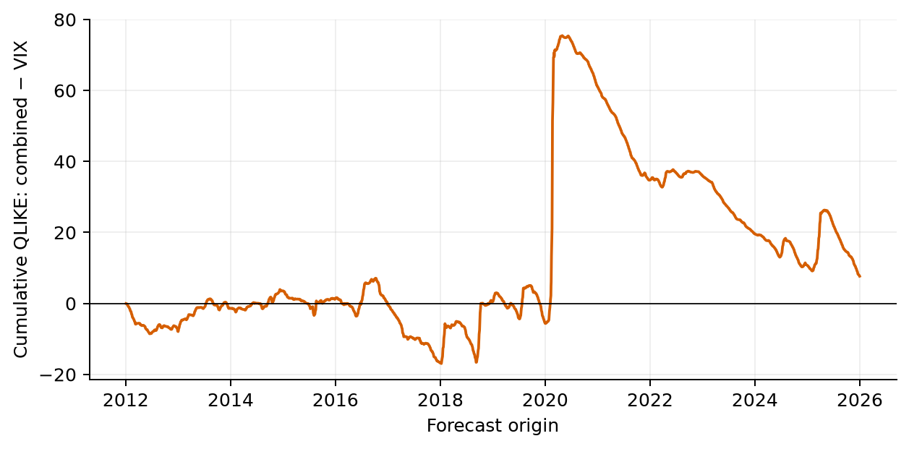
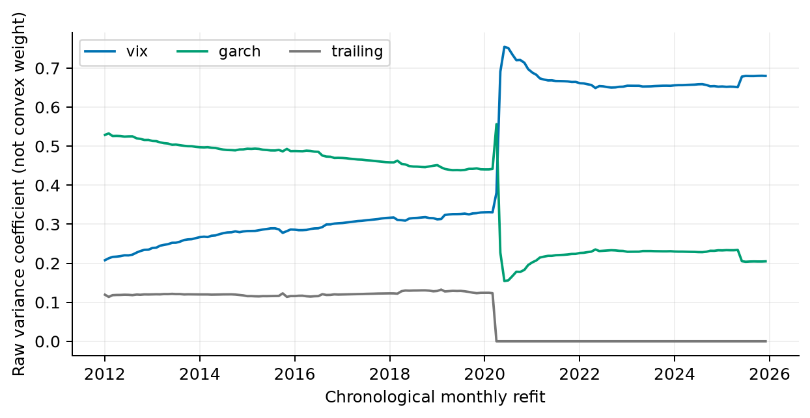

# H7 failure analysis

**EXPLORATORY DIAGNOSTICS — PENDING INDEPENDENT COAUTHOR REVIEW**

Fixed plan committed as `7ad9187` before computations. Original v2 models, parameters, source data and reported findings remain unchanged. Evaluation: 3520 origins2012–2025,168 monthly refits. All rates are decimals unless marked percent. New diagnostics use full-chronology circular block63 bootstrap,1000 draws,seed1729; fixed blocks21/126 sensitivities are retained. Historical resampling, overlapping labels and sparse stress cells do not establish causality or independent scientific acceptance.

The combination improves the weak trailing constituent but supplies no reliable QLIKE improvement over VIX/GARCH. Its lower MAE than VIX coexists with higher RMSE and QLIKE: ordinary absolute errors improve while rare large errors and relative underprediction drive other objectives. This is a loss-function mismatch, not evidence that one metric is intrinsically correct.

| model | mean_target | forecast | bias | bias_ci_low | bias_ci_high | qlike | rmse | mae | intercept | slope | bias_squared | centered_error_variance |
| --- | --- | --- | --- | --- | --- | --- | --- | --- | --- | --- | --- | --- |
| vix | 0.0282294264 | 0.0356536228 | 0.00742419647 | -0.00188498757 | 0.0132695036 | 0.385802085 | 0.060933283 | 0.0226920846 | -0.00184160679 | 0.843421531 | 5.51186932e-05 | 0.00365774629 |
| garch | 0.0282294264 | 0.0285959908 | 0.000366564422 | -0.00701786821 | 0.00569300756 | 0.389745564 | 0.0671555326 | 0.0204182702 | 0.0132258029 | 0.524675769 | 1.34369476e-07 | 0.00450973119 |
| trailing | 0.0282294264 | 0.0288067707 | 0.000577344374 | -0.00719447687 | 0.0087366365 | 0.607323124 | 0.0807487761 | 0.0233919212 | 0.0193661742 | 0.307679479 | 3.33326526e-07 | 0.00652003151 |
| ewma | 0.0282294264 | 0.0284052123 | 0.000175785966 | -0.00796897386 | 0.00802412163 | 0.525568259 | 0.0717358892 | 0.0219806492 | 0.0162234697 | 0.42266738 | 3.0900706e-08 | 0.00514600689 |
| har | 0.0282294264 | 0.0312467174 | 0.00301729106 | -0.00659253659 | 0.00889381697 | 0.41347762 | 0.0626190367 | 0.0213084911 | 0.000700215657 | 0.881027288 | 9.10404533e-06 | 0.00391203972 |
| combined | 0.0282294264 | 0.0319517219 | 0.00372229553 | -0.00467410955 | 0.00936485151 | 0.387982297 | 0.063252187 | 0.0209226379 | 0.00635507931 | 0.684606205 | 1.3855484e-05 | 0.00398698368 |

MSE=bias²+centered error variance exactly. OOS y=a+b*f+u gives y−f=(a+(b−1)f)+u; calibration MSE, residual MSE and twice their covariance are retained. The OOS projection is a descriptive decomposition using outcomes; its fitted values are never submitted as forecasts. Calibration intervals appear in the complete audit. Most squared loss is centered error, so mean bias alone is insufficient.

| baseline | loss | difference | ci_low | ci_high |
| --- | --- | --- | --- | --- |
| vix | qlike | 0.00218021156 | -0.0336240081 | 0.0533541938 |
| vix | mse | 0.00028797418 | -0.000160166867 | 0.00113243428 |
| vix | mae | -0.00176944663 | -0.0031842223 | 0.000221444647 |
| garch | qlike | -0.00176326665 | -0.0292143214 | 0.0272760698 |
| garch | mse | -0.0005090264 | -0.00158519937 | 7.27536791e-05 |
| garch | mae | 0.000504367745 | -0.00156477507 | 0.00222353322 |
| trailing | qlike | -0.219340827 | -0.347383869 | -0.105716304 |
| trailing | mse | -0.00251952568 | -0.00748647603 | -2.30928604e-05 |
| trailing | mae | -0.00246928324 | -0.00870188376 | 0.00144314834 |

Negative differences favor combination; new intervals are absolute loss differences, whereas original v2 reports also contain relative-reduction intervals. No original inference or Holm family is replaced.

Pairwise correlations: IVAR/GARCH 0.896248626, GARCH/trailing 0.925837589, IVAR/trailing 0.79210772; standardized predictor condition number 7.6908894. This supports overlapping information, but correlation alone cannot identify absence of incremental signal or a causal reason for failure; the trailing comparison shows some useful combination behavior.

| model | feature | min | median | max | first | last |
| --- | --- | --- | --- | --- | --- | --- |
| combined | ivar | 0.207834584 | 0.317253677 | 0.754352479 | 0.207834584 | 0.679895961 |
| combined | garch | 0.154449421 | 0.447022199 | 0.556202504 | 0.528882153 | 0.204843539 |
| combined | trailing | 0 | 0.115895072 | 0.132420356 | 0.119268374 | 0 |
| har | har1 | 0.0109811109 | 0.0145317758 | 0.0169944669 | 0.0132835421 | 0.0134666573 |
| har | har5 | 0.185439705 | 0.213327095 | 0.297899964 | 0.273234869 | 0.207912646 |
| har | har22 | 0.36494582 | 0.43674128 | 0.504173599 | 0.393806325 | 0.420289087 |

All168 intercepts/scalers and HAR smearing factors are retained. Raw coefficients are not convex weights; their sum need not equal1 and intercept contributions matter. IVAR’s raw coefficient rises0.207835→0.679896, GARCH falls0.528882→0.204844, trailing ends at0. Early coefficients plus shock errors are consistent with too little implied-volatility responsiveness, but no coefficient intervention was tested; changing collinearity, the fitted intercept and outcome unpredictability also explain these associations. Strong historical IVAR calibration does not prove a coefficient of1 would improve the combination.

| group | baseline | n | difference | ci_low | ci_high |
| --- | --- | --- | --- | --- | --- |
| 2012_2016 | vix | 1258 | -0.000283619565 | -0.0217305569 | 0.0211039733 |
| 2012_2016 | garch | 1258 | 0.01804962 | -0.0220101936 | 0.0585242999 |
| 2012_2016 | trailing | 1258 | -0.185478627 | -0.356170547 | -0.0299635112 |
| 2017_2021 | vix | 1259 | 0.0278826239 | -0.064945913 | 0.178566174 |
| 2017_2021 | garch | 1259 | -0.0145088756 | -0.080960265 | 0.0481322859 |
| 2017_2021 | trailing | 1259 | -0.333996831 | -0.634742705 | -0.0898904916 |
| 2022_2025 | vix | 1003 | -0.0269921091 | -0.064817162 | 0.018867757 |
| 2022_2025 | garch | 1003 | -0.0106146024 | -0.0426431111 | 0.021708924 |
| 2022_2025 | trailing | 1003 | -0.117891913 | -0.249530052 | -0.0227214593 |
| 2020_pre | vix | 32 | 0.831420577 | 0.0208431553 | 3.77007103 |
| 2020_pre | garch | 32 | -0.167059139 | -0.941354162 | -0.0197477656 |
| 2020_pre | trailing | 32 | -1.37296835 | -1.75143085 | -0.898615579 |
| 2020_onset | vix | 24 | 2.10704344 | 0.0465683999 | 7.12288092 |
| 2020_onset | garch | 24 | -0.808314427 | -3.75383018 | 0.210596938 |
| 2020_onset | trailing | 24 | -1.95455668 | -4.95580989 | -0.0873019451 |
| 2020_normalize | vix | 69 | 0.0340490815 | -0.0898480876 | 0.194061001 |
| 2020_normalize | garch | 69 | -0.0694049588 | -0.164456286 | 0.121522964 |
| 2020_normalize | trailing | 69 | -0.209381791 | -0.564451735 | 0.0663995763 |
| 2020_late | vix | 128 | -0.101439806 | -0.164714867 | -0.0640242033 |
| 2020_late | garch | 128 | 0.0217176233 | -0.231871056 | 0.339938157 |
| 2020_late | trailing | 128 | -0.152095955 | -0.490091162 | 0.167365694 |
| vix_low | vix | 1432 | 0.0286717138 | -0.00753278083 | 0.0774715007 |
| vix_low | garch | 1432 | -0.00962148399 | -0.042740845 | 0.0218224098 |
| vix_low | trailing | 1432 | -0.360419093 | -0.62934006 | -0.139498188 |
| vix_mid | vix | 1706 | -0.0221369031 | -0.0614815953 | 0.0292857858 |
| vix_mid | garch | 1706 | 0.00336741819 | -0.0395569272 | 0.0446042453 |
| vix_mid | trailing | 1706 | -0.110702799 | -0.191759628 | -0.0345066937 |
| vix_high | vix | 382 | 0.0114712231 | -0.0798435704 | 0.152312122 |
| vix_high | garch | 382 | 0.00478128541 | -0.0425527841 | 0.0591003218 |
| vix_high | trailing | 382 | -0.175656008 | -0.442823612 | -0.00715249426 |
| shock_down | vix | 191 | 0.020791106 | -0.0103014163 | 0.0476006435 |
| shock_down | garch | 191 | -0.0118822235 | -0.0465287528 | 0.0210045045 |
| shock_down | trailing | 191 | 0.0230347225 | -0.0389477373 | 0.0868027808 |
| shock_stable | vix | 2983 | -0.00314970563 | -0.030953073 | 0.0329022493 |
| shock_stable | garch | 2983 | 0.00117305455 | -0.0249206506 | 0.028186109 |
| shock_stable | trailing | 2983 | -0.215828717 | -0.339416174 | -0.102509832 |
| shock_up | vix | 346 | 0.0378578478 | -0.0938931526 | 0.231966938 |
| shock_up | garch | 346 | -0.0214925307 | -0.100229442 | 0.051864832 |
| shock_up | trailing | 346 | -0.383416997 | -0.683726678 | -0.119885824 |

In2020 onset combined-minus-VIX QLIKE is+2.10704, versus−0.808314 against GARCH; it still beats trailing by−1.95456. Falling-VIX origins give+0.0230347 against trailing, contradicting a universal combination improvement. High and low VIX panels both have positive VIX-relative mean loss, but uncertainty spans zero. Pre/onset versus normalization are fixed descriptive calendar windows; their targets overlap across windows and do not isolate independent episodes.

| loss | fraction | n | share_of_total_loss |
| --- | --- | --- | --- |
| qlike | 0.01 | 36 | 0.280965689 |
| qlike | 0.05 | 176 | 0.448264244 |
| mse | 0.01 | 36 | 0.829098561 |
| mse | 0.05 | 176 | 0.940689572 |
| mae | 0.01 | 36 | 0.255461207 |
| mae | 0.05 | 176 | 0.434312211 |

The largest36 combined MSE losses supply82.910% of its squared loss; the largest36 QLIKE losses supply28.097%. This explains sensitivity of RMSE without treating outcome-selected loss ranks as predictors. All constituent concentration summaries and exact contributing origins are retained.

| omitted_year | difference |
| --- | --- |
| 2012 | 0.00477271762 |
| 2013 | 0.000343404914 |
| 2014 | 0.000850445277 |
| 2015 | 0.00302437133 |
| 2016 | 0.00285697134 |
| 2017 | 0.00735877693 |
| 2018 | -0.00292808275 |
| 2019 | 0.00419665689 |
| 2020 | -0.0180181352 |
| 2021 | 0.0103837619 |
| 2022 | 0.00196215116 |
| 2023 | 0.00735874613 |
| 2024 | 0.0050692923 |
| 2025 | 0.00328031957 |

Leaving2020 out changes VIX-relative QLIKE from+0.00218021 to−0.0180181; leaving2018 out also changes the sign. These are sensitivity calculations on frozen forecasts, not retraining or evidence for deleting crisis years. The trailing-relative mean remains negative in every leave-year-out panel, contradicting a claim that its aggregate benefit depends entirely on one year.

Upward segments mean greater combined QLIKE loss.

Raw-unit slopes; not portfolio allocation weights.

| group | model | n | qlike | rmse | mae | bias |
| --- | --- | --- | --- | --- | --- | --- |
| full | vix | 3520 | 0.385802085 | 0.060933283 | 0.0226920846 | 0.00742419647 |
| full | garch | 3520 | 0.389745564 | 0.0671555326 | 0.0204182702 | 0.000366564422 |
| full | trailing | 3520 | 0.607323124 | 0.0807487761 | 0.0233919212 | 0.000577344374 |
| full | ewma | 3520 | 0.525568259 | 0.0717358892 | 0.0219806492 | 0.000175785966 |
| full | har | 3520 | 0.41347762 | 0.0626190367 | 0.0213084911 | 0.00301729106 |
| full | combined | 3520 | 0.387982297 | 0.063252187 | 0.0209226379 | 0.00372229553 |
| year_2012 | vix | 250 | 0.261562384 | 0.018230912 | 0.015869817 | 0.015869817 |
| year_2012 | garch | 250 | 0.140222651 | 0.0101138974 | 0.00788867742 | 0.00354307474 |
| year_2012 | trailing | 250 | 0.16858728 | 0.00960669231 | 0.00763093666 | 0.000534591803 |
| year_2012 | ewma | 250 | 0.174549609 | 0.0112010835 | 0.00852535176 | 0.00191479198 |
| year_2012 | har | 250 | 0.215334516 | 0.0160152585 | 0.0127539127 | 0.0114362739 |
| year_2012 | combined | 250 | 0.229832616 | 0.0151701971 | 0.0128841535 | 0.0126968908 |
| year_2013 | vix | 252 | 0.218314399 | 0.011219728 | 0.00938943204 | 0.00837890482 |
| year_2013 | garch | 252 | 0.174611904 | 0.0091205122 | 0.00723938616 | 0.00382420065 |
| year_2013 | trailing | 252 | 0.262780955 | 0.00966317689 | 0.0079017601 | 0.000983470774 |
| year_2013 | ewma | 252 | 0.18099393 | 0.00827454104 | 0.00661518969 | 0.000813103647 |
| year_2013 | har | 252 | 0.263616627 | 0.0141368162 | 0.010926099 | 0.00943223915 |
| year_2013 | combined | 252 | 0.244314786 | 0.0118330696 | 0.0100147644 | 0.00917125136 |
| year_2014 | vix | 252 | 0.284389458 | 0.0129564463 | 0.0104851903 | 0.00713961042 |
| year_2014 | garch | 252 | 0.310160474 | 0.0114183173 | 0.00943294797 | 0.00198232796 |
| year_2014 | trailing | 252 | 0.803966391 | 0.0137049343 | 0.011014731 | -0.00102651215 |
| year_2014 | ewma | 252 | 0.436015087 | 0.0114257921 | 0.00928804667 | -0.0014134021 |
| year_2014 | har | 252 | 0.384354005 | 0.0149609841 | 0.0120779976 | 0.00583949952 |
| year_2014 | combined | 252 | 0.303814416 | 0.0120905567 | 0.0102338891 | 0.00581678192 |
| year_2015 | vix | 252 | 0.31803251 | 0.0256547577 | 0.0171746771 | 0.00466837971 |
| year_2015 | garch | 252 | 0.345805855 | 0.0249252387 | 0.0157395702 | 3.42087766e-05 |
| year_2015 | trailing | 252 | 0.480174833 | 0.0279582579 | 0.0172469088 | -0.000874658991 |
| year_2015 | ewma | 252 | 0.452510165 | 0.0257812819 | 0.0160449954 | -0.00150524667 |
| year_2015 | har | 252 | 0.336249985 | 0.0257986848 | 0.0179864097 | 0.00545929724 |
| year_2015 | combined | 252 | 0.309265443 | 0.0240278367 | 0.0157681276 | 0.00210986693 |
| year_2016 | vix | 252 | 0.341367642 | 0.016062109 | 0.0137552767 | 0.0117498769 |
| year_2016 | garch | 252 | 0.360381797 | 0.014549282 | 0.0118295454 | 0.0057136376 |
| year_2016 | trailing | 252 | 0.631924272 | 0.0157987577 | 0.0118853367 | 0.00319859527 |
| year_2016 | ewma | 252 | 0.431937693 | 0.0145042124 | 0.0112254649 | 0.00352522214 |
| year_2016 | har | 252 | 0.42607042 | 0.0177157013 | 0.0148588474 | 0.00972217768 |
| year_2016 | combined | 252 | 0.334771461 | 0.0140022534 | 0.0123833208 | 0.00810539568 |
| year_2017 | vix | 251 | 0.422207208 | 0.00856940134 | 0.0077536738 | 0.00775354141 |
| year_2017 | garch | 251 | 0.296903905 | 0.00575857756 | 0.00510963483 | 0.00500870964 |
| year_2017 | trailing | 251 | 0.194654814 | 0.00283945971 | 0.00219051582 | 1.8598845e-05 |
| year_2017 | ewma | 251 | 0.166449681 | 0.00268247544 | 0.00215845488 | 1.35395376e-05 |
| year_2017 | har | 251 | 0.317545595 | 0.00672930611 | 0.00557481552 | 0.00523276927 |
| year_2017 | combined | 251 | 0.356942279 | 0.00682185874 | 0.00630084806 | 0.00628385793 |
| year_2018 | vix | 251 | 0.456280865 | 0.0259534719 | 0.0203183152 | -0.000163579309 |
| year_2018 | garch | 251 | 0.597276354 | 0.0259604403 | 0.0197037828 | -0.00392248238 |
| year_2018 | trailing | 251 | 1.4252455 | 0.0280150578 | 0.0204979002 | -0.00477213576 |
| year_2018 | ewma | 251 | 1.24632783 | 0.0265177761 | 0.0195272775 | -0.00621870062 |
| year_2018 | har | 251 | 0.607014886 | 0.0258427918 | 0.0202405892 | -0.000210336727 |
| year_2018 | combined | 251 | 0.524991013 | 0.0249055858 | 0.0193524762 | -0.00388349926 |
| year_2019 | vix | 252 | 0.368395261 | 0.0163527569 | 0.0142332046 | 0.0102472114 |
| year_2019 | garch | 252 | 0.360329184 | 0.0183455855 | 0.0133819412 | 0.00690254039 |
| year_2019 | trailing | 252 | 0.660062042 | 0.0227676669 | 0.0152909431 | 0.0052393909 |
| year_2019 | ewma | 252 | 0.459470038 | 0.0202078688 | 0.0140573855 | 0.00616585797 |
| year_2019 | har | 252 | 0.417672429 | 0.0209567918 | 0.0159570291 | 0.0100011816 |
| year_2019 | combined | 252 | 0.344425698 | 0.0164626769 | 0.0129104679 | 0.00721892657 |
| year_2020 | vix | 253 | 1.35853232 | 0.209919509 | 0.104644709 | -0.0184064632 |
| year_2020 | garch | 253 | 1.72728378 | 0.234672387 | 0.114807245 | -0.0197921896 |
| year_2020 | trailing | 253 | 2.11465709 | 0.284994903 | 0.144136845 | 0.00315107607 |
| year_2020 | ewma | 253 | 2.36983741 | 0.252070335 | 0.135497892 | 0.000237417237 |
| year_2020 | har | 253 | 1.54460538 | 0.217050988 | 0.0966966702 | -0.0432155737 |
| year_2020 | combined | 253 | 1.62153466 | 0.221579629 | 0.109921307 | -0.0184417264 |
| year_2021 | vix | 252 | 0.37063456 | 0.0272176225 | 0.022813127 | 0.0225265414 |
| year_2021 | garch | 252 | 0.204645246 | 0.0115149576 | 0.00946037515 | 0.00283240841 |
| year_2021 | trailing | 252 | 0.389333637 | 0.0123565262 | 0.0102996079 | -0.000382450889 |
| year_2021 | ewma | 252 | 0.258295422 | 0.0106985478 | 0.00858053046 | -0.000727371211 |
| year_2021 | har | 252 | 0.264994935 | 0.0159243489 | 0.0130950106 | 0.00867151496 |
| year_2021 | combined | 252 | 0.266429048 | 0.0189427998 | 0.015578549 | 0.014501875 |
| year_2022 | vix | 251 | 0.0966838907 | 0.0283177215 | 0.0221614507 | 0.00878572346 |
| year_2022 | garch | 251 | 0.159044053 | 0.0289956228 | 0.0220999259 | -0.00695545841 |
| year_2022 | trailing | 251 | 0.175486354 | 0.0314231019 | 0.0244547249 | 0.000319265475 |
| year_2022 | ewma | 251 | 0.14673287 | 0.0293218032 | 0.0232854423 | -0.00179664268 |
| year_2022 | har | 251 | 0.113241188 | 0.0275892472 | 0.0209252123 | 0.00153709755 |
| year_2022 | combined | 251 | 0.1017041 | 0.0251642262 | 0.0190318672 | -0.00209685856 |
| year_2023 | vix | 250 | 0.172358887 | 0.0153408747 | 0.0129205676 | 0.0129205676 |
| year_2023 | garch | 250 | 0.0852083734 | 0.00778257769 | 0.00608758326 | 0.00448877438 |
| year_2023 | trailing | 250 | 0.0919464984 | 0.00772736482 | 0.00585264205 | 0.00179798773 |
| year_2023 | ewma | 250 | 0.0766657645 | 0.0072897946 | 0.00582892839 | 0.0025808718 |
| year_2023 | har | 250 | 0.176954248 | 0.0139257066 | 0.0116141657 | 0.0112514019 |
| year_2023 | combined | 250 | 0.106803866 | 0.010247065 | 0.00820294233 | 0.00792278016 |
| year_2024 | vix | 252 | 0.222128549 | 0.017486437 | 0.0128497874 | 0.0089255188 |
| year_2024 | garch | 252 | 0.20182596 | 0.0119758919 | 0.00928377895 | 0.00258698982 |
| year_2024 | trailing | 252 | 0.492603381 | 0.0139094855 | 0.0102009618 | -0.000706623293 |
| year_2024 | ewma | 252 | 0.318415334 | 0.0122491919 | 0.00877037197 | -0.00104438147 |
| year_2024 | har | 252 | 0.253950793 | 0.0152731702 | 0.012636813 | 0.00756303736 |
| year_2024 | combined | 252 | 0.186842428 | 0.0133918668 | 0.00990306955 | 0.0044880092 |
| year_2025 | vix | 250 | 0.504016252 | 0.0549112126 | 0.0328730462 | 0.00370332236 |
| year_2025 | garch | 250 | 0.483315616 | 0.0661638986 | 0.0332485692 | -0.00101554222 |
| year_2025 | trailing | 250 | 0.597362352 | 0.0740008829 | 0.0381654992 | 0.000576887484 |
| year_2025 | ewma | 250 | 0.626823059 | 0.0681053893 | 0.0376796933 | -8.73452021e-05 |
| year_2025 | har | 250 | 0.458698145 | 0.0570513315 | 0.0325523546 | -0.000198284355 |
| year_2025 | combined | 250 | 0.491807051 | 0.0558656114 | 0.0299128254 | -0.00167484046 |
| 2012_2016 | vix | 1258 | 0.284770116 | 0.0175618098 | 0.0133308485 | 0.00955128836 |
| 2012_2016 | garch | 1258 | 0.266436876 | 0.0151645312 | 0.0104300594 | 0.00301865754 |
| 2012_2016 | trailing | 1258 | 0.469965124 | 0.0167705419 | 0.011141507 | 0.00056314266 |
| 2012_2016 | ewma | 1258 | 0.335456705 | 0.0154947566 | 0.0103426944 | 0.00066490986 |
| 2012_2016 | har | 1258 | 0.325299659 | 0.018221893 | 0.0137221902 | 0.00837303522 |
| 2012_2016 | combined | 1258 | 0.284486497 | 0.0160621238 | 0.0122558538 | 0.00757190244 |
| 2017_2021 | vix | 1259 | 0.596064098 | 0.0959477592 | 0.0340403941 | 0.00437428992 |
| 2017_2021 | garch | 1259 | 0.638455597 | 0.106308953 | 0.0325898845 | -0.00181221114 |
| 2017_2021 | trailing | 1259 | 0.957943553 | 0.128896194 | 0.0386101931 | 0.000657691312 |
| 2017_2021 | ewma | 1259 | 0.901551164 | 0.114082099 | 0.0360832727 | -0.000100818276 |
| 2017_2021 | har | 1259 | 0.631359823 | 0.0987317967 | 0.0303931995 | -0.00394550442 |
| 2017_2021 | combined | 1259 | 0.623946722 | 0.100624622 | 0.0329057246 | 0.0011202345 |
| 2022_2025 | vix | 1003 | 0.248592059 | 0.0329805009 | 0.0201885085 | 0.00858466581 |
| 2022_2025 | garch | 1003 | 0.232214553 | 0.0367786502 | 0.0176676289 | -0.000224915839 |
| 2022_2025 | trailing | 1003 | 0.339491864 | 0.0409332354 | 0.0196543506 | 0.00049430246 |
| 2022_2025 | ewma | 1003 | 0.292066621 | 0.0377122951 | 0.0188753092 | -9.04883281e-05 |
| 2022_2025 | har | 1003 | 0.250580495 | 0.033297231 | 0.019420075 | 0.00503985671 |
| 2022_2025 | combined | 1003 | 0.22159995 | 0.0317428168 | 0.0167512604 | 0.00216017123 |
| 2020_pre | vix | 32 | 3.97402056 | 0.21004965 | 0.105789686 | -0.104549016 |
| 2020_pre | garch | 32 | 4.97250027 | 0.211823837 | 0.11042113 | -0.11042113 |
| 2020_pre | trailing | 32 | 6.17840948 | 0.213008616 | 0.115496198 | -0.115496198 |
| 2020_pre | ewma | 32 | 7.29590078 | 0.214273635 | 0.115760301 | -0.115760301 |
| 2020_pre | har | 32 | 4.11022424 | 0.210195103 | 0.107462342 | -0.107245928 |
| 2020_pre | combined | 32 | 4.80544113 | 0.211676975 | 0.109445828 | -0.109389243 |
| 2020_onset | vix | 24 | 5.79384854 | 0.610175867 | 0.545956928 | -0.457281712 |
| 2020_onset | garch | 24 | 8.70920641 | 0.649391658 | 0.610945126 | -0.37986051 |
| 2020_onset | trailing | 24 | 9.85544867 | 0.662151336 | 0.624606503 | -0.428705928 |
| 2020_onset | ewma | 24 | 11.8741543 | 0.649868821 | 0.606808536 | -0.443726866 |
| 2020_onset | har | 24 | 8.27288386 | 0.639959797 | 0.550437237 | -0.544294448 |
| 2020_onset | combined | 24 | 7.90089199 | 0.632661085 | 0.582756833 | -0.445185837 |
| 2020_normalize | vix | 69 | 0.241508484 | 0.0876597179 | 0.0710466901 | 0.0668868468 |
| 2020_normalize | garch | 69 | 0.344962524 | 0.18309781 | 0.122124217 | 0.104160609 |
| 2020_normalize | trailing | 69 | 0.484939356 | 0.350412554 | 0.215811636 | 0.202072452 |
| 2020_normalize | ewma | 69 | 0.520111623 | 0.251917926 | 0.191796952 | 0.191711483 |
| 2020_normalize | har | 69 | 0.231856468 | 0.0918661618 | 0.0704650211 | 0.0573863457 |
| 2020_normalize | combined | 69 | 0.275557565 | 0.133426632 | 0.095193357 | 0.0871993742 |
| 2020_late | vix | 128 | 0.475184136 | 0.0460230554 | 0.0397238561 | 0.0394398592 |
| 2020_late | garch | 128 | 0.352026707 | 0.022174114 | 0.0189336158 | 0.00355954989 |
| 2020_late | trailing | 128 | 0.525840285 | 0.0282512424 | 0.0225717543 | 0.00655502867 |
| 2020_late | ewma | 128 | 0.35337995 | 0.0267263175 | 0.021712832 | 0.00926366121 |
| 2020_late | har | 128 | 0.349302153 | 0.0270719261 | 0.0230693943 | 0.0125135817 |
| 2020_late | combined | 128 | 0.37374433 | 0.0345983499 | 0.0293228013 | 0.0273625177 |
| vix_low | vix | 1432 | 0.423402481 | 0.0375680792 | 0.0118926085 | 0.00204756769 |
| vix_low | garch | 1432 | 0.461695679 | 0.0378706153 | 0.0110719027 | -0.00102802866 |
| vix_low | trailing | 1432 | 0.812493288 | 0.038349305 | 0.0109734599 | -0.00439039003 |
| vix_low | ewma | 1432 | 0.655563067 | 0.0382539416 | 0.0104239928 | -0.00409990669 |
| vix_low | har | 1432 | 0.493835137 | 0.0383335056 | 0.0130899032 | 0.00187018894 |
| vix_low | combined | 1432 | 0.452074195 | 0.0378577024 | 0.0117547228 | 0.00104342884 |
| vix_mid | vix | 1706 | 0.354641517 | 0.0391492101 | 0.0208611633 | 0.0101931047 |
| vix_mid | garch | 1706 | 0.329137196 | 0.038357458 | 0.015942608 | -0.000142374577 |
| vix_mid | trailing | 1706 | 0.443207414 | 0.0410128163 | 0.0177244709 | -0.000606082725 |
| vix_mid | ewma | 1706 | 0.41684309 | 0.039689717 | 0.0169629063 | -0.000531372869 |
| vix_mid | har | 1706 | 0.347855913 | 0.0391753451 | 0.0192609345 | 0.00648415261 |
| vix_mid | combined | 1706 | 0.332504614 | 0.0383303787 | 0.0176514424 | 0.00496113266 |
| vix_high | vix | 382 | 0.384011937 | 0.148584044 | 0.0713528213 | 0.0152136598 |
| vix_high | garch | 382 | 0.390701875 | 0.172075013 | 0.0754430816 | 0.00786736868 |
| vix_high | trailing | 382 | 0.571139168 | 0.216928263 | 0.0952555511 | 0.0244849944 |
| vix_high | ewma | 382 | 0.523821062 | 0.186810505 | 0.0877120656 | 0.0193621861 |
| vix_high | har | 382 | 0.405306598 | 0.154173624 | 0.0612617621 | -0.00816547221 |
| vix_high | combined | 382 | 0.39548316 | 0.157899477 | 0.0698993759 | 0.00823193149 |
| shock_down | vix | 191 | 0.334822217 | 0.0312197725 | 0.0203014626 | 0.0145856375 |
| shock_down | garch | 191 | 0.367495547 | 0.0598458568 | 0.0285583176 | 0.0231349676 |
| shock_down | trailing | 191 | 0.332578601 | 0.112530874 | 0.0373048387 | 0.0321193029 |
| shock_down | ewma | 191 | 0.347415237 | 0.0776776066 | 0.0337427547 | 0.027832705 |
| shock_down | har | 191 | 0.451706211 | 0.0431586268 | 0.0285815793 | 0.0233566065 |
| shock_down | combined | 191 | 0.355613324 | 0.041871876 | 0.0232485668 | 0.01738725 |
| shock_stable | vix | 2983 | 0.370559164 | 0.0454534877 | 0.0189598104 | 0.00801931428 |
| shock_stable | garch | 2983 | 0.366236404 | 0.0510264298 | 0.0168051885 | 0.00118542606 |
| shock_stable | trailing | 2983 | 0.583238176 | 0.0661089937 | 0.0197384421 | 0.00201768146 |
| shock_stable | ewma | 2983 | 0.491218127 | 0.0563757688 | 0.0182817482 | 0.00158813924 |
| shock_stable | har | 2983 | 0.390848399 | 0.0455141302 | 0.0178798509 | 0.00468262053 |
| shock_stable | combined | 2983 | 0.367409459 | 0.0474432968 | 0.0174282192 | 0.00487108741 |
| shock_up | vix | 346 | 0.545359276 | 0.139364637 | 0.0561891438 | -0.00165982566 |
| shock_up | garch | 346 | 0.604709654 | 0.146479185 | 0.0470745522 | -0.0192618439 |
| shock_up | trailing | 346 | 0.96663412 | 0.14719058 | 0.0472097271 | -0.0292522499 |
| shock_up | ewma | 346 | 0.920058636 | 0.147041569 | 0.0473773527 | -0.0272679173 |
| shock_up | har | 346 | 0.587469832 | 0.144926378 | 0.0468532133 | -0.0225679317 |
| shock_up | combined | 346 | 0.583217123 | 0.142578929 | 0.0497654086 | -0.0137252551 |
| outcome_ratio_le1 | vix | 2964 | 0.303214945 | 0.0263862559 | 0.0178828119 | 0.0178828119 |
| outcome_ratio_le1 | garch | 2964 | 0.209202967 | 0.0391269503 | 0.013870548 | 0.0107827339 |
| outcome_ratio_le1 | trailing | 2964 | 0.247040917 | 0.0602575899 | 0.0166994793 | 0.0114506152 |
| outcome_ratio_le1 | ewma | 2964 | 0.209644423 | 0.0449697848 | 0.0152510651 | 0.0108740101 |
| outcome_ratio_le1 | har | 2964 | 0.277287861 | 0.0232488854 | 0.0152335839 | 0.0134402966 |
| outcome_ratio_le1 | combined | 2964 | 0.252284698 | 0.0290262432 | 0.0148821527 | 0.0143623765 |
| outcome_ratio_1_1.5 | vix | 312 | 0.023206752 | 0.0107227588 | 0.00654364055 | -0.00654364055 |
| outcome_ratio_1_1.5 | garch | 312 | 0.242674489 | 0.0215678093 | 0.0156017338 | -0.0153702142 |
| outcome_ratio_1_1.5 | trailing | 312 | 0.957747365 | 0.0272085039 | 0.0186408421 | -0.0160389776 |
| outcome_ratio_1_1.5 | ewma | 312 | 0.473916919 | 0.0253748633 | 0.0165292807 | -0.0147810884 |
| outcome_ratio_1_1.5 | har | 312 | 0.181122544 | 0.029003662 | 0.012998517 | -0.0111218597 |
| outcome_ratio_1_1.5 | combined | 312 | 0.0782422769 | 0.0189173778 | 0.0117924439 | -0.0115700677 |
| outcome_ratio_1.5_3 | vix | 156 | 0.315193203 | 0.0724239911 | 0.0352004023 | -0.0352004023 |
| outcome_ratio_1.5_3 | garch | 156 | 0.785499494 | 0.0717439498 | 0.0396048438 | -0.0394890992 |
| outcome_ratio_1.5_3 | trailing | 156 | 2.1796285 | 0.0811244538 | 0.0434754499 | -0.0426860076 |
| outcome_ratio_1.5_3 | ewma | 156 | 1.56932892 | 0.0795897486 | 0.0428133583 | -0.0427460971 |
| outcome_ratio_1.5_3 | har | 156 | 0.621718691 | 0.0862550148 | 0.03868434 | -0.0383519396 |
| outcome_ratio_1.5_3 | combined | 156 | 0.537400662 | 0.0757697053 | 0.038807081 | -0.038807081 |
| outcome_ratio_gt3 | vix | 88 | 4.5782227 | 0.339644134 | 0.219756868 | -0.219756868 |
| outcome_ratio_gt3 | garch | 88 | 6.29061849 | 0.343593801 | 0.224021705 | -0.224021705 |
| outcome_ratio_gt3 | trailing | 88 | 8.7126011 | 0.352456154 | 0.230047648 | -0.230047648 |
| outcome_ratio_gt3 | ewma | 88 | 9.49928194 | 0.352441685 | 0.231042142 | -0.231042142 |
| outcome_ratio_gt3 | har | 88 | 5.45524605 | 0.349955605 | 0.224582406 | -0.224582406 |
| outcome_ratio_gt3 | combined | 88 | 5.79181529 | 0.346712781 | 0.225043612 | -0.225043612 |
| outcome_variance_down | vix | 786 | 0.5107076 | 0.0376109572 | 0.0268221972 | 0.0268151677 |
| outcome_variance_down | garch | 786 | 0.461775445 | 0.068860318 | 0.0318231702 | 0.0318231702 |
| outcome_variance_down | trailing | 786 | 0.48820502 | 0.114827366 | 0.0441098552 | 0.0441098552 |
| outcome_variance_down | ewma | 786 | 0.454251402 | 0.0832153791 | 0.037563219 | 0.037563219 |
| outcome_variance_down | har | 786 | 0.590314028 | 0.0400984967 | 0.0304627003 | 0.0303303373 |
| outcome_variance_down | combined | 786 | 0.500909896 | 0.0494013371 | 0.0286224002 | 0.0286224002 |
| outcome_variance_stable | vix | 2116 | 0.22900688 | 0.0219995944 | 0.0150359322 | 0.0129024117 |
| outcome_variance_stable | garch | 2116 | 0.110822662 | 0.0204447064 | 0.00812476238 | 0.00275149687 |
| outcome_variance_stable | trailing | 2116 | 0.0741077471 | 0.0152951482 | 0.00687552925 | 0.000228025732 |
| outcome_variance_stable | ewma | 2116 | 0.0847436487 | 0.0179066135 | 0.00762692755 | 0.00128127627 |
| outcome_variance_stable | har | 2116 | 0.160525188 | 0.0172161153 | 0.0105586251 | 0.00726017862 |
| outcome_variance_stable | combined | 2116 | 0.168956413 | 0.0182512182 | 0.0110617715 | 0.00782774651 |
| outcome_variance_up | vix | 618 | 0.763800337 | 0.133009206 | 0.0436534921 | -0.035995232 |
| outcome_variance_up | garch | 618 | 1.25315231 | 0.135001247 | 0.0480053431 | -0.0478072369 |
| outcome_variance_up | trailing | 618 | 2.58452469 | 0.139885525 | 0.0535931981 | -0.0535931981 |
| outcome_variance_up | ewma | 618 | 2.12563286 | 0.13930405 | 0.0513084405 | -0.0511603626 |
| outcome_variance_up | har | 618 | 1.05466521 | 0.138831543 | 0.0464727436 | -0.0462480882 |
| outcome_variance_up | combined | 618 | 0.994289219 | 0.136174459 | 0.0448928324 | -0.0420036212 |

Full results: [scores and exact decomposition](tables/quant_failure/h7_scores.csv), [all paired contrasts](tables/quant_failure/h7_contrasts.csv), [168 fit coefficients](tables/quant_failure/coefficients_h7.csv), [forecast contribution shares](tables/quant_failure/coefficients_contributions.csv), [concentration](tables/quant_failure/h7_concentration.csv), [all leave-year-out results](tables/quant_failure/h7_leave_year_out.csv), [blocks21/63/126](tables/quant_failure/sensitivities.csv).

Primary result SHA `165ee888a84dd8df8a406490ac81b67667eee7906e0cb98c4c579cd6672ac80d`; independent audit SHA `444073f5f35454dfa6c38d7d775bee60f1af37c840694f1da08659724dfef8f7`. Full provenance, all input hashes and exact tables are in [results](../data/manifests/quant_failure_results_v1.json) and [audit](../data/manifests/quant_failure_independent_audit_v1.json). Reproduction and interpretation limits: [synthesis](quant_failure_mechanisms.md).
