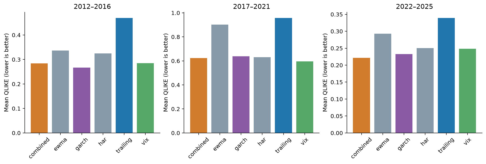

# H7: physical variance forecasting

**EXPLORATORY — POST H1–H5 RESULT SELECTION — PENDING INDEPENDENT REVIEW**

Executed 3520 identical common origins and 168 monthly fits of HAR/combination. No GARCH refits; existing4780 cached forecasts reused after original configuration/forecast hash checks. All variance outputs annualized decimal units; floor counts `{'combined': 0, 'ewma': 0, 'garch': 0, 'har': 0, 'trailing': 0, 'vix': 0}`. Gaussian GARCH common training begins2007; no fabricated pre-2007 forecasts.

| model | QLIKE | RMSE variance | MAE variance | bias f-y | underprediction1.5 | calibration intercept | calibration slope |
|---|---|---|---|---|---|---|---|
| combined | 0.388055513 | 0.0632535918 | 0.0209260596 | 0.0037159203 | 0.0971590909 | 0.00635500097 | 0.684745281 |
| ewma | 0.526369104 | 0.0717400891 | 0.0219956772 | 0.00015396821 | 0.241477273 | 0.0162353083 | 0.422575179 |
| garch | 0.390253092 | 0.0671593887 | 0.0204314054 | 0.000340842605 | 0.165625 | 0.013242023 | 0.524580407 |
| har | 0.41347762 | 0.0626190367 | 0.0213084911 | 0.00301729106 | 0.117329545 | 0.000700215657 | 0.881027288 |
| trailing | 0.607323124 | 0.0807487761 | 0.0233919212 | 0.000577344374 | 0.287215909 | 0.0193661742 | 0.307679479 |
| vix | 0.385802085 | 0.060933283 | 0.0226920846 | 0.00742419647 | 0.0693181818 | -0.00184160679 | 0.843421531 |

VIX is the strongest constituent and strongest full-family baseline on QLIKE and RMSE. Combination improves QLIKE36.10% versus trailing, but is0.58% worse than VIX and only0.56% better than GARCH with broad intervals. Registered5% practical QLIKE improvement versus strongest constituent fails. RMSE is3.81% worse than VIX (still inside the5% deterioration bound), so the joint gate fails through QLIKE. HAR also fails to beat VIX; GARCH has the smallest MAE. A weaker trailing benchmark alone would create an unsupported positive narrative.

| baseline | QLIKE difference | HAC63 CI | raw p | Holm p | relative reduction | bootstrap CI |
|---|---|---|---|---|---|---|
| vix | 0.00225342793 | [-0.04385381091634758, 0.04836066677383322] | 0.923686926 | 1 | -0.005840891 | [-0.10079902049822333, 0.10632024651391367] |
| garch | -0.00219757877 | [-0.030143463371570117, 0.025748305838303134] | 0.877510732 | 1 | 0.00563116298 | [-0.10157869308380026, 0.062069044448013796] |
| trailing | -0.219267611 | [-0.34198508594361493, -0.09655013613442491] | 0.000461779287 | 0.00138533786 | 0.361039457 | [0.2269287244264852, 0.4880317875396203] |

Negative paired losses favor combination. Three-test Holm family; no global confirmatory inference. Full MSE/MAE/HAC21 sensitivities, variance-calibration intervals, and underprediction frequency are retained in JSON. Underprediction rate is a forecast-relative tail diagnostic, not a binary classifier with calibrated probability.

| period | N | model | QLIKE | RMSE | MAE |
|---|---|---|---|---|---|
| 2012_2016 | 1258 | combined | 0.284480748 | 0.0160622195 | 0.012250546 |
| 2012_2016 | 1258 | ewma | 0.336707009 | 0.0155036605 | 0.0103585742 |
| 2012_2016 | 1258 | garch | 0.267094757 | 0.0151723747 | 0.0104490425 |
| 2012_2016 | 1258 | har | 0.325299659 | 0.018221893 | 0.0137221902 |
| 2012_2016 | 1258 | trailing | 0.469965124 | 0.0167705419 | 0.011141507 |
| 2012_2016 | 1258 | vix | 0.284770116 | 0.0175618098 | 0.0133308485 |
| 2017_2021 | 1259 | combined | 0.62415504 | 0.100627429 | 0.0329219659 |
| 2017_2021 | 1259 | ewma | 0.902064335 | 0.114088052 | 0.0361142072 |
| 2017_2021 | 1259 | garch | 0.638984072 | 0.106315108 | 0.0326187065 |
| 2017_2021 | 1259 | har | 0.631359823 | 0.0987317967 | 0.0303931995 |
| 2017_2021 | 1259 | trailing | 0.957943553 | 0.128896194 | 0.0386101931 |
| 2017_2021 | 1259 | vix | 0.596064098 | 0.0959477592 | 0.0340403941 |
| 2020 | 253 | combined | 1.62093728 | 0.221578242 | 0.109917338 |
| 2020 | 253 | ewma | 2.36983741 | 0.252070335 | 0.135497892 |
| 2020 | 253 | garch | 1.72728378 | 0.234672387 | 0.114807245 |
| 2020 | 253 | har | 1.54460538 | 0.217050988 | 0.0966966702 |
| 2020 | 253 | trailing | 2.11465709 | 0.284994903 | 0.144136845 |
| 2020 | 253 | vix | 1.35853232 | 0.209919509 | 0.104644709 |
| 2022 | 251 | combined | 0.10168584 | 0.0251641246 | 0.0190319495 |
| 2022 | 251 | ewma | 0.14673287 | 0.0293218032 | 0.0232854423 |
| 2022 | 251 | garch | 0.159044053 | 0.0289956228 | 0.0220999259 |
| 2022 | 251 | har | 0.113241188 | 0.0275892472 | 0.0209252123 |
| 2022 | 251 | trailing | 0.175486354 | 0.0314231019 | 0.0244547249 |
| 2022 | 251 | vix | 0.0966838907 | 0.0283177215 | 0.0221614507 |
| 2022_2025 | 1003 | combined | 0.221602622 | 0.0317414093 | 0.0167495393 |
| 2022_2025 | 1003 | ewma | 0.292664838 | 0.037713136 | 0.0188693025 |
| 2022_2025 | 1003 | garch | 0.232507212 | 0.0367769722 | 0.0176537389 |
| 2022_2025 | 1003 | har | 0.250580495 | 0.033297231 | 0.019420075 |
| 2022_2025 | 1003 | trailing | 0.339491864 | 0.0409332354 | 0.0196543506 |
| 2022_2025 | 1003 | vix | 0.248592059 | 0.0329805009 | 0.0201885085 |

Raw-unit combination coefficient stability:

| feature | min | median | max | first | last |
|---|---|---|---|---|---|
| ivar | 0.207834584 | 0.317293059 | 0.754628087 | 0.207834584 | 0.680094195 |
| garch | 0.154196323 | 0.446839077 | 0.555804432 | 0.528882153 | 0.204648452 |
| trailing | 0 | 0.115910297 | 0.134317036 | 0.119268374 | 0 |

Intercept and all168 monthly coefficients/scaling/smearing parameters are in the result JSON. Nonnegative ridge KKT and independent HAR linear-system checks passed. HAR uses squared daily returns, not intraday realized variance. Coefficient correlation is not causal evidence.

Generated from `h7.json`, SHA-256 `630cc87c95cececb6b26ee08536aa2e32bae86fcc01b3313eec5d73cd76a54d5`. Exact forecasts, refit parameters/scaling and source identity are preserved in `outputs/quant_extension/v1/`; sanitized result metadata is committed in `data/manifests/quant_extension_h7.json`. Reproduction instructions: `docs/quant_extension_reproduction.md`. Independent scientific review PENDING.
