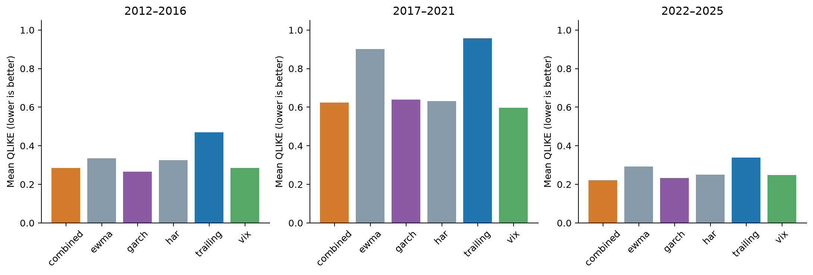

# H7: physical variance forecasting

**EXPLORATORY — POST H1–H5 RESULT SELECTION — PENDING INDEPENDENT REVIEW**

Current evidence is **v2**, after the registered calendar-information correction. Version1 affected comparisons are **INVALIDATED_FOR_STRICT_AS_OF_CALENDAR**, preserved unchanged in original manifests and `outputs/quant_extension/v1/` with original report copies. No model setting or practical threshold was changed; see `paper/quant_extension_calendar_amendment.md`.

Executed 3520 identical common origins and 168 monthly fits of HAR/combination. No GARCH refits; existing 4780 cached forecasts reused after original configuration/forecast hash checks. All variance outputs annualized decimal units; floor counts `{'combined': 0, 'ewma': 0, 'garch': 0, 'har': 0, 'trailing': 0, 'vix': 0}`. Gaussian GARCH common training begins 2007; no fabricated pre-2007 forecasts.

| model | QLIKE | RMSE variance | MAE variance | bias f-y | underprediction1.5 | calibration intercept | calibration slope |
|---|---|---|---|---|---|---|---|
| combined | 0.387982297 | 0.063252187 | 0.0209226379 | 0.00372229553 | 0.0971590909 | 0.00635507931 | 0.684606205 |
| ewma | 0.525568259 | 0.0717358892 | 0.0219806492 | 0.000175785966 | 0.240909091 | 0.0162234697 | 0.42266738 |
| garch | 0.389745564 | 0.0671555326 | 0.0204182702 | 0.000366564422 | 0.163352273 | 0.0132258029 | 0.524675769 |
| har | 0.41347762 | 0.0626190367 | 0.0213084911 | 0.00301729106 | 0.117329545 | 0.000700215657 | 0.881027288 |
| trailing | 0.607323124 | 0.0807487761 | 0.0233919212 | 0.000577344374 | 0.287215909 | 0.0193661742 | 0.307679479 |
| vix | 0.385802085 | 0.060933283 | 0.0226920846 | 0.00742419647 | 0.0693181818 | -0.00184160679 | 0.843421531 |

Strongest constituent QLIKE: vix; strongest full-family baseline: vix. Combination relative QLIKE reductions: trailing 36.116%, VIX -0.565%, GARCH 0.452%. Positive favors combination. VIX-relative RMSE change 3.806% (positive is deterioration). Registered practical gate passed: False. Strong constituent comparisons and uncertainty determine the conclusion; a weak trailing benchmark alone is insufficient.

| baseline | QLIKE difference | HAC63 CI | raw p | Holm p | relative reduction | bootstrap CI |
|---|---|---|---|---|---|---|
| vix | 0.00218021156 | [-0.044001693589312954, 0.04836211671174509] | 0.926278257 | 1 | -0.00565111399 | [-0.1008373562245032, 0.10659095295564837] |
| garch | -0.00176326665 | [-0.02965235546641521, 0.026125822164875155] | 0.901380796 | 1 | 0.0045241481 | [-0.10293003409892426, 0.06125391695528518] |
| trailing | -0.219340827 | [-0.34204290383692004, -0.09663875097617325] | 0.000458998444 | 0.00137699533 | 0.361160013 | [0.22722439758030266, 0.48839618092760867] |

Negative paired losses favor combination. Three-test Holm family; no global confirmatory inference. Full MSE/MAE/HAC21 sensitivities, variance-calibration intervals, and underprediction frequency are retained in JSON. Underprediction rate is a forecast-relative tail diagnostic, not a binary classifier with calibrated probability.

| period | N | model | QLIKE | RMSE | MAE |
|---|---|---|---|---|---|
| 2012_2016 | 1258 | combined | 0.284486497 | 0.0160621238 | 0.0122558538 |
| 2012_2016 | 1258 | ewma | 0.335456705 | 0.0154947566 | 0.0103426944 |
| 2012_2016 | 1258 | garch | 0.266436876 | 0.0151645312 | 0.0104300594 |
| 2012_2016 | 1258 | har | 0.325299659 | 0.018221893 | 0.0137221902 |
| 2012_2016 | 1258 | trailing | 0.469965124 | 0.0167705419 | 0.011141507 |
| 2012_2016 | 1258 | vix | 0.284770116 | 0.0175618098 | 0.0133308485 |
| 2017_2021 | 1259 | combined | 0.623946722 | 0.100624622 | 0.0329057246 |
| 2017_2021 | 1259 | ewma | 0.901551164 | 0.114082099 | 0.0360832727 |
| 2017_2021 | 1259 | garch | 0.638455597 | 0.106308953 | 0.0325898845 |
| 2017_2021 | 1259 | har | 0.631359823 | 0.0987317967 | 0.0303931995 |
| 2017_2021 | 1259 | trailing | 0.957943553 | 0.128896194 | 0.0386101931 |
| 2017_2021 | 1259 | vix | 0.596064098 | 0.0959477592 | 0.0340403941 |
| 2020 | 253 | combined | 1.62153466 | 0.221579629 | 0.109921307 |
| 2020 | 253 | ewma | 2.36983741 | 0.252070335 | 0.135497892 |
| 2020 | 253 | garch | 1.72728378 | 0.234672387 | 0.114807245 |
| 2020 | 253 | har | 1.54460538 | 0.217050988 | 0.0966966702 |
| 2020 | 253 | trailing | 2.11465709 | 0.284994903 | 0.144136845 |
| 2020 | 253 | vix | 1.35853232 | 0.209919509 | 0.104644709 |
| 2022 | 251 | combined | 0.1017041 | 0.0251642262 | 0.0190318672 |
| 2022 | 251 | ewma | 0.14673287 | 0.0293218032 | 0.0232854423 |
| 2022 | 251 | garch | 0.159044053 | 0.0289956228 | 0.0220999259 |
| 2022 | 251 | har | 0.113241188 | 0.0275892472 | 0.0209252123 |
| 2022 | 251 | trailing | 0.175486354 | 0.0314231019 | 0.0244547249 |
| 2022 | 251 | vix | 0.0966838907 | 0.0283177215 | 0.0221614507 |
| 2022_2025 | 1003 | combined | 0.22159995 | 0.0317428168 | 0.0167512604 |
| 2022_2025 | 1003 | ewma | 0.292066621 | 0.0377122951 | 0.0188753092 |
| 2022_2025 | 1003 | garch | 0.232214553 | 0.0367786502 | 0.0176676289 |
| 2022_2025 | 1003 | har | 0.250580495 | 0.033297231 | 0.019420075 |
| 2022_2025 | 1003 | trailing | 0.339491864 | 0.0409332354 | 0.0196543506 |
| 2022_2025 | 1003 | vix | 0.248592059 | 0.0329805009 | 0.0201885085 |

Raw-unit combination coefficient stability:

| feature | min | median | max | first | last |
|---|---|---|---|---|---|
| ivar | 0.207834584 | 0.317253677 | 0.754352479 | 0.207834584 | 0.679895961 |
| garch | 0.154449421 | 0.447022199 | 0.556202504 | 0.528882153 | 0.204843539 |
| trailing | 0 | 0.115895072 | 0.132420356 | 0.119268374 | 0 |

Intercept and all 168 monthly coefficients/scaling/smearing parameters are in the result JSON. Nonnegative ridge KKT and independent HAR linear-system checks passed. HAR uses squared daily returns, not intraday realized variance. Coefficient correlation is not causal evidence.

Generated from `h7.json`, SHA-256 `cec3e911eaef7f4d27d8395ba8316f807a910b82601a79bcfe29a8f636001d68`. Exact forecasts, refit parameters/scaling and source identity are preserved in `outputs/quant_extension/v2/`; sanitized result metadata is committed in `data/manifests/quant_extension_h7_v2.json`. Reproduction instructions: `docs/quant_extension_reproduction.md`. Independent scientific review PENDING.
