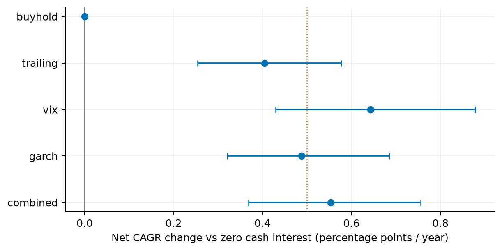
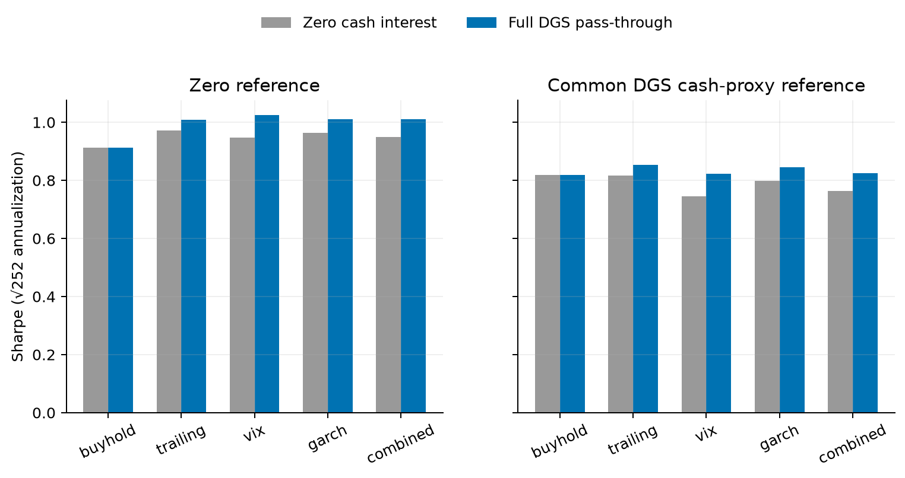

# H8 cash-yield sensitivity

**EXPLORATORY CASH-YIELD SENSITIVITY — PENDING INDEPENDENT COAUTHOR REVIEW**

Plan committed as `669af87`, source-batching / common-Sharpe clarification `f952067`, before any portfolio comparisons. Corrected sensitivity v2 restores the original H8 execution-date period masks; v1 full-sample results are unchanged and preserved. Same3520 marks2012-01-04 open–2026-01-02 open,3519 trades/signals, five strategies and0/1/5/10/25bps costs. No model refit, exposure change, new strategy, threshold search or future-hypothesis execution.

**Answer: cash income materially changes return levels and some Sharpe rankings, but does not reverse the CAGR ranking or establish superiority of the sophisticated combined strategy.** Under full DGS pass-through at5bps, VIX CAGR rises0.643056pp and combined0.552976pp, exceeding the predeclared0.5pp descriptive materiality threshold at the point estimates. Their bootstrap lower bounds are below0.5pp: historical resampling does not establish that minimum effect prospectively. Full and half compensation are modeled assumptions, not observed broker credits.

| strategy | cash_calendar_% | zero_CAGR_% | DGS_CAGR_% | CAGR_change_pp | CAGR_change_CI_pp | zero_Sharpe | DGS_Sharpe | zero_common_excess_Sharpe | DGS_common_excess_Sharpe | DGS_vol_% | DGS_tracking_RMSE_% |
| --- | --- | --- | --- | --- | --- | --- | --- | --- | --- | --- | --- |
| buyhold | 0 | 14.79527742 | 14.79527742 | 0 | 0, 0 | 0.9132312657 | 0.9132312657 | 0.8188516706 | 0.8188516706 | 16.66756996 | 9.957048798 |
| trailing | 22.72377513 | 9.760273504 | 10.16437706 | 0.4041035542 | 0.2537757732, 0.577387041 | 0.971269201 | 1.007603232 | 0.8161801631 | 0.8525589795 | 10.13948072 | 2.960577531 |
| vix | 38.00964912 | 7.302612936 | 7.945668652 | 0.6430557159 | 0.4293100147, 0.8785878213 | 0.9474356396 | 1.024383072 | 0.745073466 | 0.8221537182 | 7.775199883 | 3.297103078 |
| garch | 27.06568817 | 9.029079664 | 9.517154905 | 0.4880752412 | 0.3204321961, 0.685557127 | 0.9639900414 | 1.011319936 | 0.7975820346 | 0.8449829179 | 9.451330084 | 2.685065198 |
| combined | 34.1227123 | 7.938932104 | 8.491908298 | 0.5529761934 | 0.3685231025, 0.7557684713 | 0.9495303466 | 1.010154388 | 0.7631146149 | 0.8238386718 | 8.439010934 | 3.02775502 |

CAGR point ordering remains buyhold > trailing > GARCH > combined > VIX. The original zero-reference Sharpe ordering (trailing > GARCH > combined > VIX > buyhold) changes to VIX > GARCH > combined > trailing > buyhold at full pass-through. With a common DGS cash-proxy reference the full-interest ordering is trailing > GARCH > combined > VIX > buyhold. These small Sharpe separations are uncertain; a point-ranking reversal is not demonstrated alpha. Buyhold has zero uninvested cash and remains exactly unchanged in every cost/scenario.

The combined-minus-trailing CAGR disadvantage narrows from1.821341pp to1.672469pp; the primary block63 interval for trailing-minus-combined is[0.559587,2.854898]pp. Combined rolling21 tracking RMSE is3.027755% versus trailing2.960578%, still worse at the point estimate; its difference interval spans zero. GARCH remains the best point tracker. The original joint H8 gate still fails: no >=0.005 tracking-RMSE reduction and combined loses more than0.005 CAGR against trailing. Every cash scenario retains that negative gate. Accounting for cash makes the zero-interest simplification economically meaningful, without changing the underlying variance forecasts or proving that low equity exposure is efficient for every investor.

Full DGS pass-through versus frozen zero-interest counterpart at5bps; paired block63/1000 percentile95% intervals. The dotted line is the fixed0.5pp materiality descriptor, not a trading-success or hypothesis-test gate.

Identical portfolios under two clearly named references. The common benchmark is a modeled Treasury-based liquid cash account, not a traded overnight risk-free asset.

## Source coverage, convention and availability

| series | provider_coverage_start | frozen_first | frozen_last | initial_release_n | role |
| --- | --- | --- | --- | --- | --- |
| DGS1MO | 2001-07-31 | 2011-12-01 | 2026-01-02 | 3521 | primary |
| DTB4WK | 2001-07-31 | 2011-12-01 | 2026-01-02 | 3519 | fixed alternative |
| DTB3 | 1954-01-04 | 2011-12-01 | 2026-01-02 | — | investigated, not executed |
| SOFR | 2018-04-03 | 2018-04-03 | 2026-01-02 | — | investigated, not executed |

[DGS1MO](https://fred.stlouisfed.org/series/DGS1MO) is a one-month Treasury constant-maturity yield quoted on an investment basis in annual percent. It is interpolated from the Treasury curve and has full-period support; it is not a bill purchase price or guaranteed cash-account return. [DTB4WK](https://fred.stlouisfed.org/series/DTB4WK) and [DTB3](https://fred.stlouisfed.org/series/DTB3) are secondary-market bill quotes on bank discount basis (360-day quotation year). The latter longer maturity is documented but not selected after results. See [H15 definitions](https://www.federalreserve.gov/releases/h15/) and [Treasury methodology](https://home.treasury.gov/policy-issues/financing-the-government/interest-rate-statistics/treasury-yield-curve-methodology).

For DTB4WK, d=quote_percent/100; fixed28-day price/face=1−d*28/360; ACT365 investment equivalent r=(d/360)/(1−d*28/360)*365. This preserves the discount-price denominator. Merely dividing the discount quote by100 would be incorrect. The28-day remaining maturity is an explicit standardized conversion, not a reconstructed held bill. DGS annual percent is divided by100 once. ACT/365F is the chosen modeled cash-account accrual convention; it is not asserted to be the legal coupon/day-count convention of a Treasury security. Negative quotes would remain negative rather than being clipped.

Official [SOFR](https://www.newyorkfed.org/markets/reference-rates/additional-information-about-reference-rates) began with value date2018-04-02, first published2018-04-03. It measures secured overnight Treasury repo transactions and uses ACT360 money-market accrual; the next-business-day publication is after the transactions measured. The frozen FRED series starts2018-04-03. It lacks2012–2017, so no SOFR backcast, splice or full-period SOFR scenario is invented. A broker cash sweep need not receive SOFR or Treasury yields.

Current FRED series can be revised. Primary and bill scenarios instead use the [ALFRED initial-release-only format](https://alfred.stlouisfed.org/help/downloaddata), with actual archived realtime_start dates. [ALFRED documentation](https://alfred.stlouisfed.org/help) explains archive vintage meaning and possible source-versus-FRED availability differences. The archive is date-granular: conservatively treat each value as usable only at00:00 New York on the next calendar date. Select the freshest initial observation available at the previous opening, lock it for that interval, and never use the ending-day quote. The [current H15 release](https://www.federalreserve.gov/releases/h15/) is at4:15pm; [historical2012 H15](https://www.federalreserve.gov/releases/h15/20120625/) had Monday releases with Tuesday–Friday updates. We do not invent historical intraday timestamps from the current schedule. First-release retention ignores later corrections even when they would subsequently be known, a documented conservative proxy policy.

| series | intervals | elapsed_days_total | multi_day_intervals | max_elapsed_days | max_quote_age_days | max_factor_error |
| --- | --- | --- | --- | --- | --- | --- |
| DGS1MO | 3519 | 5112 | 769 | 5 | 7 | 1.084202172e-19 |
| DTB4WK | 3519 | 5112 | 769 | 5 | 7 | 1.626303259e-19 |

Independent initial-release selection and ten actual vintage-snapshot checks pass. There are769 multiday intervals per rate source, with maximum5 calendar days (including exchange closures). All5112 calendar days accrue; leap day counts, DST clock hours do not alter ACT day counts. Maximum known-quote age is7 days, below the fixed15-day fail guard. Among finite initial observations, no differences versus current-history quotes were found. However, current history contains four finite cells absent/missing in the initial exports; they are explicitly not filled:

| series | observation_date | current_percent | initial_realtime_start_date | treatment |
| --- | --- | --- | --- | --- |
| DGS1MO | 2020-08-19 | 0.07 | 2020-08-21 | Not backfilled; last eligible initial-release quote remains locked. |
| DTB4WK | 2017-04-20 | 0.72 | — | Not backfilled; last eligible initial-release quote remains locked. |
| DTB4WK | 2017-04-21 | 0.71 | — | Not backfilled; last eligible initial-release quote remains locked. |
| DTB4WK | 2020-08-19 | 0.07 | 2020-08-21 | Not backfilled; last eligible initial-release quote remains locked. |

The initial download attempt exceeded the provider450-vintage limit and was rejected before any portfolio comparison. Accepted downloads use disjoint<=400-vintage batches, with ZIP/member/form/request/merged-data SHA-256 provenance and normal TLS verification. The only later execution stops were CSV integer-versus-float type inference and a disk-full duplicate-output write; exact value/byte controls and immutable hardlink reuse resolved them. No stopped process supplied a new scientific result.

## Accrual and fixed execution

Interest = actual prior-opening post-trade cash × historically known annual rate × elapsed calendar days /365. It is credited at the next open before the original ex-date dividend cash and rebalance. The opening-to-opening rate is locked across holidays/weekends; there is no invented holiday observation or rate update inside a locked interval. First funded opening earns no pre-inception interest. Terminal opening receives the final interval income and old-holding dividend, with no final trade or liquidation fee. Cash compounds through subsequent actual balances; no intra-interval compounding. The full path and all date/quote/release fields are retained in100 new ledgers. Dividend cash newly credited at an open cannot earn interest for the previous interval.

Interest changes portfolio wealth, shares and trade notionals while preserving every target weight and rebalance date. Freezing dollar trades would break self-financing. Equity quote data, original fractional-share/open-fill/ex-date-dividend assumptions, cash liquidity, taxes excluded and flat traded-notional fees are preserved. No Treasury mark-to-market return, maturity roll, spread, sweep charge or actual broker contract is modeled. The50% pass-through case illustrates compensation sensitivity; it does not assert a particular broker historically paid half a Treasury quote.

## Fixed alternatives, costs and uncertainty

| scenario | strategy | cagr | sharpe_zero_reference | sharpe_excess_common_dgs1mo | annual_vol | rolling21_target_rmse | max_drawdown |
| --- | --- | --- | --- | --- | --- | --- | --- |
| zero | buyhold | 0.1479527742 | 0.9132312657 | 0.8188516706 | 0.1666756996 | 0.09957048798 | -0.3372292846 |
| zero | trailing | 0.09760273504 | 0.971269201 | 0.8161801631 | 0.1013954424 | 0.02959654185 | -0.1315710646 |
| zero | vix | 0.07302612936 | 0.9474356396 | 0.745073466 | 0.07774545402 | 0.03297956725 | -0.1239087564 |
| zero | garch | 0.09029079664 | 0.9639900414 | 0.7975820346 | 0.09450916804 | 0.02684565903 | -0.1352638435 |
| zero | combined | 0.07938932104 | 0.9495303466 | 0.7631146149 | 0.08438373228 | 0.03028142732 | -0.1327063669 |
| dgs1mo_full | buyhold | 0.1479527742 | 0.9132312657 | 0.8188516706 | 0.1666756996 | 0.09957048798 | -0.3372292846 |
| dgs1mo_full | trailing | 0.1016437706 | 1.007603232 | 0.8525589795 | 0.1013948072 | 0.02960577531 | -0.1281460465 |
| dgs1mo_full | vix | 0.07945668652 | 1.024383072 | 0.8221537182 | 0.07775199883 | 0.03297103078 | -0.1196313539 |
| dgs1mo_full | garch | 0.09517154905 | 1.011319936 | 0.8449829179 | 0.09451330084 | 0.02685065198 | -0.1319909591 |
| dgs1mo_full | combined | 0.08491908298 | 1.010154388 | 0.8238386718 | 0.08439010934 | 0.0302775502 | -0.1287703261 |
| dgs1mo_half | buyhold | 0.1479527742 | 0.9132312657 | 0.8188516706 | 0.1666756996 | 0.09957048798 | -0.3372292846 |
| dgs1mo_half | trailing | 0.09962144039 | 0.9894393639 | 0.8343717341 | 0.1013947965 | 0.02960116578 | -0.1298602183 |
| dgs1mo_half | vix | 0.07623667849 | 0.9859192281 | 0.7836188687 | 0.07774807563 | 0.03297543071 | -0.1217726255 |
| dgs1mo_half | garch | 0.0927284964 | 0.987659308 | 0.8212852591 | 0.09451087091 | 0.02684814851 | -0.1336289262 |
| dgs1mo_half | combined | 0.08215072693 | 0.9798489941 | 0.7934805798 | 0.08438644873 | 0.03027953119 | -0.1307201656 |
| dtb4wk_full | buyhold | 0.1479527742 | 0.9132312657 | 0.8188516706 | 0.1666756996 | 0.09957048798 | -0.3372292846 |
| dtb4wk_full | trailing | 0.1015721766 | 1.006961211 | 0.8519158773 | 0.1013947569 | 0.02960562902 | -0.1282247692 |
| dtb4wk_full | vix | 0.07934217582 | 1.023019579 | 0.820786633 | 0.0777516668 | 0.03297120552 | -0.1197322232 |
| dtb4wk_full | garch | 0.09508374885 | 1.010471597 | 0.8441327856 | 0.09451310381 | 0.02685059966 | -0.1320649463 |
| dtb4wk_full | combined | 0.0848202251 | 1.009075225 | 0.8227569021 | 0.08438982609 | 0.03027763782 | -0.1288488884 |

| block | candidate | estimate | ci95 |
| --- | --- | --- | --- |
| 21 | buyhold | 0 | 0, 0 |
| 21 | trailing | 0.004041035542 | 0.003023153526, 0.0051523987 |
| 21 | vix | 0.006430557159 | 0.005136482347, 0.007737307613 |
| 21 | garch | 0.004880752412 | 0.00384207365, 0.006004343175 |
| 21 | combined | 0.005529761934 | 0.004362303813, 0.006671198261 |
| 63 | buyhold | 0 | 0, 0 |
| 63 | trailing | 0.004041035542 | 0.002537757732, 0.00577387041 |
| 63 | vix | 0.006430557159 | 0.004293100147, 0.008785878213 |
| 63 | garch | 0.004880752412 | 0.003204321961, 0.00685557127 |
| 63 | combined | 0.005529761934 | 0.003685231025, 0.007557684713 |
| 126 | buyhold | 0 | 0, 0 |
| 126 | trailing | 0.004041035542 | 0.002164918489, 0.006093488994 |
| 126 | vix | 0.006430557159 | 0.003551206567, 0.00959333177 |
| 126 | garch | 0.004880752412 | 0.002663081637, 0.007255842085 |
| 126 | combined | 0.005529761934 | 0.00305185549, 0.008168833796 |

Paired circular blocks21/63/126,1000 draws,seed1729 preserve return/rate pairing; full sample metrics and rolling windows are recomputed. Cash-income/log-component streams are resampled with the same fixed design. These intervals condition on historical regimes and the chosen cash model, not future rates or broker compensation. Drawdown intervals are descriptive because resampled paths stitch regimes. No optimization, crisis deletion or new forecast family is selected. All100 scenario/cost/strategy summaries, all10 pair contrasts per scenario at5bps, rankings and ranking frequencies remain in the complete tables.

Full tables: [summary](tables/h8_cash_yield/summary.csv), [all paired uncertainty](tables/h8_cash_yield/uncertainty.csv), [rank orders](tables/h8_cash_yield/rankings.csv), [bootstrap rank frequencies](tables/h8_cash_yield/ranking_uncertainty.csv), [DGS timing](tables/h8_cash_yield/DGS1MO_schedule.csv), [bill timing](tables/h8_cash_yield/DTB4WK_schedule.csv), [snapshot checks](tables/h8_cash_yield/vintage_checks.csv). [Economic attribution](h8_economic_attribution.md) gives units, income, fees, periods and exact identities.

Primary result SHA `849296a15472fb8f4902d275807c66f8b58af49de4cf5d182baec8da4ab884fd`; rate-source manifest SHA `61ff6f555ea3d6c1106b4717ee83f215b17e379ad8cea78852637b7d216f91d7`; independent audit SHA `1f986961f5a42a310e582bd18b941f395ae9fffbc8455503bb37216874009fa1`. [Result manifest](../data/manifests/h8_cash_results_v2.json), [source provenance](../data/manifests/h8_cash_rate_source_v1.json), [independent audit](../data/manifests/h8_cash_independent_audit_v2.json), [fixed plan](../paper/h8_cash_yield_plan.md). Original [H8 zero-interest report](h8_portfolio_economic_value.md) is preserved.
