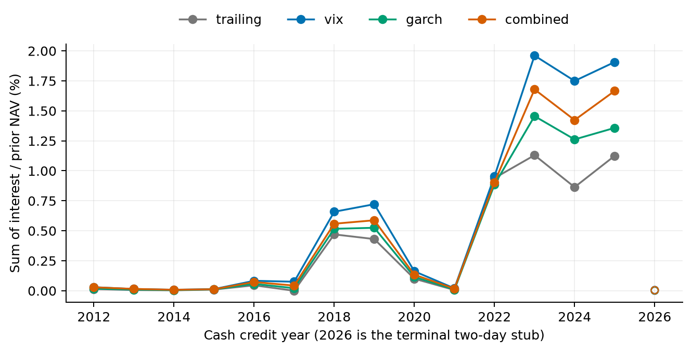

# H8 economic attribution with cash income

**EXPLORATORY CASH-YIELD SENSITIVITY — PENDING INDEPENDENT COAUTHOR REVIEW**

Plan committed as `669af87`, source-batching / common-Sharpe clarification `f952067`, before any portfolio comparisons. Corrected sensitivity v2 restores the original H8 execution-date period masks; v1 full-sample results are unchanged and preserved. Same3520 marks2012-01-04 open–2026-01-02 open,3519 trades/signals, five strategies and0/1/5/10/25bps costs. No model refit, exposure change, new strategy, threshold search or future-hypothesis execution.

Cash yield is the sole changed economic assumption. CAGR order stays unchanged across all four scenarios at each fixed cost. Full pass-through reverses several zero-reference Sharpe point ranks, but no paired Sharpe separation establishes a superior strategy. The original combined practical gate remains failed, and comparison of portfolios with different realized risk cannot be interpreted as alpha.

## Cash allocation and income units

All dollar quantities divide by initial NAV1. Calendar-weighted cash fraction averages post-trade opening cash fractions using actual interval days; session mean also includes the final drifted opening. Target weights are identical across scenarios, so calendar-weighted fractions are identical; income compounds the dollar base. Sum(I/previous NAV)/elapsed years is an annual normalized income measure, distinct from income dollars/initial NAV/year. CAGR increment compares fully self-financing interest-bearing and zero-interest NAV paths, and is not either of those annualized income measures. Elapsed CAGR length uses the original365.25 calendar-day year; interest accrual uses ACT/365F.

| strategy | mean_cash_fraction_calendar_weighted | mean_cash_fraction_session | cash_income_initial_nav | cash_income_initial_nav_per_year | annual_normalized_cash_income | cash_income_cagr_increment |
| --- | --- | --- | --- | --- | --- | --- |
| buyhold | 0 | 0 | 0 | 0 | 0 | 0 |
| trailing | 0.2272377513 | 0.2259548482 | 0.1414555589 | 0.01010693327 | 0.003675066113 | 0.004041035542 |
| vix | 0.3800964912 | 0.380020515 | 0.1879721839 | 0.01343052429 | 0.005976472732 | 0.006430557159 |
| garch | 0.2706568817 | 0.2725220557 | 0.1634735273 | 0.01168010677 | 0.004467719786 | 0.004880752412 |
| combined | 0.341227123 | 0.3417773687 | 0.1697870873 | 0.01213120768 | 0.005111437334 | 0.005529761934 |

| strategy | estimate | ci95 |
| --- | --- | --- |
| buyhold | 0 | 0, 0 |
| trailing | 0.003675066113 | 0.002314168743, 0.005325817056 |
| vix | 0.005976472732 | 0.003987455832, 0.008177015303 |
| garch | 0.004467719786 | 0.002936811885, 0.006244256563 |
| combined | 0.005111437334 | 0.003404008244, 0.006983518391 |

VIX holds approximately38.010% calendar-weighted cash, combined34.123%, GARCH27.066%, trailing22.724%. VIX therefore gains more cash income, but return/risk outcomes also depend on equity exposure and the timing of rates. A larger cash allocation does not alone imply better utility. Buyhold receives no cash income and is an exact control.

Sum of cash interest/prior NAV by credit year at5bps, full DGS proxy. The2026 point is the two-day terminal interval only, not a full-year estimate; original evaluation and final endpoint are unchanged.

## Exact accounting and reinvestment

Daily return = [old-share overnight P&L + old-share dividend + new-share intraday P&L + cash interest − fee] / previous NAV. First row starts in cash at open; final row has no intraday exposure. Interest uses the prior actual cash balance and is not earned on a newly received dividend. Cash/shares are solved after cost; fee equals cost-rate × absolute traded shares × opening price. All100 ledgers pass the independent Decimal rate/income and separate algebraic rebalance audit. Maximum independent economic/nominal residual is 3.190503417e-14.

| strategy | terminal_nav_change | cash_interest_initial_nav | changed_equity_pnl_initial_nav | changed_dividends_initial_nav | changed_negative_fees_initial_nav | residual |
| --- | --- | --- | --- | --- | --- | --- |
| buyhold | 0 | 0 | 0 | 0 | 0 | 0 |
| trailing | 0.1943268912 | 0.1414555589 | 0.04903832042 | 0.00495595954 | -0.001122947695 | 2.553512957e-14 |
| vix | 0.2339079324 | 0.1879721839 | 0.04340135553 | 0.004538874445 | -0.002004481536 | 1.959543638e-14 |
| garch | 0.216301153 | 0.1634735273 | 0.04988119722 | 0.004973502828 | -0.002027074323 | -8.409939412e-15 |
| combined | 0.2159726952 | 0.1697870873 | 0.04337278686 | 0.004524991567 | -0.001712170536 | -6.883382753e-15 |

These dollar changes sum exactly to terminal NAV change. Interest dollars alone do not equal terminal wealth change: credited cash can subsequently fund equity/dividend returns and changes paid fees. The different balances are outcomes of the unchanged weight policy, not parameter changes.

For normalized returns, delta r = direct I/previous cash-scenario NAV + changed normalized equity/dividend P&L + changed negative fee. Multiply each component by L=log((1+r_cash)/(1+r_zero))/(r_cash−r_zero), with the continuous limit1/(1+r_zero), to allocate incremental log wealth exactly. Apply one common total-growth-to-CAGR multiplier to allocate the net CAGR change. This is a fixed accounting allocation, not unique causal attribution. Indirect terms are small in normalized/log units because prior compounding increases both the invested-dollar base and the NAV denominator; nominal reinvestment contributions can still be substantial.

| strategy | incremental_log_growth | direct_interest_log_contribution | changed_equity_dividend_log_contribution | changed_fee_log_contribution | direct_interest_cagr_allocation | changed_equity_dividend_cagr_allocation | changed_fee_cagr_allocation | log_attribution_residual |
| --- | --- | --- | --- | --- | --- | --- | --- | --- |
| buyhold | 0 | 0 | 0 | 0 | 0 | 0 | 0 | 0 |
| trailing | 0.05143394837 | 0.05141933319 | 1.436716502e-05 | 2.480135386e-07 | 0.004039887264 | 1.128791903e-06 | 1.948579792e-08 | 7.570333249e-15 |
| vix | 0.08362590258 | 0.08361720866 | 1.433503057e-05 | -5.64111377e-06 | 0.006429888626 | 1.102316754e-06 | -4.337831153e-07 | 6.272760089e-15 |
| garch | 0.06251364002 | 0.06250484501 | 1.62187529e-05 | -7.42373531e-06 | 0.004880065741 | 1.266279124e-06 | -5.796081305e-07 | -3.302913498e-15 |
| combined | 0.07151857456 | 0.07151197041 | 1.413828057e-05 | -7.534125078e-06 | 0.005529251306 | 1.093161129e-06 | -5.825328359e-07 | -6.827871601e-15 |

## Fees, drawdown and target tracking

Lower volatility is not necessarily better target tracking. Cash interest moves combined annual volatility only from8.438373% to8.439011%; rolling RMSE moves3.028143%→3.027755%. It improves combined max drawdown from−13.270637% to−12.877033%, but leaves it slightly worse than trailing’s−12.814605%. These are historical path summaries, not independent crisis replications. Exact fee-dollar sums and gross/net CAGR/log-growth drag are separate: fees paid/initial NAV do not equal annual drag, and fee effects include changed notional and compounding. Higher-income VIX still has higher turnover and cost drag than combined/trailing.

| scenario | strategy | cost_bps | cagr | sharpe_zero_reference | sharpe_excess_common_dgs1mo | annual_vol | rolling21_target_rmse | max_drawdown | annual_turnover_nav | cost_initial_nav | gross_minus_net_cagr | gross_minus_net_log_growth |
| --- | --- | --- | --- | --- | --- | --- | --- | --- | --- | --- | --- | --- |
| zero | buyhold | 0 | 0.1480038801 | 0.9134969797 | 0.819117565 | 0.16667616 | 0.09957032036 | -0.3372273755 | 0.08906300332 | 0 | 0 | 0 |
| zero | buyhold | 1 | 0.1479936563 | 0.9134438633 | 0.8190644075 | 0.1666760592 | 0.09957035413 | -0.3372277575 | 0.08905409791 | 0.0001671102512 | 1.022381e-05 | 0.0001246441696 |
| zero | buyhold | 5 | 0.1479527742 | 0.9132312657 | 0.8188516706 | 0.1666756996 | 0.09957048798 | -0.3372292846 | 0.08901849407 | 0.0008350622754 | 5.110590853e-05 | 0.0006230717271 |
| zero | buyhold | 10 | 0.1479017011 | 0.9129652238 | 0.8185855097 | 0.1666753478 | 0.09957065242 | -0.3372311918 | 0.08897402929 | 0.001668903597 | 0.0001021789872 | 0.001245770913 |
| zero | buyhold | 25 | 0.1477486785 | 0.9121651494 | 0.8177854447 | 0.1666749401 | 0.09957112637 | -0.3372369019 | 0.08884090107 | 0.004163126728 | 0.0002552016409 | 0.003111637548 |
| zero | trailing | 0 | 0.09998765474 | 0.9927294425 | 0.8376408953 | 0.1013949383 | 0.02959319447 | -0.1301652274 | 4.340990334 | 0 | 0 | 0 |
| zero | trailing | 1 | 0.09951025516 | 0.9884378197 | 0.8333490883 | 0.1013949853 | 0.02959386011 | -0.1304465748 | 4.340969608 | 0.01277762932 | 0.0004773995784 | 0.006075598981 |
| zero | trailing | 5 | 0.09760273504 | 0.971269201 | 0.8161801631 | 0.1013954424 | 0.02959654185 | -0.1315710646 | 4.340887211 | 0.06295906439 | 0.002384919698 | 0.03037790364 |
| zero | trailing | 10 | 0.09522300278 | 0.9498038867 | 0.7947154331 | 0.1013966184 | 0.02959993783 | -0.1329746551 | 4.340785355 | 0.1236412579 | 0.004764651958 | 0.06075559496 |
| zero | trailing | 25 | 0.08811479703 | 0.8853816122 | 0.7303013564 | 0.1014041753 | 0.02961043038 | -0.1371719863 | 4.340487386 | 0.2927617984 | 0.01187285771 | 0.1518876591 |
| zero | vix | 0 | 0.07715853986 | 0.9970121231 | 0.794638469 | 0.07774337495 | 0.03296634931 | -0.1221653368 | 7.68755888 | 0 | 0 | 0 |
| zero | vix | 1 | 0.07633078621 | 0.9870972571 | 0.7847257498 | 0.07774373028 | 0.03296902737 | -0.1225142949 | 7.687534458 | 0.01849006251 | 0.000827753656 | 0.01075942399 |
| zero | vix | 5 | 0.07302612936 | 0.9474356396 | 0.745073466 | 0.07774545402 | 0.03297956725 | -0.1239087564 | 7.687437394 | 0.09018158933 | 0.004132410497 | 0.05379709763 |
| zero | vix | 10 | 0.06890957518 | 0.8978546207 | 0.6955057937 | 0.0777482893 | 0.03299235367 | -0.125648754 | 7.687317476 | 0.1748847141 | 0.008248964684 | 0.1075941595 |
| zero | vix | 25 | 0.05665441798 | 0.7490985042 | 0.5468009051 | 0.07776133401 | 0.03302811429 | -0.1308482855 | 7.68696713 | 0.3991371095 | 0.02050412188 | 0.2689854634 |
| zero | garch | 0 | 0.09422091188 | 1.002150581 | 0.8357440247 | 0.09450910102 | 0.02683434863 | -0.1333114402 | 7.196343878 | 0 | 0 | 0 |
| zero | garch | 1 | 0.09343375637 | 0.9945189518 | 0.8281119929 | 0.09450905838 | 0.02683659393 | -0.1337022691 | 7.196318446 | 0.02017377996 | 0.0007871555169 | 0.01007192333 |
| zero | garch | 5 | 0.09029079664 | 0.9639900414 | 0.7975820346 | 0.09450916804 | 0.02684565903 | -0.1352638435 | 7.196217496 | 0.09847162089 | 0.003930115247 | 0.05035956776 |
| zero | garch | 10 | 0.0863748047 | 0.9258240072 | 0.7594159523 | 0.09450993623 | 0.02685717869 | -0.1372118994 | 7.196093063 | 0.1911440982 | 0.007846107185 | 0.1007190388 |
| zero | garch | 25 | 0.07471102926 | 0.8113010394 | 0.6449012654 | 0.09451645776 | 0.0268929852 | -0.1430300851 | 7.195731456 | 0.4374030384 | 0.01950988262 | 0.251797296 |
| zero | combined | 0 | 0.08229740688 | 0.9815375292 | 0.7951135895 | 0.08437903794 | 0.03027132147 | -0.1310165564 | 5.381151837 | 0 | 0 | 0 |
| zero | combined | 1 | 0.08171516304 | 0.9751361841 | 0.7887137739 | 0.08437993799 | 0.03027334723 | -0.1313547778 | 5.381136537 | 0.01446887492 | 0.0005822438447 | 0.007531400687 |
| zero | combined | 5 | 0.07938932104 | 0.9495303466 | 0.7631146149 | 0.08438373228 | 0.03028142732 | -0.1327063669 | 5.381075809 | 0.07109114917 | 0.002908085837 | 0.03765696749 |
| zero | combined | 10 | 0.07648905484 | 0.9175223373 | 0.7311162153 | 0.08438891217 | 0.03029147546 | -0.1343929405 | 5.38100096 | 0.1391241802 | 0.005808352038 | 0.07531386039 |
| zero | combined | 25 | 0.06783494451 | 0.8214986227 | 0.6351297423 | 0.08440736937 | 0.03032126942 | -0.1394333061 | 5.38078349 | 0.3260665155 | 0.01446246237 | 0.188284346 |
| dgs1mo_full | buyhold | 0 | 0.1480038801 | 0.9134969797 | 0.819117565 | 0.16667616 | 0.09957032036 | -0.3372273755 | 0.08906300332 | 0 | 0 | 0 |
| dgs1mo_full | buyhold | 1 | 0.1479936563 | 0.9134438633 | 0.8190644075 | 0.1666760592 | 0.09957035413 | -0.3372277575 | 0.08905409791 | 0.0001671102512 | 1.022381e-05 | 0.0001246441696 |
| dgs1mo_full | buyhold | 5 | 0.1479527742 | 0.9132312657 | 0.8188516706 | 0.1666756996 | 0.09957048798 | -0.3372292846 | 0.08901849407 | 0.0008350622754 | 5.110590853e-05 | 0.0006230717271 |
| dgs1mo_full | buyhold | 10 | 0.1479017011 | 0.9129652238 | 0.8185855097 | 0.1666753478 | 0.09957065242 | -0.3372311918 | 0.08897402929 | 0.001668903597 | 0.0001021789872 | 0.001245770913 |
| dgs1mo_full | buyhold | 25 | 0.1477486785 | 0.9121651494 | 0.8177854447 | 0.1666749401 | 0.09957112637 | -0.3372369019 | 0.08884090107 | 0.004163126728 | 0.0002552016409 | 0.003111637548 |
| dgs1mo_full | trailing | 0 | 0.1040374087 | 1.029062965 | 0.8740204781 | 0.1013943666 | 0.02960240274 | -0.1267347308 | 4.340878397 | 0 | 0 | 0 |
| dgs1mo_full | trailing | 1 | 0.1035582638 | 1.024771465 | 0.869728539 | 0.101394401 | 0.02960307341 | -0.1270171746 | 4.340857542 | 0.01300683553 | 0.0004791448227 | 0.006075442135 |
| dgs1mo_full | trailing | 5 | 0.1016437706 | 1.007603232 | 0.8525589795 | 0.1013948072 | 0.02960577531 | -0.1281460465 | 4.340774627 | 0.06408201209 | 0.002393638092 | 0.0303771158 |
| dgs1mo_full | trailing | 10 | 0.09925533946 | 0.9861381651 | 0.8310932201 | 0.1013959199 | 0.02960919661 | -0.1295551064 | 4.340672124 | 0.1258307883 | 0.004782069209 | 0.06075401028 |
| dgs1mo_full | trailing | 25 | 0.09212115383 | 0.9217150592 | 0.7666744804 | 0.1014032871 | 0.02961976591 | -0.1337687925 | 4.340372214 | 0.2978343422 | 0.01191625484 | 0.1518836298 |
| dgs1mo_full | vix | 0 | 0.08361420227 | 1.07396302 | 0.8717295248 | 0.07774989193 | 0.03295778711 | -0.1178792591 | 7.6881875 | 0 | 0 | 0 |
| dgs1mo_full | vix | 1 | 0.08278141964 | 1.064047517 | 0.8618147009 | 0.07775025282 | 0.0329604703 | -0.1182299536 | 7.688162876 | 0.01890608296 | 0.0008327826208 | 0.01076030352 |
| dgs1mo_full | vix | 5 | 0.07945668652 | 1.024383072 | 0.8221537182 | 0.07775199883 | 0.03297103078 | -0.1196313539 | 7.688065007 | 0.09218607087 | 0.004157515741 | 0.05380148967 |
| dgs1mo_full | vix | 10 | 0.0753151258 | 0.9747978906 | 0.7725745428 | 0.07775486196 | 0.0329838431 | -0.1213800089 | 7.687944083 | 0.1787125101 | 0.008299076467 | 0.1076029296 |
| dgs1mo_full | vix | 25 | 0.06298553715 | 0.8260250887 | 0.6238309521 | 0.07776799031 | 0.03301968227 | -0.1266054072 | 7.687590719 | 0.4074695955 | 0.02062866511 | 0.2690072836 |
| dgs1mo_full | garch | 0 | 0.09911977001 | 1.049484366 | 0.88315182 | 0.09451324332 | 0.02683931131 | -0.1300310212 | 7.197277 | 0 | 0 | 0 |
| dgs1mo_full | garch | 1 | 0.09832898791 | 1.041851986 | 0.8755184338 | 0.09451319878 | 0.02684156266 | -0.1304233584 | 7.197251389 | 0.02059327416 | 0.0007907821026 | 0.01007322907 |
| dgs1mo_full | garch | 5 | 0.09517154905 | 1.011319936 | 0.8449829179 | 0.09451330084 | 0.02685065198 | -0.1319909591 | 7.197149724 | 0.1004986952 | 0.003948220965 | 0.05036609151 |
| dgs1mo_full | garch | 10 | 0.09123751925 | 0.9731496619 | 0.806809574 | 0.09451405959 | 0.02686220193 | -0.1339465321 | 7.197024397 | 0.1950290545 | 0.007882250759 | 0.1007320739 |
| dgs1mo_full | garch | 25 | 0.0795200347 | 0.8586118736 | 0.6922710032 | 0.09452055325 | 0.02689809936 | -0.1397871649 | 7.196660109 | 0.4459520554 | 0.01959973532 | 0.2518297912 |
| dgs1mo_full | combined | 0 | 0.08784258047 | 1.042167189 | 0.8558473887 | 0.0843855551 | 0.03026743785 | -0.127092665 | 5.382096682 | 0 | 0 | 0 |
| dgs1mo_full | combined | 1 | 0.08725725078 | 1.035764755 | 0.84944566 | 0.08438642712 | 0.0302694649 | -0.1274284518 | 5.382081187 | 0.01481994693 | 0.0005853296913 | 0.007532722811 |
| dgs1mo_full | combined | 5 | 0.08491908298 | 1.010154388 | 0.8238386718 | 0.08439010934 | 0.0302775502 | -0.1287703261 | 5.382019681 | 0.0728033197 | 0.002923497492 | 0.0376635727 |
| dgs1mo_full | combined | 10 | 0.08200344898 | 0.9781403172 | 0.7918300879 | 0.08439514919 | 0.03028760503 | -0.130444809 | 5.381943861 | 0.1424436344 | 0.005839131488 | 0.0753270573 |
| dgs1mo_full | combined | 25 | 0.07330349705 | 0.8820957573 | 0.6958104103 | 0.08441318661 | 0.03031742024 | -0.1354881162 | 5.381723475 | 0.3336273138 | 0.01453908342 | 0.188317237 |
| dgs1mo_half | buyhold | 0 | 0.1480038801 | 0.9134969797 | 0.819117565 | 0.16667616 | 0.09957032036 | -0.3372273755 | 0.08906300332 | 0 | 0 | 0 |
| dgs1mo_half | buyhold | 1 | 0.1479936563 | 0.9134438633 | 0.8190644075 | 0.1666760592 | 0.09957035413 | -0.3372277575 | 0.08905409791 | 0.0001671102512 | 1.022381e-05 | 0.0001246441696 |
| dgs1mo_half | buyhold | 5 | 0.1479527742 | 0.9132312657 | 0.8188516706 | 0.1666756996 | 0.09957048798 | -0.3372292846 | 0.08901849407 | 0.0008350622754 | 5.110590853e-05 | 0.0006230717271 |
| dgs1mo_half | buyhold | 10 | 0.1479017011 | 0.9129652238 | 0.8185855097 | 0.1666753478 | 0.09957065242 | -0.3372311918 | 0.08897402929 | 0.001668903597 | 0.0001021789872 | 0.001245770913 |
| dgs1mo_half | buyhold | 25 | 0.1477486785 | 0.9121651494 | 0.8177854447 | 0.1666749401 | 0.09957112637 | -0.3372369019 | 0.08884090107 | 0.004163126728 | 0.0002552016409 | 0.003111637548 |
| dgs1mo_half | trailing | 0 | 0.1020107154 | 1.010899426 | 0.8558329248 | 0.1013943241 | 0.0295978057 | -0.1284516445 | 4.340934365 | 0 | 0 | 0 |
| dgs1mo_half | trailing | 1 | 0.101532444 | 1.00660785 | 0.8515410367 | 0.1013943648 | 0.02959847388 | -0.1287335395 | 4.340913575 | 0.01289128792 | 0.0004782714236 | 0.006075520558 |
| dgs1mo_half | trailing | 5 | 0.09962144039 | 0.9894393639 | 0.8343717341 | 0.1013947965 | 0.02960116578 | -0.1298602183 | 4.340830919 | 0.06351591732 | 0.002389275014 | 0.03037750972 |
| dgs1mo_half | trailing | 10 | 0.09723736258 | 0.9679740978 | 0.8129064141 | 0.1013959408 | 0.02960457452 | -0.1312665409 | 4.340728739 | 0.124727029 | 0.00477335283 | 0.06075480262 |
| dgs1mo_half | trailing | 25 | 0.09011617845 | 0.9035511813 | 0.7484897799 | 0.1014034029 | 0.02961510573 | -0.1354720417 | 4.3404298 | 0.2952773439 | 0.01189453696 | 0.1518856445 |
| dgs1mo_half | vix | 0 | 0.0803816229 | 1.035497854 | 0.8331896827 | 0.07774598248 | 0.0329621999 | -0.1200248737 | 7.687873212 | 0 | 0 | 0 |
| dgs1mo_half | vix | 1 | 0.07955135851 | 1.025582587 | 0.8232758293 | 0.07774634062 | 0.03296488053 | -0.1203746989 | 7.687848688 | 0.01869540346 | 0.0008302643904 | 0.01075986378 |
| dgs1mo_half | vix | 5 | 0.07623667849 | 0.9859192281 | 0.7836188687 | 0.07774807563 | 0.03297543071 | -0.1217726255 | 7.687751222 | 0.09117100133 | 0.00414494441 | 0.0537992938 |
| dgs1mo_half | vix | 10 | 0.07210763967 | 0.9363357172 | 0.7340450357 | 0.07775092498 | 0.03298823007 | -0.1235169466 | 7.687630801 | 0.1767741919 | 0.008273983232 | 0.1075985448 |
| dgs1mo_half | vix | 25 | 0.0598153222 | 0.7875700269 | 0.5853195699 | 0.07776401202 | 0.03302402995 | -0.1287293956 | 7.687278946 | 0.4032507089 | 0.0205663007 | 0.2689963743 |
| dgs1mo_half | garch | 0 | 0.09666765399 | 1.025821939 | 0.859450851 | 0.09451080853 | 0.02683682302 | -0.1316727591 | 7.196809904 | 0 | 0 | 0 |
| dgs1mo_half | garch | 1 | 0.09587868729 | 1.018189905 | 0.8518181128 | 0.09451076496 | 0.02683907134 | -0.1320643415 | 7.196784382 | 0.02038139823 | 0.0007889667039 | 0.01007257545 |
| dgs1mo_half | garch | 5 | 0.0927284964 | 0.987659308 | 0.8212852591 | 0.09451087091 | 0.02684814851 | -0.1336289262 | 7.196683075 | 0.09947489597 | 0.003939157593 | 0.05036282589 |
| dgs1mo_half | garch | 10 | 0.088803496 | 0.9494910076 | 0.7831154002 | 0.09451163449 | 0.02685968327 | -0.1355807371 | 7.196558195 | 0.1930669685 | 0.007864157989 | 0.1007255489 |
| dgs1mo_half | garch | 25 | 0.07711289716 | 0.8349601911 | 0.6685883344 | 0.09451814244 | 0.02689553509 | -0.1414101356 | 7.196195247 | 0.4416347982 | 0.01955475682 | 0.2518135249 |
| dgs1mo_half | combined | 0 | 0.08506650859 | 1.011859192 | 0.8254846312 | 0.08438182429 | 0.03026942209 | -0.1290263769 | 5.381624285 | 0 | 0 | 0 |
| dgs1mo_half | combined | 1 | 0.08448272382 | 1.005457262 | 0.8190838179 | 0.08438271035 | 0.03027144849 | -0.1293653946 | 5.381608887 | 0.01464242238 | 0.0005837847648 | 0.007532061784 |
| dgs1mo_half | combined | 5 | 0.08215072693 | 0.9798489941 | 0.7934805798 | 0.08438644873 | 0.03027953119 | -0.1307201656 | 5.38154777 | 0.07193755629 | 0.002915781661 | 0.03766027027 |
| dgs1mo_half | combined | 10 | 0.0792427868 | 0.9478377476 | 0.7614768825 | 0.08439155876 | 0.03028958269 | -0.1324107094 | 5.381472435 | 0.1407651923 | 0.005823721784 | 0.07532045919 |
| dgs1mo_half | combined | 25 | 0.07056578541 | 0.8518029914 | 0.6654731915 | 0.08440980656 | 0.03031938728 | -0.1374629376 | 5.381253507 | 0.3298046218 | 0.01450072317 | 0.1883007924 |
| dtb4wk_full | buyhold | 0 | 0.1480038801 | 0.9134969797 | 0.819117565 | 0.16667616 | 0.09957032036 | -0.3372273755 | 0.08906300332 | 0 | 0 | 0 |
| dtb4wk_full | buyhold | 1 | 0.1479936563 | 0.9134438633 | 0.8190644075 | 0.1666760592 | 0.09957035413 | -0.3372277575 | 0.08905409791 | 0.0001671102512 | 1.022381e-05 | 0.0001246441696 |
| dtb4wk_full | buyhold | 5 | 0.1479527742 | 0.9132312657 | 0.8188516706 | 0.1666756996 | 0.09957048798 | -0.3372292846 | 0.08901849407 | 0.0008350622754 | 5.110590853e-05 | 0.0006230717271 |
| dtb4wk_full | buyhold | 10 | 0.1479017011 | 0.9129652238 | 0.8185855097 | 0.1666753478 | 0.09957065242 | -0.3372311918 | 0.08897402929 | 0.001668903597 | 0.0001021789872 | 0.001245770913 |
| dtb4wk_full | buyhold | 25 | 0.1477486785 | 0.9121651494 | 0.8177854447 | 0.1666749401 | 0.09957112637 | -0.3372369019 | 0.08884090107 | 0.004163126728 | 0.0002552016409 | 0.003111637548 |
| dtb4wk_full | trailing | 0 | 0.1039656603 | 1.028420966 | 0.8733773722 | 0.1013943151 | 0.02960225662 | -0.126813579 | 4.340880463 | 0 | 0 | 0 |
| dtb4wk_full | trailing | 1 | 0.1034865463 | 1.024129462 | 0.8690854334 | 0.1013943497 | 0.02960292726 | -0.1270959977 | 4.34085961 | 0.01300351244 | 0.0004791139126 | 0.00607544503 |
| dtb4wk_full | trailing | 5 | 0.1015721766 | 1.006961211 | 0.8519158773 | 0.1013947569 | 0.02960562902 | -0.1282247692 | 4.340776705 | 0.06406575256 | 0.00239348368 | 0.03037713034 |
| dtb4wk_full | trailing | 10 | 0.09918389953 | 0.9854961256 | 0.8304501263 | 0.1013958706 | 0.02960905015 | -0.1296337038 | 4.340674214 | 0.1257991374 | 0.004781760732 | 0.06075403952 |
| dtb4wk_full | trailing | 25 | 0.09205017403 | 0.9210729926 | 0.7660314395 | 0.1014032412 | 0.0296196189 | -0.1338470152 | 4.340374339 | 0.2977613808 | 0.01191548623 | 0.1518837042 |
| dtb4wk_full | vix | 0 | 0.08349924381 | 1.07259958 | 0.8703623377 | 0.07774956143 | 0.03295796229 | -0.117980334 | 7.688175078 | 0 | 0 | 0 |
| dtb4wk_full | vix | 1 | 0.08266655088 | 1.062684066 | 0.8604475333 | 0.07774992201 | 0.03296064539 | -0.1183309873 | 7.688150457 | 0.01890032227 | 0.0008326929281 | 0.01076028614 |
| dtb4wk_full | vix | 5 | 0.07934217582 | 1.023019579 | 0.820786633 | 0.0777516668 | 0.03297120552 | -0.1197322232 | 7.688052603 | 0.09215838244 | 0.004157067984 | 0.05380140287 |
| dtb4wk_full | vix | 10 | 0.07520106109 | 0.9734343536 | 0.7712075704 | 0.0777545284 | 0.0329840174 | -0.1214806733 | 7.687931696 | 0.1786597992 | 0.008298182716 | 0.1076027562 |
| dtb4wk_full | vix | 25 | 0.06287279992 | 0.8246614881 | 0.6224643848 | 0.07776765217 | 0.03301985521 | -0.1267054589 | 7.687578385 | 0.4073559402 | 0.02062644388 | 0.269006852 |
| dtb4wk_full | garch | 0 | 0.09903164396 | 1.048636008 | 0.8823016037 | 0.09451304582 | 0.02683925915 | -0.130105178 | 7.197260004 | 0 | 0 | 0 |
| dtb4wk_full | garch | 1 | 0.09824092713 | 1.041003632 | 0.8746682337 | 0.09451300137 | 0.02684151046 | -0.1304974813 | 7.197234396 | 0.02058713558 | 0.0007907168325 | 0.01007320528 |
| dtb4wk_full | garch | 5 | 0.09508374885 | 1.010471597 | 0.8441327856 | 0.09451310381 | 0.02685059966 | -0.1320649463 | 7.197132744 | 0.1004690964 | 0.003947895105 | 0.05036597269 |
| dtb4wk_full | garch | 10 | 0.0911500437 | 0.9723013475 | 0.8059595322 | 0.09451386304 | 0.02686214944 | -0.13402035 | 7.197007433 | 0.194972482 | 0.00788160026 | 0.1007318365 |
| dtb4wk_full | garch | 25 | 0.07943352577 | 0.8577636728 | 0.691421272 | 0.09452035812 | 0.02689804638 | -0.1398604774 | 7.196643195 | 0.4458286047 | 0.01959811819 | 0.2518291993 |
| dtb4wk_full | combined | 0 | 0.08774344696 | 1.041087996 | 0.8547655014 | 0.08438526891 | 0.03026752544 | -0.1271713857 | 5.382079676 | 0 | 0 | 0 |
| dtb4wk_full | combined | 1 | 0.08715817246 | 1.034685568 | 0.8483637956 | 0.08438614152 | 0.0302695525 | -0.1275071408 | 5.382064185 | 0.01481489459 | 0.0005852745026 | 0.007532699014 |
| dtb4wk_full | combined | 5 | 0.0848202251 | 1.009075225 | 0.8227569021 | 0.08438982609 | 0.03027763782 | -0.1288488884 | 5.382002693 | 0.07277872564 | 0.002923221863 | 0.03766345381 |
| dtb4wk_full | combined | 10 | 0.08190486595 | 0.9770611928 | 0.790748444 | 0.08439486887 | 0.03028769268 | -0.1305232132 | 5.381926889 | 0.1423960653 | 0.005838581014 | 0.07532681976 |
| dtb4wk_full | combined | 25 | 0.07320573387 | 0.8810167968 | 0.6947291931 | 0.0844129151 | 0.03031750792 | -0.1355810871 | 5.381706556 | 0.3335197448 | 0.01453771309 | 0.188316645 |

## Fixed periods and ranking limits

Period masks use execution Date, exactly as original H8. All25 zero-interest fixed-period model summaries reproduce the original archived values exactly; period-local NAV starts1 as originally registered, while fee/income dollar sums retain full-run initial-NAV units. No new signal-date indexing is substituted. Crisis2020/2022 overlap the broader period panels and cannot be summed as disjoint observations.

| scenario | strategy | period | n | cagr | annual_vol | rolling21_target_rmse | max_drawdown | cash_income_initial_nav |
| --- | --- | --- | --- | --- | --- | --- | --- | --- |
| zero | buyhold | 2012_2016 | 1257 | 0.1428761687 | 0.1278403045 | 0.04924187141 | -0.1301429653 | 0 |
| zero | buyhold | 2017_2021 | 1259 | 0.183773855 | 0.1885657146 | 0.1309830758 | -0.3372292846 | 0 |
| zero | buyhold | 2022_2025 | 1003 | 0.1102245656 | 0.1800598744 | 0.1026762948 | -0.2449277566 | 0 |
| zero | buyhold | 2020 | 253 | 0.1838127211 | 0.3339921763 | 0.2751782596 | -0.3372292846 | 0 |
| zero | buyhold | 2022 | 251 | -0.1836199369 | 0.2424274172 | 0.1515378689 | -0.2449277566 | 0 |
| zero | trailing | 2012_2016 | 1257 | 0.08817005032 | 0.1013696684 | 0.027829219 | -0.1091337022 | 0 |
| zero | trailing | 2017_2021 | 1259 | 0.1252077777 | 0.09927279663 | 0.03513010541 | -0.1224163375 | 0 |
| zero | trailing | 2022_2025 | 1003 | 0.07470169251 | 0.1041218828 | 0.02376941689 | -0.1315710646 | 0 |
| zero | trailing | 2020 | 253 | 0.1005640689 | 0.1133309648 | 0.04364836228 | -0.1191798264 | 0 |
| zero | trailing | 2022 | 251 | -0.1131744971 | 0.1064462285 | 0.01789287259 | -0.1315710646 | 0 |
| zero | vix | 2012_2016 | 1257 | 0.0649240267 | 0.07562654767 | 0.031324682 | -0.1016778849 | 0 |
| zero | vix | 2017_2021 | 1259 | 0.09699126796 | 0.07582480941 | 0.03805429678 | -0.1078772737 | 0 |
| zero | vix | 2022_2025 | 1003 | 0.05316919355 | 0.08266146818 | 0.027552064 | -0.1239087564 | 0 |
| zero | vix | 2020 | 253 | 0.06281318056 | 0.08820851951 | 0.03839281944 | -0.1073491933 | 0 |
| zero | vix | 2022 | 251 | -0.1028696642 | 0.09402833195 | 0.01393236511 | -0.1239087564 | 0 |
| zero | garch | 2012_2016 | 1257 | 0.07773756786 | 0.09266152137 | 0.02531784245 | -0.1084184231 | 0 |
| zero | garch | 2017_2021 | 1259 | 0.1201205509 | 0.09281019117 | 0.03126362264 | -0.1291288889 | 0 |
| zero | garch | 2022_2025 | 1003 | 0.06874603969 | 0.09889866615 | 0.02242437644 | -0.1352638435 | 0 |
| zero | garch | 2020 | 253 | 0.1160362072 | 0.108762063 | 0.03416721928 | -0.1084194988 | 0 |
| zero | garch | 2022 | 251 | -0.1041988659 | 0.1109767312 | 0.01732589739 | -0.1352638435 | 0 |
| zero | combined | 2012_2016 | 1257 | 0.07065892686 | 0.08047763222 | 0.02966473723 | -0.100483242 | 0 |
| zero | combined | 2017_2021 | 1259 | 0.1041790732 | 0.08308574566 | 0.03502370942 | -0.1206467335 | 0 |
| zero | combined | 2022_2025 | 1003 | 0.05923123903 | 0.09063012906 | 0.02393541938 | -0.1327063669 | 0 |
| zero | combined | 2020 | 253 | 0.06824141604 | 0.09482150691 | 0.03820995279 | -0.112676913 | 0 |
| zero | combined | 2022 | 251 | -0.1085887507 | 0.1027993001 | 0.01356438693 | -0.1327063669 | 0 |
| dgs1mo_full | buyhold | 2012_2016 | 1257 | 0.1428761687 | 0.1278403045 | 0.04924187141 | -0.1301429653 | 0 |
| dgs1mo_full | buyhold | 2017_2021 | 1259 | 0.183773855 | 0.1885657146 | 0.1309830758 | -0.3372292846 | 0 |
| dgs1mo_full | buyhold | 2022_2025 | 1003 | 0.1102245656 | 0.1800598744 | 0.1026762948 | -0.2449277566 | 0 |
| dgs1mo_full | buyhold | 2020 | 253 | 0.1838127211 | 0.3339921763 | 0.2751782596 | -0.3372292846 | 0 |
| dgs1mo_full | buyhold | 2022 | 251 | -0.1836199369 | 0.2424274172 | 0.1515378689 | -0.2449277566 | 0 |
| dgs1mo_full | trailing | 2012_2016 | 1257 | 0.0883413783 | 0.1013699566 | 0.02782972496 | -0.108943179 | 0.00104934905 |
| dgs1mo_full | trailing | 2017_2021 | 1259 | 0.1274798619 | 0.09926301533 | 0.03513975497 | -0.1203747808 | 0.01926570275 |
| dgs1mo_full | trailing | 2022_2025 | 1003 | 0.08568281981 | 0.1041357015 | 0.02379164511 | -0.1281460465 | 0.1211405071 |
| dgs1mo_full | trailing | 2020 | 253 | 0.1016712589 | 0.1133126836 | 0.04364662304 | -0.1187565274 | 0.002103002835 |
| dgs1mo_full | trailing | 2022 | 251 | -0.104708053 | 0.1064731146 | 0.01791617738 | -0.1281460465 | 0.02363798996 |
| dgs1mo_full | vix | 2012_2016 | 1257 | 0.06524244264 | 0.07562723446 | 0.03132354483 | -0.1014469823 | 0.001846293811 |
| dgs1mo_full | vix | 2017_2021 | 1259 | 0.1005948292 | 0.07580649368 | 0.03805249553 | -0.1068429908 | 0.02771987566 |
| dgs1mo_full | vix | 2022_2025 | 1003 | 0.07064779998 | 0.08270920574 | 0.02752081026 | -0.1196313539 | 0.1582276343 |
| dgs1mo_full | vix | 2020 | 253 | 0.06454470251 | 0.08818269259 | 0.03838503646 | -0.1068429908 | 0.003003401105 |
| dgs1mo_full | vix | 2022 | 251 | -0.09415955016 | 0.09405483747 | 0.0139363497 | -0.1196313539 | 0.01925892028 |
| dgs1mo_full | garch | 2012_2016 | 1257 | 0.07795733694 | 0.09266200207 | 0.02531800431 | -0.1082214261 | 0.001324687931 |
| dgs1mo_full | garch | 2017_2021 | 1259 | 0.1227885814 | 0.09279857769 | 0.0312698605 | -0.1271397211 | 0.02148119741 |
| dgs1mo_full | garch | 2022_2025 | 1003 | 0.08210779813 | 0.0989302219 | 0.02243446199 | -0.1319909591 | 0.1405774425 |
| dgs1mo_full | garch | 2020 | 253 | 0.1173302622 | 0.1087477055 | 0.03417040533 | -0.1079670146 | 0.002299179718 |
| dgs1mo_full | garch | 2022 | 251 | -0.09613783306 | 0.1110021125 | 0.01733857177 | -0.1319909591 | 0.02080520381 |
| dgs1mo_full | combined | 2012_2016 | 1257 | 0.07095360437 | 0.08047827493 | 0.02966428861 | -0.1002694087 | 0.001726208863 |
| dgs1mo_full | combined | 2017_2021 | 1259 | 0.1071467353 | 0.08307150104 | 0.03502475075 | -0.1185887004 | 0.02343242838 |
| dgs1mo_full | combined | 2022_2025 | 1003 | 0.0743853755 | 0.09067177873 | 0.02391696739 | -0.1287703261 | 0.1444887059 |
| dgs1mo_full | combined | 2020 | 253 | 0.06967427154 | 0.0948019838 | 0.03820630237 | -0.1122154398 | 0.002563346683 |
| dgs1mo_full | combined | 2022 | 251 | -0.1003989002 | 0.1028254138 | 0.01357141398 | -0.1287703261 | 0.01914928937 |
| dgs1mo_half | buyhold | 2012_2016 | 1257 | 0.1428761687 | 0.1278403045 | 0.04924187141 | -0.1301429653 | 0 |
| dgs1mo_half | buyhold | 2017_2021 | 1259 | 0.183773855 | 0.1885657146 | 0.1309830758 | -0.3372292846 | 0 |
| dgs1mo_half | buyhold | 2022_2025 | 1003 | 0.1102245656 | 0.1800598744 | 0.1026762948 | -0.2449277566 | 0 |
| dgs1mo_half | buyhold | 2020 | 253 | 0.1838127211 | 0.3339921763 | 0.2751782596 | -0.3372292846 | 0 |
| dgs1mo_half | buyhold | 2022 | 251 | -0.1836199369 | 0.2424274172 | 0.1515378689 | -0.2449277566 | 0 |
| dgs1mo_half | trailing | 2012_2016 | 1257 | 0.08825571103 | 0.1013698118 | 0.02782947217 | -0.1090384455 | 0.0005245671955 |
| dgs1mo_half | trailing | 2017_2021 | 1259 | 0.1263432614 | 0.09926779718 | 0.03513493353 | -0.121396136 | 0.009604444685 |
| dgs1mo_half | trailing | 2022_2025 | 1003 | 0.08017843568 | 0.1041280942 | 0.02378055784 | -0.1298602183 | 0.05958977444 |
| dgs1mo_half | trailing | 2020 | 253 | 0.1011175277 | 0.1133218056 | 0.04364747996 | -0.1189682005 | 0.001046111603 |
| dgs1mo_half | trailing | 2022 | 251 | -0.108951235 | 0.106459084 | 0.01790447891 | -0.1298602183 | 0.01172776658 |
| dgs1mo_half | vix | 2012_2016 | 1257 | 0.06508322293 | 0.07562688971 | 0.03132411389 | -0.1015624408 | 0.0009227881659 |
| dgs1mo_half | vix | 2017_2021 | 1259 | 0.09879158996 | 0.07581549861 | 0.03805341595 | -0.1070961252 | 0.01379164327 |
| dgs1mo_half | vix | 2022_2025 | 1003 | 0.06187276579 | 0.08268433438 | 0.02753696592 | -0.1217726255 | 0.07704985388 |
| dgs1mo_half | vix | 2020 | 253 | 0.06367859452 | 0.08819556529 | 0.03838891435 | -0.1070961252 | 0.001489113386 |
| dgs1mo_half | vix | 2022 | 251 | -0.0985250312 | 0.09404094859 | 0.01393434087 | -0.1217726255 | 0.009521351413 |
| dgs1mo_half | garch | 2012_2016 | 1257 | 0.07784744689 | 0.09266176098 | 0.02531792352 | -0.1083199299 | 0.0006621680931 |
| dgs1mo_half | garch | 2017_2021 | 1259 | 0.1214537877 | 0.09280427613 | 0.0312667381 | -0.1281348551 | 0.01070272423 |
| dgs1mo_half | garch | 2022_2025 | 1003 | 0.07540631638 | 0.09891381718 | 0.02242939551 | -0.1336289262 | 0.06891478485 |
| dgs1mo_half | garch | 2020 | 253 | 0.116683051 | 0.1087548603 | 0.0341687949 | -0.1081932832 | 0.001142596785 |
| dgs1mo_half | garch | 2022 | 251 | -0.1001772916 | 0.1109889333 | 0.01733204359 | -0.1336289262 | 0.01031312876 |
| dgs1mo_half | combined | 2012_2016 | 1257 | 0.07080625561 | 0.08047795254 | 0.02966451322 | -0.1003763315 | 0.0008627942577 |
| dgs1mo_half | combined | 2017_2021 | 1259 | 0.1056619235 | 0.08307850461 | 0.03502423134 | -0.1196183032 | 0.01166812555 |
| dgs1mo_half | combined | 2022_2025 | 1003 | 0.06678157755 | 0.09065021006 | 0.02392638288 | -0.1307201656 | 0.07063310637 |
| dgs1mo_half | combined | 2020 | 253 | 0.06895760753 | 0.0948117177 | 0.03820811269 | -0.1124462042 | 0.001272787053 |
| dgs1mo_half | combined | 2022 | 251 | -0.1045031024 | 0.1028118308 | 0.0135677389 | -0.1307201656 | 0.009482985567 |
| dtb4wk_full | buyhold | 2012_2016 | 1257 | 0.1428761687 | 0.1278403045 | 0.04924187141 | -0.1301429653 | 0 |
| dtb4wk_full | buyhold | 2017_2021 | 1259 | 0.183773855 | 0.1885657146 | 0.1309830758 | -0.3372292846 | 0 |
| dtb4wk_full | buyhold | 2022_2025 | 1003 | 0.1102245656 | 0.1800598744 | 0.1026762948 | -0.2449277566 | 0 |
| dtb4wk_full | buyhold | 2020 | 253 | 0.1838127211 | 0.3339921763 | 0.2751782596 | -0.3372292846 | 0 |
| dtb4wk_full | buyhold | 2022 | 251 | -0.1836199369 | 0.2424274172 | 0.1515378689 | -0.2449277566 | 0 |
| dtb4wk_full | trailing | 2012_2016 | 1257 | 0.08834084674 | 0.1013699849 | 0.02782969965 | -0.1089478835 | 0.001045500989 |
| dtb4wk_full | trailing | 2017_2021 | 1259 | 0.1274748755 | 0.09926304892 | 0.03513968973 | -0.1203819496 | 0.01922429545 |
| dtb4wk_full | trailing | 2022_2025 | 1003 | 0.08544212064 | 0.1041353371 | 0.02379115578 | -0.1282247692 | 0.1184715011 |
| dtb4wk_full | trailing | 2020 | 253 | 0.1016701311 | 0.1133125179 | 0.04364632647 | -0.1187564055 | 0.002101355065 |
| dtb4wk_full | trailing | 2022 | 251 | -0.1049288036 | 0.1064724643 | 0.01791553287 | -0.1282247692 | 0.0230218036 |
| dtb4wk_full | vix | 2012_2016 | 1257 | 0.06524187232 | 0.07562726975 | 0.03132352237 | -0.1014522432 | 0.001841764988 |
| dtb4wk_full | vix | 2017_2021 | 1259 | 0.1005863032 | 0.07580652261 | 0.03805248409 | -0.1068430628 | 0.02765592071 |
| dtb4wk_full | vix | 2022_2025 | 1003 | 0.07026112178 | 0.08270792365 | 0.02752160396 | -0.1197322232 | 0.1546587402 |
| dtb4wk_full | vix | 2020 | 253 | 0.0645415986 | 0.08818246408 | 0.03838473617 | -0.1068430628 | 0.002998170205 |
| dtb4wk_full | vix | 2022 | 251 | -0.09438595735 | 0.09405423762 | 0.01393592664 | -0.1197322232 | 0.0187580803 |
| dtb4wk_full | garch | 2012_2016 | 1257 | 0.07795678048 | 0.0926620357 | 0.02531798363 | -0.1082261382 | 0.001320437297 |
| dtb4wk_full | garch | 2017_2021 | 1259 | 0.1227823878 | 0.09279861439 | 0.03126982785 | -0.1271464588 | 0.02143268809 |
| dtb4wk_full | garch | 2022_2025 | 1003 | 0.08181198626 | 0.09892936355 | 0.02243432603 | -0.1320649463 | 0.1374314222 |
| dtb4wk_full | garch | 2020 | 253 | 0.1173282886 | 0.1087475189 | 0.03417007673 | -0.1079668822 | 0.002296112372 |
| dtb4wk_full | garch | 2022 | 251 | -0.09634642376 | 0.1110015047 | 0.01733802313 | -0.1320649463 | 0.02026671715 |
| dtb4wk_full | combined | 2012_2016 | 1257 | 0.07095318792 | 0.08047830981 | 0.0296642637 | -0.1002744505 | 0.001722558095 |
| dtb4wk_full | combined | 2017_2021 | 1259 | 0.1071399991 | 0.08307152996 | 0.03502472783 | -0.1185954915 | 0.02338097466 |
| dtb4wk_full | combined | 2022_2025 | 1003 | 0.07405115596 | 0.09067067265 | 0.02391744085 | -0.1288488884 | 0.141256023 |
| dtb4wk_full | combined | 2020 | 253 | 0.06967210743 | 0.0948017589 | 0.03820597548 | -0.1122153926 | 0.002559723058 |
| dtb4wk_full | combined | 2022 | 251 | -0.1006115876 | 0.1028248163 | 0.01357088846 | -0.1288488884 | 0.01865192846 |

The main CAGR contrast favors trailing over combined after cash income, with block63 historical interval excluding zero, but their Sharpe differences remain uncertain. This reinforces that omitted cash income changes absolute economics and reference-dependent ranks; it does not show that a forecast combination beats strong simple controls. Half pass-through gives roughly half the CAGR benefit; the standardized bill alternative is close to the primary. No broker-specific compensation, spreads, taxes or cash-management friction is identified by these tests.

## Preservation and reproduction

The corrected v2 sensitivity is current. V1 remains local and in its original manifest: its full-sample100 ledgers/results/inference are valid and identical; its new period summaries used signal origin instead of the original H8 execution Date and are superseded for comparison to original period results. V2 corrects only those period masks and adds an exact zero-period gate. A disk-full write interrupted the first v2 attempt; verified identical CSVs are reused as immutable hardlinks to v1, while distinct period/results/audit metadata remain separate. No original H8 or Task1/Task2 file was deleted or rewritten. All25 original zero ledgers reproduce numerical values AND original CSV bytes exactly; buyhold remains unchanged in20 scenario/cost controls. Cash simulations did not refit H7 or alter signals.

Run committed producers against the frozen local data: `scripts/run_h8_cash_yield.py`, `scripts/audit_h8_cash_yield.py`, `scripts/h8_cash_income_uncertainty.py`, `scripts/publish_h8_cash_yield.py`. At a later Git head, use `scripts/replay_h8_cash_yield.py`: immutable producer commit identities are preserved and replay compares numerical fields/source hashes separately. Rate acquisition is `scripts/acquire_h8_cash_rates.py`; existing source pointers are checked and reused. Original SPY/vendor-price inputs and accepted raw ALFRED ZIP/form/member evidence remain local; new numerical tables and sanitized manifests are committed. No substitute data are silently generated when originals are missing.

Full tables: [nominal attribution](tables/h8_cash_yield/nominal_attribution.csv), [log/CAGR allocation](tables/h8_cash_yield/attribution.csv), [income intervals](tables/h8_cash_yield/cash_income_uncertainty.csv), [complete annual credits](tables/h8_cash_yield/annual_cash_credit.csv), [all fixed periods](tables/h8_cash_yield/periods.csv). Full pytest, compileall, diff checks, original-source preservation and deterministic replay are recorded in the execution manifest. These validate implementation, not independent coauthor acceptance.

Primary result SHA `849296a15472fb8f4902d275807c66f8b58af49de4cf5d182baec8da4ab884fd`; rate-source manifest SHA `61ff6f555ea3d6c1106b4717ee83f215b17e379ad8cea78852637b7d216f91d7`; independent audit SHA `1f986961f5a42a310e582bd18b941f395ae9fffbc8455503bb37216874009fa1`. [Result manifest](../data/manifests/h8_cash_results_v2.json), [source provenance](../data/manifests/h8_cash_rate_source_v1.json), [independent audit](../data/manifests/h8_cash_independent_audit_v2.json), [fixed plan](../paper/h8_cash_yield_plan.md). Original [H8 zero-interest report](h8_portfolio_economic_value.md) is preserved.
