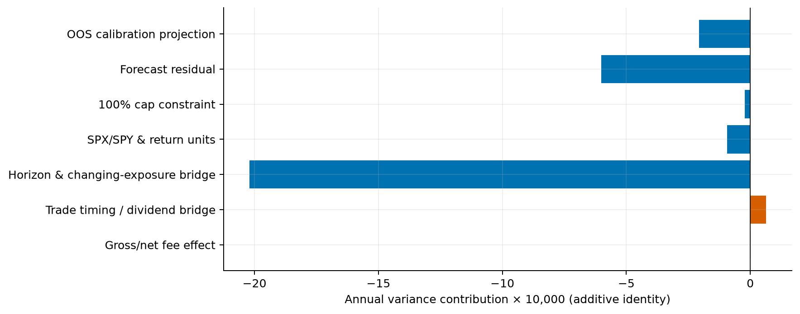

# H8 failure analysis

**EXPLORATORY DIAGNOSTICS — PENDING INDEPENDENT COAUTHOR REVIEW**

Fixed plan committed as `7ad9187` before computations. Original v2 models, parameters, source data and reported findings remain unchanged. Evaluation: 3520 origins2012–2025,168 monthly refits. All rates are decimals unless marked percent. New diagnostics use full-chronology circular block63 bootstrap,1000 draws,seed1729; fixed blocks21/126 sensitivities are retained. Historical resampling, overlapping labels and sparse stress cells do not establish causality or independent scientific acceptance.

The combined strategy’s8.438% realized volatility is lower than trailing’s10.140%, but its rolling21 target RMSE3.028% is worse than trailing2.960% and GARCH2.685%. Target tracking is distinct from risk reduction. Gross combined CAGR8.230% versus trailing9.999% already shows a return disadvantage; fees are not its sole cause.

| strategy | annual_vol | rolling21_target_rmse | cagr | max_drawdown | mean_cash_fraction | cap_fraction_earned | annual_turnover_nav | gross_minus_net_cagr |
| --- | --- | --- | --- | --- | --- | --- | --- | --- |
| buyhold | 0.1666757 | 0.099570488 | 0.147952774 | -0.337229285 | 0 | — | 0.0890184941 | 5.11059085e-05 |
| trailing | 0.101395442 | 0.0295965418 | 0.097602735 | -0.131571065 | 0.225954848 | 0.319408923 | 4.34088721 | 0.0023849197 |
| vix | 0.077745454 | 0.0329795672 | 0.0730261294 | -0.123908756 | 0.380020503 | 0.0167661267 | 7.68743739 | 0.0041324105 |
| garch | 0.094509168 | 0.026845659 | 0.0902907966 | -0.135263844 | 0.272522049 | 0.0835464621 | 7.1962175 | 0.00393011525 |
| combined | 0.0843837323 | 0.0302814273 | 0.079389321 | -0.132706367 | 0.341777359 | 0.0267121341 | 5.38107581 | 0.00290808584 |

Saved weights remain clip(.1/sqrt(f),0,1). Of3519 earned combined signals,2.671% have100% equity exposure, compared with31.941% for trailing. Combined keeps34.178% mean cash versus trailing22.595%. The cap DOES prevent the ex-ante forecast-implied10% target when f<.01: w²f=min(f,.01). It is not a bound on future realized volatility: a surprise can still yield much higher realized risk. The constraint reduces combined mean proxy variance by0.0000222402, only about0.772% of its absolute full-sample net variance gap0.00287939. For trailing the term is−0.00111577 yet aggregate volatility slightly exceeds target, contradicting cap binding as a sufficient explanation of aggregate undershooting. Low-VIX cap fractions/shortfalls and uncertainty are retained for every strategy.

For each origin, **w²y−.01=w²(y−f)+(w²f−.01)**, in annual decimal variance. Split y−f into the descriptive OOS calibration projection and residual. Mean only3519 earned origins; terminal forecast earns no return. Separately use actual next30-calendar-day SPY cash-dividend simple squared returns to identify the SPX/log-versus-SPY/simple instrument convention difference. A saved-weight close-to-close algebraic return proxy then separates horizon/aggregation/changing-exposure differences from actual old-share overnight versus new-share intraday timing. This proxy is never run as an alternative strategy. Every covariance and denominator effect is retained; the horizon bridge remains unexplained economically.

| strategy | variance_minus_target | calibration | forecast_residual | constraint | instrument_return_convention | horizon_dynamic_exposure_mean_sample_bridge | implementation_trade_timing_dividend_bridge | transaction_cost_variance_effect | arithmetic_residual |
| --- | --- | --- | --- | --- | --- | --- | --- | --- | --- |
| vix | -0.00395564438 | -0.00232446615 | 0.000234529665 | -1.07233475e-05 | -7.77040794e-05 | -0.0018192368 | 4.16330625e-05 | 3.23272844e-07 | -1.73472348e-18 |
| garch | -0.00106801716 | 0.0027698967 | -0.00157517789 | -9.07922336e-05 | -0.000118020657 | -0.00214246052 | 8.85247796e-05 | 1.26693149e-08 | 3.25260652e-18 |
| trailing | 0.00028103574 | 0.00645043317 | -0.00276695257 | -0.00111576676 | -0.000141157446 | -0.00227254691 | 0.000126924021 | 1.02236506e-07 | 8.67361738e-19 |
| combined | -0.00287938573 | -0.000205913039 | -0.000601350831 | -2.22402154e-05 | -9.32211792e-05 | -0.00202095796 | 6.35052642e-05 | 7.92229707e-07 | 0 |

These terms add exactly to net sample annual variance minus.01. Calibration and forecasting residual are a projection-dependent allocation, not independent causal effects. The combined largest term is the horizon/dynamic-exposure bridge−0.00202096; instrument convention is−0.0000932212, timing/dividend bridge+0.0000635053 and fee variance effect+0.000000792230. The cap is a small contributor. No unique explanation for the largest bridge is identified: averaging forward overlapping30-day variance at origin weights differs from full-sample variance under changing next-open exposures and rolling21 tracking. Labeling that whole bridge “model error” would be false precision. Arithmetic residual zero does not imply no scientifically unexplained difference.

Independently reconstructed daily return = [old shares × (open−previous close) + old shares × dividend + new shares × (close−open) − fee] / previous NAV. First row starts in cash at open; final row has overnight only. Every one of25 ledgers passes share/cash/cost/return recurrence and covariance accounting. Full symmetric covariance tables sum to portfolio variance; diagonal component variances alone would omit cross terms.

| block | metric | estimate | ci95 | valid_draws |
| --- | --- | --- | --- | --- |
| 21 | rolling_tracking_rmse | 0.000684885472 | [-0.002374110957926431, 0.0030283841602062656] | 1000 |
| 21 | annual_vol | -0.0170117101 | [-0.019368589359529433, -0.014653851496557365] | 1000 |
| 21 | cagr | -0.018213414 | [-0.03150486713143176, -0.006383426660660898] | 1000 |
| 63 | rolling_tracking_rmse | 0.000684885472 | [-0.0020908622975143285, 0.0037154110689510533] | 1000 |
| 63 | annual_vol | -0.0170117101 | [-0.019709947558217183, -0.014345079737320838] | 1000 |
| 63 | cagr | -0.018213414 | [-0.030339977458077278, -0.006871612633162488] | 1000 |
| 126 | rolling_tracking_rmse | 0.000684885472 | [-0.002081325967458101, 0.0037112652386829615] | 1000 |
| 126 | annual_vol | -0.0170117101 | [-0.02028247804361676, -0.014072778319218614] | 1000 |
| 126 | cagr | -0.018213414 | [-0.03087518388942766, -0.007594439514479339] | 1000 |

Across all three fixed block lengths the risk-error difference remains uncertain and CAGR disadvantage intervals stay negative. Group volatility/exposure/cap intervals resample full chronology before selecting memberships. Group rolling intervals resample the original complete-window losses; the full paired intervals recompute rolling windows on resampled returns. Neither estimates independent crisis replication.

| group | strategy | n | mean_weight | cap_fraction | annual_vol | rolling_target_rmse | variance_contribution | total_log_return | turnover_sum |
| --- | --- | --- | --- | --- | --- | --- | --- | --- | --- |
| 2020_pre | buyhold | 32 | 1 | — | 0.115049342 | 0.0276777237 | 0.000117700157 | 0.0406262089 | 0 |
| 2020_onset | buyhold | 24 | 1 | — | 0.826173121 | 0.445515381 | 0.00473984587 | -0.324595183 | 0.00576092647 |
| 2020_normalize | buyhold | 69 | 1 | — | 0.32986285 | 0.414014068 | 0.00215389431 | 0.24890614 | 0.00432697785 |
| 2020_late | buyhold | 128 | 1 | — | 0.164832081 | 0.0901623679 | 0.000987302557 | 0.180209733 | 0.00821366236 |
| vix_low | buyhold | 1432 | 1 | — | 0.087261774 | 0.0300416277 | 0.00310110885 | 0.538993714 | 0.11832598 |
| vix_mid | buyhold | 1706 | 1 | — | 0.152787094 | 0.0724691327 | 0.011310414 | 0.956429664 | 1.09618861 |
| vix_high | buyhold | 382 | 1 | — | 0.35117938 | 0.253525483 | 0.013369266 | 0.435732203 | 0.0313787508 |
| shock_down | buyhold | 191 | 1 | — | 0.195086823 | 0.16121622 | 0.00207355523 | 0.324087689 | 0.00511390348 |
| shock_stable | buyhold | 2983 | 1 | — | 0.143307467 | 0.0907262109 | 0.0174077361 | 1.2390694 | 1.21190027 |
| shock_up | buyhold | 346 | 1 | — | 0.29078341 | 0.124308369 | 0.00829949755 | 0.367998494 | 0.0288791657 |
| 2020_pre | trailing | 32 | 0.920155555 | 0.59375 | 0.109510633 | 0.0254354043 | 0.000106654507 | 0.0329723548 | 0.336708423 |
| 2020_onset | trailing | 24 | 0.325456929 | 0 | 0.200033284 | 0.0827888219 | 0.000307605833 | -0.117010278 | 0.6959256 |
| 2020_normalize | trailing | 69 | 0.287820815 | 0 | 0.0868065166 | 0.0414808486 | 0.000146431596 | 0.0540397253 | 0.799259109 |
| 2020_late | trailing | 128 | 0.619945229 | 0.0625 | 0.100660031 | 0.0345166649 | 0.000367373999 | 0.102477132 | 2.87234715 |
| vix_low | trailing | 1432 | 0.922216562 | 0.576519916 | 0.081599796 | 0.0287938939 | 0.00270848344 | 0.414447603 | 16.1839876 |
| vix_mid | trailing | 1706 | 0.72984652 | 0.171746776 | 0.109684169 | 0.0261718012 | 0.00582923362 | 0.702559258 | 35.9859495 |
| vix_high | trailing | 382 | 0.415986004 | 0.0157068063 | 0.126875748 | 0.0435271206 | 0.00174331868 | 0.186409259 | 8.5846568 |
| shock_down | trailing | 191 | 0.634603438 | 0.120418848 | 0.07743734 | 0.0372407814 | 0.000326751191 | 0.161496589 | 2.24922616 |
| shock_stable | trailing | 2983 | 0.788680717 | 0.342387659 | 0.0955941196 | 0.0282363129 | 0.0077454038 | 0.848150092 | 46.427617 |
| shock_up | trailing | 346 | 0.724841329 | 0.231213873 | 0.14988855 | 0.0356030557 | 0.00220888075 | 0.293769438 | 12.0777507 |
| 2020_pre | vix | 32 | 0.707463568 | 0 | 0.0776695429 | 0.0348126405 | 5.35322756e-05 | 0.0221672991 | 1.12231727 |
| 2020_onset | vix | 24 | 0.276919027 | 0 | 0.172964322 | 0.0495455145 | 0.000228659432 | -0.0999263136 | 0.935865486 |
| 2020_normalize | vix | 69 | 0.288357665 | 0 | 0.0863518299 | 0.0314332365 | 0.000145817728 | 0.059939333 | 1.11197096 |
| 2020_late | vix | 128 | 0.39642232 | 0 | 0.0597313623 | 0.0412465993 | 0.000129251856 | 0.0660728407 | 1.95791011 |
| vix_low | vix | 1432 | 0.783475681 | 0.0412299092 | 0.0663366176 | 0.036565088 | 0.00178948523 | 0.396460508 | 43.0163746 |
| vix_mid | vix | 1706 | 0.547255786 | 0 | 0.0808926712 | 0.0305523196 | 0.00317047118 | 0.468729168 | 54.4318185 |
| vix_high | vix | 382 | 0.331864617 | 0 | 0.100076153 | 0.0288706456 | 0.00108439921 | 0.121280277 | 10.1443599 |
| shock_down | vix | 191 | 0.608296791 | 0.0209424084 | 0.0757797773 | 0.0293547604 | 0.000313168542 | 0.144711271 | 6.30503265 |
| shock_stable | vix | 2983 | 0.637724992 | 0.0184439973 | 0.0745719051 | 0.0335773422 | 0.00471309573 | 0.66433739 | 81.6613175 |
| shock_up | vix | 346 | 0.473437836 | 0 | 0.101832351 | 0.0295240619 | 0.00101809135 | 0.177421292 | 19.6262028 |
| 2020_pre | garch | 32 | 0.844766286 | 0.0625 | 0.0986579412 | 0.021840274 | 8.62887223e-05 | 0.0265510945 | 1.20073562 |
| 2020_onset | garch | 24 | 0.298816161 | 0 | 0.180895609 | 0.0652689885 | 0.000250689411 | -0.104121435 | 0.914111262 |
| 2020_normalize | garch | 69 | 0.317154496 | 0 | 0.0972326107 | 0.0336847832 | 0.000184267508 | 0.062627189 | 1.22010188 |
| 2020_late | garch | 128 | 0.614562579 | 0 | 0.0957325323 | 0.0264978385 | 0.000332650097 | 0.102151971 | 4.05346109 |
| vix_low | garch | 1432 | 0.870068886 | 0.199161426 | 0.0757445204 | 0.0292764312 | 0.00233342339 | 0.414155092 | 35.1513194 |
| vix_mid | garch | 1706 | 0.678389914 | 0.00527549824 | 0.101405382 | 0.0218936885 | 0.00498226889 | 0.584717873 | 53.4558959 |
| vix_high | garch | 382 | 0.412174209 | 0 | 0.122131597 | 0.0357007557 | 0.00161629057 | 0.210994279 | 12.1102764 |
| shock_down | garch | 191 | 0.600433226 | 0.0104712042 | 0.0748792894 | 0.0283744185 | 0.000305488294 | 0.152621923 | 4.50493135 |
| shock_stable | garch | 2983 | 0.746402699 | 0.094232059 | 0.090154617 | 0.0264575681 | 0.00688906096 | 0.778689652 | 77.503903 |
| shock_up | garch | 346 | 0.634451991 | 0.0317919075 | 0.132905406 | 0.0291760033 | 0.00173743359 | 0.278555669 | 18.7086574 |
| 2020_pre | combined | 32 | 0.808216583 | 0 | 0.0920820244 | 0.0255041684 | 7.52699752e-05 | 0.0256687779 | 0.871982882 |
| 2020_onset | combined | 24 | 0.301190546 | 0 | 0.185530381 | 0.0646269505 | 0.000263331064 | -0.10756093 | 0.744690755 |
| 2020_normalize | combined | 69 | 0.293446875 | 0 | 0.0864459766 | 0.0328659416 | 0.00014596855 | 0.0597278237 | 0.930062664 |
| 2020_late | combined | 128 | 0.437766307 | 0 | 0.066165268 | 0.0362031905 | 0.000158620363 | 0.0729938374 | 2.0127499 |
| vix_low | combined | 1432 | 0.813011843 | 0.0656883298 | 0.0698804934 | 0.0331230662 | 0.00198581915 | 0.41534865 | 25.1377323 |
| vix_mid | combined | 1706 | 0.594660396 | 0 | 0.0891244697 | 0.0271018849 | 0.00384856709 | 0.513023005 | 40.6250134 |
| vix_high | combined | 382 | 0.36183273 | 0 | 0.108988475 | 0.0323547302 | 0.00128622803 | 0.140850735 | 9.55021675 |
| shock_down | combined | 191 | 0.602819281 | 0.0104712042 | 0.0755202263 | 0.0274642833 | 0.000310935501 | 0.147958482 | 3.78842383 |
| shock_stable | combined | 2983 | 0.6746367 | 0.0301810865 | 0.0802132331 | 0.0305849426 | 0.00545318809 | 0.718825657 | 54.6858872 |
| shock_up | combined | 346 | 0.547294617 | 0.00578034682 | 0.117534032 | 0.029130127 | 0.00135649069 | 0.20243825 | 16.8386514 |

Regimes are indexed by signal origin, with their realized next-open ledger row. Variance contributions are sums of (r−full mean)²×252/(N−1); the disjoint VIX and shock-direction families each sum exactly to full-sample variance. Calendar windows/outcome groups overlap and must not be summed together. Annual volatility within a group is not its contribution to full variance. Fragmented subgroup log returns and drawdowns are descriptive stitched observations, not an executable strategy. Rising-VIX and normalization panels expose changing weights and foregone equity returns; low cash-weight exposure both protects drawdowns and sacrifices upside. The2022 fixed panel shows why reduced exposure can help in a falling market, contradicting a universal economic inefficiency claim.

| strategy | cost_bps | annual_vol | rolling21_target_rmse | cagr | max_drawdown | annual_turnover_nav | cost_initial_nav | gross_minus_net_total_log_return | gross_minus_net_cagr |
| --- | --- | --- | --- | --- | --- | --- | --- | --- | --- |
| buyhold | 0 | 0.16667616 | 0.0995703204 | 0.14800388 | -0.337227375 | 0.0890630033 | 0 | 0 | 0 |
| buyhold | 1 | 0.166676059 | 0.0995703541 | 0.147993656 | -0.337227757 | 0.0890540979 | 0.000167110251 | 0.00012464417 | 1.022381e-05 |
| buyhold | 5 | 0.1666757 | 0.099570488 | 0.147952774 | -0.337229285 | 0.0890184941 | 0.000835062275 | 0.000623071727 | 5.11059085e-05 |
| buyhold | 10 | 0.166675348 | 0.0995706524 | 0.147901701 | -0.337231192 | 0.0889740293 | 0.0016689036 | 0.00124577091 | 0.000102178987 |
| buyhold | 25 | 0.16667494 | 0.0995711264 | 0.147748678 | -0.337236902 | 0.0888409011 | 0.00416312673 | 0.00311163755 | 0.000255201641 |
| trailing | 0 | 0.101394938 | 0.0295931945 | 0.0999876547 | -0.130165227 | 4.34099033 | 0 | 0 | 0 |
| trailing | 1 | 0.101394985 | 0.0295938601 | 0.0995102552 | -0.130446575 | 4.34096961 | 0.0127776293 | 0.00607559898 | 0.000477399578 |
| trailing | 5 | 0.101395442 | 0.0295965418 | 0.097602735 | -0.131571065 | 4.34088721 | 0.0629590644 | 0.0303779036 | 0.0023849197 |
| trailing | 10 | 0.101396618 | 0.0295999378 | 0.0952230028 | -0.132974655 | 4.34078535 | 0.123641258 | 0.060755595 | 0.00476465196 |
| trailing | 25 | 0.101404175 | 0.0296104304 | 0.088114797 | -0.137171986 | 4.34048739 | 0.292761798 | 0.151887659 | 0.0118728577 |
| vix | 0 | 0.0777433749 | 0.0329663493 | 0.0771585399 | -0.122165337 | 7.68755888 | 0 | 0 | 0 |
| vix | 1 | 0.0777437303 | 0.0329690274 | 0.0763307862 | -0.122514295 | 7.68753446 | 0.0184900625 | 0.010759424 | 0.000827753656 |
| vix | 5 | 0.077745454 | 0.0329795672 | 0.0730261294 | -0.123908756 | 7.68743739 | 0.0901815893 | 0.0537970976 | 0.0041324105 |
| vix | 10 | 0.0777482893 | 0.0329923537 | 0.0689095752 | -0.125648754 | 7.68731748 | 0.174884714 | 0.107594159 | 0.00824896468 |
| vix | 25 | 0.077761334 | 0.0330281143 | 0.056654418 | -0.130848286 | 7.68696713 | 0.399137109 | 0.268985463 | 0.0205041219 |
| garch | 0 | 0.094509101 | 0.0268343486 | 0.0942209119 | -0.13331144 | 7.19634388 | 0 | 0 | 0 |
| garch | 1 | 0.0945090584 | 0.0268365939 | 0.0934337564 | -0.133702269 | 7.19631845 | 0.02017378 | 0.0100719233 | 0.000787155517 |
| garch | 5 | 0.094509168 | 0.026845659 | 0.0902907966 | -0.135263844 | 7.1962175 | 0.0984716209 | 0.0503595678 | 0.00393011525 |
| garch | 10 | 0.0945099362 | 0.0268571787 | 0.0863748047 | -0.137211899 | 7.19609306 | 0.191144098 | 0.100719039 | 0.00784610718 |
| garch | 25 | 0.0945164578 | 0.0268929852 | 0.0747110293 | -0.143030085 | 7.19573146 | 0.437403038 | 0.251797296 | 0.0195098826 |
| combined | 0 | 0.0843790379 | 0.0302713215 | 0.0822974069 | -0.131016556 | 5.38115184 | 0 | 0 | 0 |
| combined | 1 | 0.084379938 | 0.0302733472 | 0.081715163 | -0.131354778 | 5.38113654 | 0.0144688749 | 0.00753140069 | 0.000582243845 |
| combined | 5 | 0.0843837323 | 0.0302814273 | 0.079389321 | -0.132706367 | 5.38107581 | 0.0710911492 | 0.0376569675 | 0.00290808584 |
| combined | 10 | 0.0843889122 | 0.0302914755 | 0.0764890548 | -0.134392941 | 5.38100096 | 0.13912418 | 0.0753138604 | 0.00580835204 |
| combined | 25 | 0.0844073694 | 0.0303212694 | 0.0678349445 | -0.139433306 | 5.38078349 | 0.326066516 | 0.188284346 | 0.0144624624 |

Fees are cost-rate × traded notional, never cost-rate × NAV. Exact gross/net compounded log-return drag is sum log(1+r_gross)−sum log(1+r_net); it includes compounding and self-financing wealth effects. Total fee dollars / initial NAV is a different quantity. No dividends, costs, leverage constraints, parameters or cash-interest assumptions changed. Fractional shares, next-open fills, zero cash interest, ex-date rather than pay-date dividend cash and lack of independent SPY provider confirmation limit external validity.

Additive accounting identity, not causal attribution; the largest horizon/changing-exposure term remains economically unresolved.

Full tables: [all regimes](tables/quant_failure/h8_regimes.csv), [variance covariances](tables/quant_failure/h8_variance_components.csv), [daily return components](tables/quant_failure/h8_daily_components.csv), [split bridge](tables/quant_failure/split_bridge.csv), [bridge daily proxies](tables/quant_failure/split_daily_bridge.csv), [group uncertainties](tables/quant_failure/portfolio_groups.csv).

Primary result SHA `165ee888a84dd8df8a406490ac81b67667eee7906e0cb98c4c579cd6672ac80d`; independent audit SHA `444073f5f35454dfa6c38d7d775bee60f1af37c840694f1da08659724dfef8f7`. Full provenance, all input hashes and exact tables are in [results](../data/manifests/quant_failure_results_v1.json) and [audit](../data/manifests/quant_failure_independent_audit_v1.json). Reproduction and interpretation limits: [synthesis](quant_failure_mechanisms.md).
