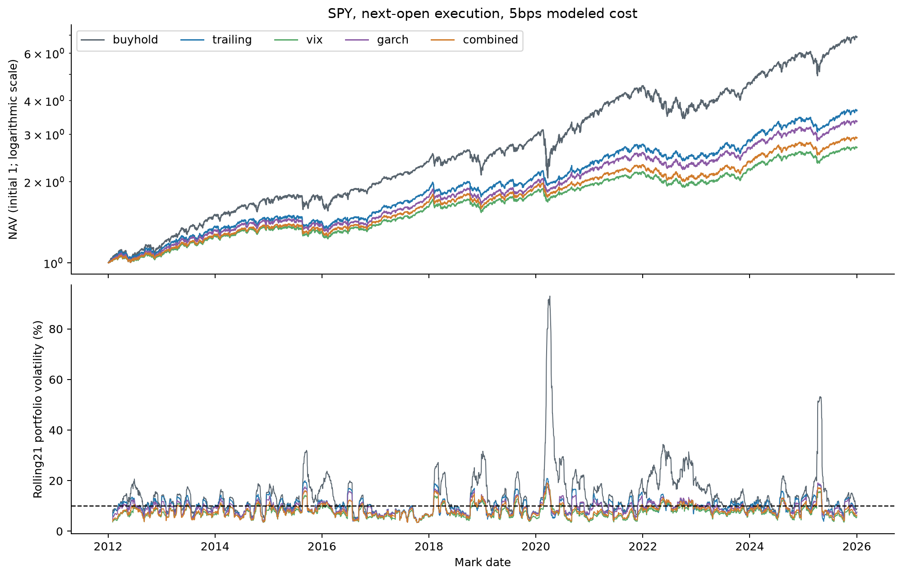

# H8: investable SPY risk control after costs

**EXPLORATORY — POST H1–H5 RESULT SELECTION — PENDING INDEPENDENT REVIEW**

Current evidence is **v2**, after the registered calendar-information correction. Version1 affected comparisons are **INVALIDATED_FOR_STRICT_AS_OF_CALENDAR**, preserved unchanged in original manifests and `outputs/quant_extension/v1/` with original report copies. No model setting or practical threshold was changed; see `paper/quant_extension_calendar_amendment.md`.

SPY source SHA `25b45ed25d1c6c09d337d277518e9710fbdcbfc62f691d7971231a6a3d7c5b44`;4821 exact sessions2006-12-01–2026-02-02,77 dividend events,0 splits. Cash-dividend versus vendor-adjustment maximum daily return difference0.00025187083, cumulative return-factor difference0.000589671302; passes locked tolerance, lacks independent-provider confirmation.

Five strategies × five cost scenarios executed. 3520 signals, 3519 actual rebalance signals,3520 mark-to-mark returns2012-01-04 open–2026-01-02 open. Last2025-12-31 forecast has no earned return under the frozen terminal convention. Old shares earn overnight and ex-date dividends before next-open rebalance; new shares earn intraday. No leverage, short or missing sessions.

| cost bps | strategy | annual_vol | rolling21_target_rmse | cagr | sharpe_zero_reference | max_drawdown | annual_turnover_nav | cost_initial_nav | downside_rms | worst_month |
|---|---|---|---|---|---|---|---|---|---|---|
| 0 | buyhold | 0.16667616 | 0.0995703204 | 0.14800388 | 0.91349698 | -0.337227375 | 0.0890630033 | 0 | 0.117849075 | -0.124943546 |
| 0 | combined | 0.0843790379 | 0.0302713215 | 0.0822974069 | 0.981537529 | -0.131016556 | 5.38115184 | 0 | 0.0611857138 | -0.0534321309 |
| 0 | garch | 0.094509101 | 0.0268343486 | 0.0942209119 | 1.00215058 | -0.13331144 | 7.19634388 | 0 | 0.0684616821 | -0.0599005734 |
| 0 | trailing | 0.101394938 | 0.0295931945 | 0.0999876547 | 0.992729443 | -0.130165227 | 4.34099033 | 0 | 0.0734003235 | -0.0667293022 |
| 0 | vix | 0.0777433749 | 0.0329663493 | 0.0771585399 | 0.997012123 | -0.122165337 | 7.68755888 | 0 | 0.0562324885 | -0.0489289938 |
| 1 | buyhold | 0.166676059 | 0.0995703541 | 0.147993656 | 0.913443863 | -0.337227757 | 0.0890540979 | 0.000167110251 | 0.117849149 | -0.12494405 |
| 1 | combined | 0.084379938 | 0.0302733472 | 0.081715163 | 0.975136184 | -0.131354778 | 5.38113654 | 0.0144688749 | 0.0612039316 | -0.0535066881 |
| 1 | garch | 0.0945090584 | 0.0268365939 | 0.0934337564 | 0.994518952 | -0.133702269 | 7.19631845 | 0.02017378 | 0.0684849364 | -0.0599721985 |
| 1 | trailing | 0.101394985 | 0.0295938601 | 0.0995102552 | 0.98843782 | -0.130446575 | 4.34096961 | 0.0127776293 | 0.0734147793 | -0.0668160456 |
| 1 | vix | 0.0777437303 | 0.0329690274 | 0.0763307862 | 0.987097257 | -0.122514295 | 7.68753446 | 0.0184900625 | 0.0562571605 | -0.0489810931 |
| 10 | buyhold | 0.166675348 | 0.0995706524 | 0.147901701 | 0.912965224 | -0.337231192 | 0.0889740293 | 0.0016689036 | 0.117849814 | -0.124948584 |
| 10 | combined | 0.0843889122 | 0.0302914755 | 0.0764890548 | 0.917522337 | -0.134392941 | 5.38100096 | 0.13912418 | 0.0613684779 | -0.0541777345 |
| 10 | garch | 0.0945099362 | 0.0268571787 | 0.0863748047 | 0.925824007 | -0.137211899 | 7.19609306 | 0.191144098 | 0.0686951263 | -0.0606169154 |
| 10 | trailing | 0.101396618 | 0.0295999378 | 0.0952230028 | 0.949803887 | -0.132974655 | 4.34078535 | 0.123641258 | 0.0735456593 | -0.0675966101 |
| 10 | vix | 0.0777482893 | 0.0329923537 | 0.0689095752 | 0.897854621 | -0.125648754 | 7.68731748 | 0.174884714 | 0.0564802643 | -0.0494499161 |
| 25 | buyhold | 0.16667494 | 0.0995711264 | 0.147748678 | 0.912165149 | -0.337236902 | 0.0888409011 | 0.00416312673 | 0.117850921 | -0.124956123 |
| 25 | combined | 0.0844073694 | 0.0303212694 | 0.0678349445 | 0.821498623 | -0.139433306 | 5.38078349 | 0.326066516 | 0.0616450692 | -0.0552962744 |
| 25 | garch | 0.0945164578 | 0.0268929852 | 0.0747110293 | 0.811301039 | -0.143030085 | 7.19573146 | 0.437403038 | 0.0690490818 | -0.0616918091 |
| 25 | trailing | 0.101404175 | 0.0296104304 | 0.088114797 | 0.885381612 | -0.137171986 | 4.34048739 | 0.292761798 | 0.0737669316 | -0.0688970507 |
| 25 | vix | 0.077761334 | 0.0330281143 | 0.056654418 | 0.749098504 | -0.130848286 | 7.68696713 | 0.399137109 | 0.0568563484 | -0.0507678538 |
| 5 | buyhold | 0.1666757 | 0.099570488 | 0.147952774 | 0.913231266 | -0.337229285 | 0.0890184941 | 0.000835062275 | 0.117849444 | -0.124946066 |
| 5 | combined | 0.0843837323 | 0.0302814273 | 0.079389321 | 0.949530347 | -0.132706367 | 5.38107581 | 0.0710911492 | 0.061276933 | -0.0538049239 |
| 5 | garch | 0.094509168 | 0.026845659 | 0.0902907966 | 0.963990041 | -0.135263844 | 7.1962175 | 0.0984716209 | 0.0685781538 | -0.0602587191 |
| 5 | trailing | 0.101395442 | 0.0295965418 | 0.097602735 | 0.971269201 | -0.131571065 | 4.34088721 | 0.0629590644 | 0.0734727752 | -0.0671629911 |
| 5 | vix | 0.077745454 | 0.0329795672 | 0.0730261294 | 0.94743564 | -0.123908756 | 7.68743739 | 0.0901815893 | 0.0563560831 | -0.0491894746 |

All rates are decimals; turnover is one-way traded-notional/NAV per calendar year. Costs are total dollars divided by initial NAV, not a percentage of contemporaneous wealth; they do not equal CAGR drag. Zero cash interest and zero Sharpe reference rate are explicit modeling assumptions. ETF expenses are embedded in SPY prices; dividend cash credit on ex-date, fractional shares and opening fills simplify implementation. Buyhold includes dividend reinvestment trades and fees. Final endpoint is a partial overnight interval; no liquidation fee. Taxes, actual spreads/impact, payment-date financing and broker fills are not modeled.

At 5 bps combined/trailing annual volatility: 8.438%/10.140%; lower volatility is not necessarily closer to the10% target. Rolling risk RMSE: 3.028%/2.960%. Net CAGR: 7.939%/9.760%. Registered joint practical gate passed: False. Exact paired intervals below; positive risk-error differences are deterioration. Gross evidence is preserved separately, so costs cannot be treated as the sole source of failure. Strongest historical rolling-risk strategy: garch; no outcome-selected replacement strategy is promoted.

| cost bps | metric | combined-trailing | bootstrap95 CI |
|---|---|---|---|
| 0 | cagr | -0.0176902479 | [-0.02980868728790583, -0.006310342077811687] |
| 0 | rolling_target_rmse | 0.000678127004 | [-0.0020922950695385556, 0.0037029003051884347] |
| 0 | sharpe | -0.0111919133 | [-0.09927237963783579, 0.07946171375931561] |
| 0 | volatility | -0.0170159003 | [-0.0197078727026716, -0.014347816844308836] |
| 1 | cagr | -0.0177950921 | [-0.029915160514560512, -0.006427801198667316] |
| 1 | rolling_target_rmse | 0.000679487122 | [-0.002091995660488106, 0.003705410500341386] |
| 1 | sharpe | -0.0133016356 | [-0.10177311941819567, 0.07691274402848268] |
| 1 | volatility | -0.0170150473 | [-0.0197082856565564, -0.014347259276935401] |
| 10 | cagr | -0.0187339479 | [-0.030836908389751182, -0.007339622458893122] |
| 10 | rolling_target_rmse | 0.000691537637 | [-0.002089589821825173, 0.0037278209389860722] |
| 10 | sharpe | -0.0322815494 | [-0.12111863083471337, 0.05659475920678286] |
| 10 | volatility | -0.0170077063 | [-0.01971211882510708, -0.014342469039976585] |
| 25 | cagr | -0.0202798525 | [-0.03240694564993647, -0.008836099036838461] |
| 25 | rolling_target_rmse | 0.000710839043 | [-0.002086728352868382, 0.003764437444067135] |
| 25 | sharpe | -0.0638829895 | [-0.15297453454687696, 0.027727248750600612] |
| 25 | volatility | -0.016996806 | [-0.01971925344343264, -0.014329297848401434] |
| 5 | cagr | -0.018213414 | [-0.030339977458077316, -0.006871612633162634] |
| 5 | rolling_target_rmse | 0.000684885472 | [-0.0020908622975143285, 0.0037154110689510533] |
| 5 | sharpe | -0.0217388544 | [-0.11065318080750787, 0.06789115803111069] |
| 5 | volatility | -0.0170117101 | [-0.019709947558217183, -0.014345079737320838] |

Primary5bps rolling squared-error HAC63 p=0.597853445. Block63/1000 paired return draws recompute metrics; they preserve local dependence but stitch regimes and do not prove future utility. Other costs/periods are fixed sensitivities, not independent primary tests.

| period | strategy | annual_vol | rolling error | CAGR | drawdown | worst month |
|---|---|---|---|---|---|---|
| 2012_2016 | buyhold | 0.127840305 | 0.0492418714 | 0.142876169 | -0.130142965 | -0.0609501275 |
| 2012_2016 | combined | 0.0804776322 | 0.0296647372 | 0.0706589269 | -0.100483242 | -0.0524940185 |
| 2012_2016 | garch | 0.0926615214 | 0.0253178424 | 0.0777375679 | -0.108418423 | -0.0579769917 |
| 2012_2016 | trailing | 0.101369668 | 0.027829219 | 0.0881700503 | -0.109133702 | -0.0671629911 |
| 2012_2016 | vix | 0.0756265477 | 0.031324682 | 0.0649240267 | -0.101677885 | -0.0487934414 |
| 2017_2021 | buyhold | 0.188565715 | 0.130983076 | 0.183773855 | -0.337229285 | -0.124946066 |
| 2017_2021 | combined | 0.0830857457 | 0.0350237094 | 0.104179073 | -0.120646733 | -0.0538049239 |
| 2017_2021 | garch | 0.0928101912 | 0.0312636226 | 0.120120551 | -0.129128889 | -0.0602587191 |
| 2017_2021 | trailing | 0.0992727966 | 0.0351301054 | 0.125207778 | -0.122416337 | -0.0603207028 |
| 2017_2021 | vix | 0.0758248094 | 0.0380542968 | 0.096991268 | -0.107877274 | -0.0491894746 |
| 2020 | buyhold | 0.333992176 | 0.27517826 | 0.183812721 | -0.337229285 | -0.124946066 |
| 2020 | combined | 0.0948215069 | 0.0382099528 | 0.068241416 | -0.112676913 | -0.0384279916 |
| 2020 | garch | 0.108762063 | 0.0341672193 | 0.116036207 | -0.108419499 | -0.0395326939 |
| 2020 | trailing | 0.113330965 | 0.0436483623 | 0.100564069 | -0.119179826 | -0.0391804075 |
| 2020 | vix | 0.0882085195 | 0.0383928194 | 0.0628131806 | -0.107349193 | -0.0336749735 |
| 2022 | buyhold | 0.242427417 | 0.151537869 | -0.183619937 | -0.244927757 | -0.0924053698 |
| 2022 | combined | 0.1027993 | 0.0135643869 | -0.108588751 | -0.132706367 | -0.044215363 |
| 2022 | garch | 0.110976731 | 0.0173258974 | -0.104198866 | -0.135263844 | -0.0471809945 |
| 2022 | trailing | 0.106446229 | 0.0178928726 | -0.113174497 | -0.131571065 | -0.0466037451 |
| 2022 | vix | 0.0940283319 | 0.0139323651 | -0.102869664 | -0.123908756 | -0.0403999589 |
| 2022_2025 | buyhold | 0.180059874 | 0.102676295 | 0.110224566 | -0.244927757 | -0.0924053698 |
| 2022_2025 | combined | 0.0906301291 | 0.0239354194 | 0.059231239 | -0.132706367 | -0.044215363 |
| 2022_2025 | garch | 0.0988986662 | 0.0224243764 | 0.0687460397 | -0.135263844 | -0.0471809945 |
| 2022_2025 | trailing | 0.104121883 | 0.0237694169 | 0.0747016925 | -0.131571065 | -0.0466037451 |
| 2022_2025 | vix | 0.0826614682 | 0.027552064 | 0.0531691936 | -0.123908756 | -0.0403999589 |

2008 is warm-up, so no extension OOS portfolio claim is made for2008. Worst-month identifiers and complete costs/exposures/share/cash/equity paths are in JSON/CSV.

Generated from `h8.json`, SHA-256 `b09b8f3ffdd8af230854709e39771efb0e73f8c9b5afb9c5b33607e04183f001`. Exact forecasts, refit parameters/scaling and source identity are preserved in `outputs/quant_extension/v2/`; sanitized result metadata is committed in `data/manifests/quant_extension_h8_v2.json`. Reproduction instructions: `docs/quant_extension_reproduction.md`. Independent scientific review PENDING.
