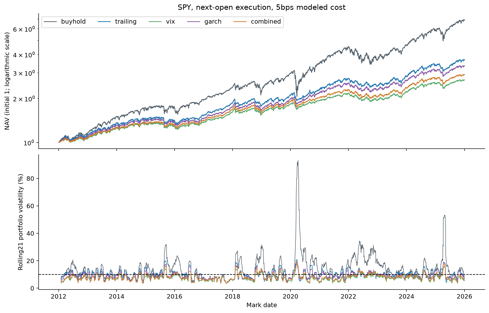

# H8: investable SPY risk control after costs

**EXPLORATORY — POST H1–H5 RESULT SELECTION — PENDING INDEPENDENT REVIEW**

SPY source SHA `25b45ed25d1c6c09d337d277518e9710fbdcbfc62f691d7971231a6a3d7c5b44`;4821 exact sessions2006-12-01–2026-02-02,77 dividend events,0 splits. Cash-dividend versus vendor-adjustment maximum daily return difference0.00025187083, cumulative return-factor difference0.000589671302; passes locked tolerance, lacks independent-provider confirmation.

Five strategies × five cost scenarios executed. 3520 signals, 3519 actual rebalance signals,3520 mark-to-mark returns2012-01-04 open–2026-01-02 open. Last2025-12-31 forecast has no earned return under the frozen terminal convention. Old shares earn overnight and ex-date dividends before next-open rebalance; new shares earn intraday. No leverage, short or missing sessions.

| cost bps | strategy | annual_vol | rolling21_target_rmse | cagr | sharpe_zero_reference | max_drawdown | annual_turnover_nav | cost_initial_nav | downside_rms | worst_month |
|---|---|---|---|---|---|---|---|---|---|---|
| 0 | buyhold | 0.16667616 | 0.0995703204 | 0.14800388 | 0.91349698 | -0.337227375 | 0.0890630033 | 0 | 0.117849075 | -0.124943546 |
| 0 | combined | 0.0843912752 | 0.0302788913 | 0.0822348133 | 0.980720633 | -0.13101078 | 5.38109929 | 0 | 0.0611990359 | -0.0534230926 |
| 0 | garch | 0.094592029 | 0.0268626094 | 0.0940252266 | 0.999460516 | -0.13331144 | 7.21132703 | 0 | 0.0685428061 | -0.0599005734 |
| 0 | trailing | 0.101394938 | 0.0295931945 | 0.0999876547 | 0.992729443 | -0.130165227 | 4.34099033 | 0 | 0.0734003235 | -0.0667293022 |
| 0 | vix | 0.0777433749 | 0.0329663493 | 0.0771585399 | 0.997012123 | -0.122165337 | 7.68755888 | 0 | 0.0562324885 | -0.0489289938 |
| 1 | buyhold | 0.166676059 | 0.0995703541 | 0.147993656 | 0.913443863 | -0.337227757 | 0.0890540979 | 0.000167110251 | 0.117849149 | -0.12494405 |
| 1 | combined | 0.0843921663 | 0.0302809162 | 0.0816526088 | 0.974320383 | -0.131349009 | 5.38108399 | 0.014463336 | 0.0612172452 | -0.0534976181 |
| 1 | garch | 0.0945919402 | 0.0268648132 | 0.0932365739 | 0.991820143 | -0.133702269 | 7.21130151 | 0.0201840373 | 0.068566081 | -0.0599721985 |
| 1 | trailing | 0.101394985 | 0.0295938601 | 0.0995102552 | 0.98843782 | -0.130446575 | 4.34096961 | 0.0127776293 | 0.0734147793 | -0.0668160456 |
| 1 | vix | 0.0777437303 | 0.0329690274 | 0.0763307862 | 0.987097257 | -0.122514295 | 7.68753446 | 0.0184900625 | 0.0562571605 | -0.0489810931 |
| 10 | buyhold | 0.166675348 | 0.0995706524 | 0.147901701 | 0.912965224 | -0.337231192 | 0.0889740293 | 0.0016689036 | 0.117849814 | -0.124948584 |
| 10 | combined | 0.0844010603 | 0.0302990368 | 0.0764268538 | 0.916716337 | -0.134387242 | 5.38094839 | 0.139071181 | 0.061381715 | -0.0541683795 |
| 10 | garch | 0.0945924068 | 0.0268850329 | 0.0861642482 | 0.923046183 | -0.137211899 | 7.21107532 | 0.19121981 | 0.0687764575 | -0.0606169154 |
| 10 | trailing | 0.101396618 | 0.0295999378 | 0.0952230028 | 0.949803887 | -0.132974655 | 4.34078535 | 0.123641258 | 0.0735456593 | -0.0675966101 |
| 10 | vix | 0.0777482893 | 0.0329923537 | 0.0689095752 | 0.897854621 | -0.125648754 | 7.68731748 | 0.174884714 | 0.0564802643 | -0.0494499161 |
| 25 | buyhold | 0.16667494 | 0.0995711264 | 0.147748678 | 0.912165149 | -0.337236902 | 0.0888409011 | 0.00416312673 | 0.117850921 | -0.124956123 |
| 25 | combined | 0.0844193851 | 0.0303288198 | 0.0677733276 | 0.820708732 | -0.139427723 | 5.38073088 | 0.325943296 | 0.0616581786 | -0.0552864444 |
| 25 | garch | 0.09459826 | 0.0269202623 | 0.0744785839 | 0.80839027 | -0.143030085 | 7.21071242 | 0.437496972 | 0.06913073 | -0.0616918091 |
| 25 | trailing | 0.101404175 | 0.0296104304 | 0.088114797 | 0.885381612 | -0.137171986 | 4.34048739 | 0.292761798 | 0.0737669316 | -0.0688970507 |
| 25 | vix | 0.077761334 | 0.0330281143 | 0.056654418 | 0.749098504 | -0.130848286 | 7.68696713 | 0.399137109 | 0.0568563484 | -0.0507678538 |
| 5 | buyhold | 0.1666757 | 0.099570488 | 0.147952774 | 0.913231266 | -0.337229285 | 0.0890184941 | 0.000835062275 | 0.117849444 | -0.124946066 |
| 5 | combined | 0.0843959249 | 0.0302889928 | 0.079326924 | 0.948718914 | -0.132700629 | 5.38102325 | 0.0710639936 | 0.0612902127 | -0.0537957272 |
| 5 | garch | 0.0945918661 | 0.0268737143 | 0.0900876477 | 0.961256186 | -0.135263844 | 7.2112002 | 0.0985167397 | 0.068659381 | -0.0602587191 |
| 5 | trailing | 0.101395442 | 0.0295965418 | 0.097602735 | 0.971269201 | -0.131571065 | 4.34088721 | 0.0629590644 | 0.0734727752 | -0.0671629911 |
| 5 | vix | 0.077745454 | 0.0329795672 | 0.0730261294 | 0.94743564 | -0.123908756 | 7.68743739 | 0.0901815893 | 0.0563560831 | -0.0491894746 |

All rates are decimals; turnover is one-way traded-notional/NAV per calendar year. Costs are total dollars divided by initial NAV, not a percentage of contemporaneous wealth; they do not equal CAGR drag. Zero cash interest and zero Sharpe reference rate are explicit modeling assumptions. ETF expenses are embedded in SPY prices; dividend cash credit on ex-date, fractional shares and opening fills simplify implementation. Buyhold includes dividend reinvestment trades and fees. Final endpoint is a partial overnight interval; no liquidation fee. Taxes, actual spreads/impact, payment-date financing and broker fills are not modeled.

At5bps combination realized volatility8.44% versus trailing10.14%; being lower is not necessarily closer to10%. Rolling risk error3.029% versus2.960%: difference+0.069 percentage points, CI[-0.208,+0.372]percentage points. Registered reduction of0.5percentage points fails. Net CAGR7.933% versus9.760%, difference-1.828percentage points, CI[-3.038,-0.690]. The registered no-more-than0.5percentage-point CAGR deterioration also fails. Combination turnover is higher. Failure is present gross too; costs amplify return drag rather than creating the whole failure. GARCH has lowest historical rolling risk error among these strategies, but no outcome-selected replacement strategy is promoted.

| cost bps | metric | combined-trailing | bootstrap95 CI |
|---|---|---|---|
| 0 | cagr | -0.0177528414 | [-0.02985808892507206, -0.006349582266887993] |
| 0 | rolling_target_rmse | 0.000685696837 | [-0.0020852605863115777, 0.0037032796774817433] |
| 0 | sharpe | -0.0120088092 | [-0.10019082703980285, 0.07880890495566246] |
| 0 | volatility | -0.017003663 | [-0.01969511854683696, -0.014319175327710218] |
| 1 | cagr | -0.0178576463 | [-0.029964551955254513, -0.006469477922219302] |
| 1 | rolling_target_rmse | 0.000687056055 | [-0.0020849695296404538, 0.0037057917951867896] |
| 1 | sharpe | -0.0141174363 | [-0.10268787071275043, 0.07625994860763502] |
| 1 | volatility | -0.017002819 | [-0.019695551195339795, -0.014317849981910657] |
| 10 | cagr | -0.018796149 | [-0.030856096639965507, -0.007385504901606894] |
| 10 | rolling_target_rmse | 0.000699098935 | [-0.0020826373274346853, 0.0037282192873871346] |
| 10 | sharpe | -0.0330875494 | [-0.12160348212910398, 0.05599854189807604] |
| 10 | volatility | -0.0169955582 | [-0.01969963563377565, -0.014312884700509091] |
| 25 | cagr | -0.0203414694 | [-0.03247880736069827, -0.008875980797135799] |
| 25 | rolling_target_rmse | 0.000718389403 | [-0.0020757412428363074, 0.003764863204306999] |
| 25 | sharpe | -0.0646728806 | [-0.15409497140814907, 0.02589291325829946] |
| 25 | volatility | -0.0169847903 | [-0.019707031585933264, -0.014314121353374691] |
| 5 | cagr | -0.018275811 | [-0.030381742371385505, -0.006903842137309031] |
| 5 | rolling_target_rmse | 0.000692450911 | [-0.002083869233730739, 0.0037157999987306937] |
| 5 | sharpe | -0.0225502866 | [-0.1115514599485629, 0.06745484673658733] |
| 5 | volatility | -0.0169995175 | [-0.019697324216448993, -0.01431529695730049] |

Primary5bps rolling squared-error HAC63 p=0.593589182. Block63/1000 paired return draws recompute metrics; they preserve local dependence but stitch regimes and do not prove future utility. Other costs/periods are fixed sensitivities, not independent primary tests.

| period | strategy | annual_vol | rolling error | CAGR | drawdown | worst month |
|---|---|---|---|---|---|---|
| 2012_2016 | buyhold | 0.127840305 | 0.0492418714 | 0.142876169 | -0.130142965 | -0.0609501275 |
| 2012_2016 | combined | 0.0804800769 | 0.0296601458 | 0.070592556 | -0.10045845 | -0.0524808342 |
| 2012_2016 | garch | 0.0927468104 | 0.0253151727 | 0.0774928815 | -0.108418423 | -0.0579769917 |
| 2012_2016 | trailing | 0.101369668 | 0.027829219 | 0.0881700503 | -0.109133702 | -0.0671629911 |
| 2012_2016 | vix | 0.0756265477 | 0.031324682 | 0.0649240267 | -0.101677885 | -0.0487934414 |
| 2017_2021 | buyhold | 0.188565715 | 0.130983076 | 0.183773855 | -0.337229285 | -0.124946066 |
| 2017_2021 | combined | 0.0831106098 | 0.035043809 | 0.104119061 | -0.120790134 | -0.0537957272 |
| 2017_2021 | garch | 0.0928735412 | 0.0312904001 | 0.120036301 | -0.129455768 | -0.0602587191 |
| 2017_2021 | trailing | 0.0992727966 | 0.0351301054 | 0.125207778 | -0.122416337 | -0.0603207028 |
| 2017_2021 | vix | 0.0758248094 | 0.0380542968 | 0.096991268 | -0.107877274 | -0.0491894746 |
| 2020 | buyhold | 0.333992176 | 0.27517826 | 0.183812721 | -0.337229285 | -0.124946066 |
| 2020 | combined | 0.094824112 | 0.0382216091 | 0.0682081585 | -0.112700679 | -0.0384235187 |
| 2020 | garch | 0.108762063 | 0.0341672193 | 0.116036207 | -0.108419499 | -0.0395326939 |
| 2020 | trailing | 0.113330965 | 0.0436483623 | 0.100564069 | -0.119179826 | -0.0391804075 |
| 2020 | vix | 0.0882085195 | 0.0383928194 | 0.0628131806 | -0.107349193 | -0.0336749735 |
| 2022 | buyhold | 0.242427417 | 0.151537869 | -0.183619937 | -0.244927757 | -0.0924053698 |
| 2022 | combined | 0.102793369 | 0.0135631143 | -0.108585316 | -0.132700629 | -0.0442125605 |
| 2022 | garch | 0.110976731 | 0.0173258974 | -0.104198866 | -0.135263844 | -0.0471809945 |
| 2022 | trailing | 0.106446229 | 0.0178928726 | -0.113174497 | -0.131571065 | -0.0466037451 |
| 2022 | vix | 0.0940283319 | 0.0139323651 | -0.102869664 | -0.123908756 | -0.0403999589 |
| 2022_2025 | buyhold | 0.180059874 | 0.102676295 | 0.110224566 | -0.244927757 | -0.0924053698 |
| 2022_2025 | combined | 0.0906386521 | 0.0239389401 | 0.0591707136 | -0.132700629 | -0.0442125605 |
| 2022_2025 | garch | 0.0990011523 | 0.0225006138 | 0.0684515853 | -0.135263844 | -0.0471809945 |
| 2022_2025 | trailing | 0.104121883 | 0.0237694169 | 0.0747016925 | -0.131571065 | -0.0466037451 |
| 2022_2025 | vix | 0.0826614682 | 0.027552064 | 0.0531691936 | -0.123908756 | -0.0403999589 |

2008 is warm-up, so no extension OOS portfolio claim is made for2008. Worst-month identifiers and complete costs/exposures/share/cash/equity paths are in JSON/CSV.

Generated from `h8.json`, SHA-256 `2f00f779fae13a4c79760ed340c378deb54ed36ba154864c477a4a52a9c30ba7`. Exact forecasts, refit parameters/scaling and source identity are preserved in `outputs/quant_extension/v1/`; sanitized result metadata is committed in `data/manifests/quant_extension_h8.json`. Reproduction instructions: `docs/quant_extension_reproduction.md`. Independent scientific review PENDING.
