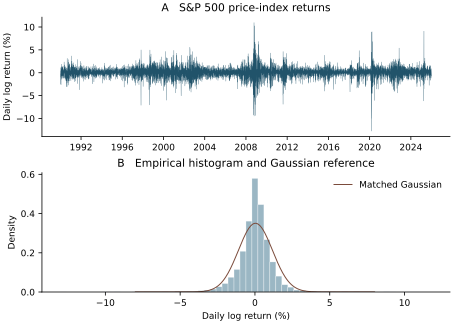
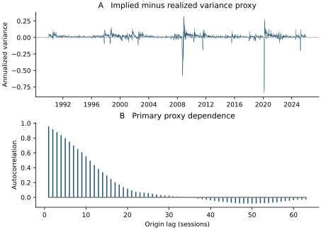

# Scope and evidence status

This supplement accompanies the coauthor review draft dated 2 November 2026. The primary specification remains implied minus realized variance over returns ending in the next 30 calendar days. The 21-trading-day specification is mandatory robustness. The core estimates are provisional pending independent freeze and coauthor acceptance. The source chronology, exact original and fresh digests, software and commands appear in the reproducibility guide and audit files.

# S1. Distribution and dependence diagnostics

Returns below use the full canonical price-index series before the VIX-origin mask. Initial-sample statistics end in 2006, before the first OOS origin. Full descriptive statistics end in 2025. They omit target-support returns in 2026. Standard deviation uses ddof=1; skewness and Fisher excess kurtosis use the bias corrections specified in the protocol. Figures S1–S2 and the machine-readable audit retain untrimmed crises. Zero p-values in the saved diagnostic library output denote floating-point underflow.


| Statistic | Through 2006 | Through 2025 |
| --- | --- | --- |
| n_obs | 4286 | 9066 |
| mean | 0.0003201054 | 0.0003249619 |
| std | 0.009947374 | 0.01138507 |
| skewness | -0.1019717 | -0.3649075 |
| excess_kurtosis | 3.919268 | 10.88439 |
| min | -0.07112747 | -0.1276522 |
| q01 | -0.0261911 | -0.03169195 |
| q05 | -0.01594838 | -0.01736586 |
| q25 | -0.004653794 | -0.004436681 |
| median | 0.0004434756 | 0.0006000589 |
| q75 | 0.005512931 | 0.005694352 |
| q95 | 0.01551995 | 0.01629336 |
| q99 | 0.02702147 | 0.0301087 |
| max | 0.0557443 | 0.109572 |


| Cutoff | Diagnostic | Statistic | p-value |
| --- | --- | --- | --- |
| 2006-12-31 | jarque_bera | 2742.23 | <1e-300 |
| 2006-12-31 | arch_lm_10 | 491.7114 | 2.605096e-99 |
| 2006-12-31 | ljung_box_returns(10) | 22.84508 | 0.01133308 |
| 2006-12-31 | ljung_box_returns(21) | 42.46285 | 0.003678498 |
| 2006-12-31 | ljung_box_squared_returns(10) | 1214.061 | 1.334953e-254 |
| 2006-12-31 | ljung_box_squared_returns(21) | 1943.336 | <1e-300 |
| 2025-12-31 | jarque_bera | 44898.41 | <1e-300 |
| 2025-12-31 | arch_lm_10 | 2325.604 | <1e-300 |
| 2025-12-31 | ljung_box_returns(10) | 91.70699 | 2.455034e-15 |
| 2025-12-31 | ljung_box_returns(21) | 148.0107 | 4.190453e-21 |
| 2025-12-31 | ljung_box_squared_returns(10) | 7868.712 | <1e-300 |
| 2025-12-31 | ljung_box_squared_returns(21) | 11363.15 | <1e-300 |


{width=95%}

*Figure S1. Daily price-index returns through 2025, and the empirical histogram with a Gaussian density matched to the sample mean and standard deviation. The return series includes the observations before masking VIX predictors.*

The full-sample primary proxy has the following distribution. Its extreme negative tail makes the median and positive fraction incomplete summaries of the mean. Quantiles use the committed estimator implementation and fresh targets whose values were independently checked.


| Statistic | Primary 30-calendar-day proxy |
| --- | --- |
| n_obs | 9064 |
| mean | 0.01134891 |
| std | 0.05199225 |
| skewness | -8.378011 |
| excess_kurtosis | 109.2018 |
| min | -0.8426273 |
| q01 | -0.1459644 |
| q05 | -0.0215239 |
| q25 | 0.005926146 |
| median | 0.012399 |
| q75 | 0.02295643 |
| q95 | 0.05212567 |
| q99 | 0.09859956 |
| max | 0.3249461 |
| proportion_positive | 0.8599956 |


{width=95%}

*Figure S2. The primary implied-minus-realized variance proxy across 9,064 origins, followed by its autocorrelation over 63 origin lags. Dependence reflects both volatility dynamics and overlapping targets.*

# S2. Complete confirmatory tables

The CSVs in the companion `tables` directory are the complete numerical tables, retained at their published precision. The manifest `audits/supplementary-table-index.json` records original report hashes and row counts. The corrected forecast tables are generated from the numerical calendar-repair manifest and retain full precision. In those files, select `normal_expanding`, `full`, `cc`, `30c`, `overlapping` and lag 21 for the primary H3/H4 design. Negative H3 loss differences favor the first named model. Secondary Holm values apply only to the two naive-comparator tests at the same specification and lag.


| File | Rows | Contents |
| --- | --- | --- |
| h1_results-1.csv | 144 | docs/h1_results.md |
| h2_results-1.csv | 2 | docs/h2_results.md |
| h2_results-2.csv | 72 | docs/h2_results.md |
| h5_results-1.csv | 2 | docs/h5_results.md |
| h5_results-2.csv | 129 | docs/h5_results.md |
| h5_results-3.csv | 3 | docs/h5_results.md |


| File | Rows | Contents |
| --- | --- | --- |
| h1-robustness.csv | 72 | Mean variance proxy across estimator/horizon/subsample/lag |
| corrected-h3-contrasts.csv | 486 | All 72 corrected cells, paired squared-loss contrasts and lag settings |
| corrected-h4-encompassing.csv | 486 | All 72 corrected cells, intercept/VIX/GARCH coefficients and uncertainty |
| source-discrepancies.csv | 32 | Eight single/joint scenarios, CC/GK and both horizons |


The H5 report also includes the secondary volatility-gap contrasts. Its formal confirmatory test is the recession shift in the variance proxy. H2 tests calibration jointly, so individual intercept/slope intervals cannot replace its Wald restriction. H1/H2/H5 source files retain their original record. The forecasting tables use only the corrected forecast manifest. Detailed selectors and source hashes are supplied in `claim-audit.md` and `audit-keys.md`.

Independent observation-level calculations check 66 robustness cells across H1/H2/H5. The receipt reports fresh coefficient, covariance, target and sample information. Separate aggregate checks retain all 72 calendar-repair cells, the 36 fixed-session controls and 1,134 historical classification comparisons. These checks answer different reproducibility questions.

# S3. Recursive GARCH diagnostics

Every fresh run fitted 4,780 OOS origins using the registered cold-start routine. Parameter units follow the fitting implementation. The mean is in percentage return units and omega in squared percentage return units; the forecast is divided by 10,000 before aggregation. Alpha, beta and persistence are dimensionless, and Student-t nu is degrees of freedom. Likelihood is the fitted total log likelihood at each origin, so different training sample lengths limit its comparison across windows. The table summarizes the 4,780 fitted values per model, rather than a single full-sample fit.


| Variant | Parameter | Minimum | Median | Maximum |
| --- | --- | --- | --- | --- |
| normal_expanding | mu | 0.04568587 | 0.05263826 | 0.06215882 |
| normal_expanding | omega | 0.004909375 | 0.01266021 | 0.02004803 |
| normal_expanding | alpha[1] | 0.05451782 | 0.08269717 | 0.1084841 |
| normal_expanding | beta[1] | 0.8759348 | 0.9064165 | 0.9400976 |
| normal_expanding | persistence | 0.9835114 | 0.9893738 | 0.9958353 |
| normal_expanding | log_likelihood | -12053.66 | -8965.835 | -5481.272 |
| t_expanding | mu | 0.05384244 | 0.06358824 | 0.07539312 |
| t_expanding | omega | 0.003196864 | 0.007320408 | 0.01206621 |
| t_expanding | alpha[1] | 0.04806723 | 0.07616288 | 0.1038788 |
| t_expanding | beta[1] | 0.8911429 | 0.9204032 | 0.9493791 |
| t_expanding | nu | 5.985857 | 6.752772 | 7.610888 |
| t_expanding | persistence | 0.9947029 | 0.9965936 | 0.9996461 |
| t_expanding | log_likelihood | -11826.41 | -8835.936 | -5406.469 |
| normal_rolling5y | mu | 0.02578379 | 0.07203303 | 0.1097002 |
| normal_rolling5y | omega | 0.003429567 | 0.03695707 | 0.0798902 |
| normal_rolling5y | alpha[1] | 0 | 0.1379224 | 0.273797 |
| normal_rolling5y | beta[1] | 0.6844835 | 0.8259533 | 0.9917354 |
| normal_rolling5y | persistence | 0.8796409 | 0.9803922 | 1 |
| normal_rolling5y | log_likelihood | -2141.094 | -1624.937 | -1289.067 |


All 14,340 fresh fits converged. The implementation selected the first and final eligible origin of each evaluation year before examining diagnostic outcomes, yielding 38 anchors per variant. All 114 repeated anchor fits exactly reproduced their checkpoint parameters in the current runtime. Numerical convergence does not establish residual adequacy. ARCH-LM(10) had unadjusted p<0.05 at 2/38 Gaussian expanding, 10/38 Student-t expanding and 8/38 Gaussian rolling anchors. Squared-residual Ljung–Box(21) did so at 0/38, 0/38 and 2/38 anchors. Two rolling persistence values were at or fractionally above one at machine precision, maximum 1.0000000000000004. The historical original record reported three boundary fits; this is a documented fresh-refit difference. No model was replaced after viewing these diagnostics.

The full 114-row `garch_anchor_diagnostics.csv` records log likelihood, persistence, Jarque–Bera, return/squared-residual Ljung–Box and remaining ARCH-LM statistics and p-values. Repeated anchor tests are dependent and unadjusted, and diagnostics outside those anchors were not claimed. The receipt `audits/econometrics/garch_diagnostics_receipt.json` identifies the actual fresh data/checkpoints and software. That source differs from the archived historical fit cache.

# S4. Exploratory extensions


All extensions are historical and exploratory, selected after inspection of the S&P 500 H1–H5 results. They remain provisional pending independent coauthor review. Registering their subsequent implementation does not make the 2012–2025 evaluation prospective. No prospective extension results or executable variance-option strategy results are available.

## Design and version control

H6–H8 share 3,520 evaluation origins in 2012–2025 after a 2007–2011 warm-up. Fitted models update at 168 monthly refits using only training labels whose complete 30-calendar-day outcomes have matured. Features use information through the origin, scaling is training-only, and cached Gaussian expanding GARCH forecasts are reused. No crisis observations are deleted. The outcome and implied variance remain annualized decimal variances,

$$
y_t=\frac{365}{30}\sum_{t<d\leq t+30\mathrm{c}}r_d^2,
\qquad i_t=(VIX_t/100)^2.
$$

The evidence below uses version 2 of the extension. Version 1 used finalized calendars containing future unscheduled closures and is explicitly invalidated for strict as-of calendar claims. The correction separates forecast-time scheduled sessions from actual target sessions, changes 61 forecast origins and analytically extends ten cached GARCH variance vectors; it does not alter the historical outcomes or select new model settings. The historical artifacts are preserved. This calendar repair does not constitute independent scientific acceptance.

H6 and H7 compare paired loss differences with Bartlett HAC(63), HAC(21) sensitivity, and circular 63-session block bootstrap intervals (1,000 draws, seed 1729). Holm correction covers the four advanced-versus-simple H6 tests and three combination-versus-constituent H7 tests separately. H8 has one primary contrast, combination versus trailing at 5 bp. Historical bootstrap intervals do not remove the exploratory selection of the research questions or establish future performance.

## H6: underestimation events

The fixed event is $Y_t=1[y_t>1.5i_t]$, corresponding to a realized-to-implied volatility ratio above $\sqrt{1.5}$. There are 244 events (6.932%). Model A is an expanding matured event-frequency forecast; B is a logistic regression on log implied variance; C is a six-feature logistic model; D is a fixed shallow gradient-boosting model. Neither advanced model improves primary Brier loss.

| Model | Mean probability | Brier | Event contribution | Nonevent contribution | ROC AUC | Recall at retrospective 10% alert budget |
|---|---:|---:|---:|---:|---:|---:|
| A | 0.082965 | 0.065280 | 0.058785 | 0.006496 | 0.3223 | 0.0000 |
| B | 0.086696 | 0.066011 | 0.058743 | 0.007268 | 0.3216 | 0.0041 |
| C | 0.094268 | 0.067777 | 0.056996 | 0.010782 | 0.5084 | 0.0574 |
| D | 0.085558 | 0.070276 | 0.060028 | 0.010248 | 0.3917 | 0.0328 |

For C versus A, excess Brier is 0.002497 (HAC 95% CI [−0.000333, 0.005327], Holm $p=0.1674$). D is worse than A by 0.004996 ([0.001584, 0.008408], Holm $p=0.01641$). C's event contribution improves by 0.001789, but its nonevent contribution worsens by 0.004286; over-warning on numerous nonevents offsets its event-day improvement. Its ROC-AUC block interval [0.3878, 0.6226] includes chance. Neither advanced model passes the registered joint requirement of at least 5% relative Brier improvement and five percentage points of recall improvement against the strongest simple benchmark.

The 10% alert budget ranks the entire evaluation sample and is a retrospective allocation diagnostic. It is not a deployable threshold. The separately saved training-quantile rule has varying alert fractions; A alerts on every date because of ties. The event is relative to implied variance: a high VIX raises the realized-variance threshold. Thus these events cannot be interpreted as an exhaustive definition of economically severe volatility shocks.

## H7: combining variance forecasts

The six fixed forecasts are raw implied variance, Gaussian GARCH, trailing calendar-month variance, EWMA, HAR-style ridge on daily squared-return proxies, and a nonnegative-coefficient ridge combination of implied, GARCH and trailing variance. The HAR model does not use intraday realized variance. The combination is not a convex weighted average: its intercept and coefficient scaling matter. Primary QLIKE is $y/f-\log(y/f)-1$; negative candidate-minus-baseline differences favor the candidate.

| Forecast | QLIKE | RMSE | MAE | Mean forecast minus outcome |
|---|---:|---:|---:|---:|
| Implied variance | 0.385802 | 0.060933 | 0.022692 | 0.007424 |
| GARCH | 0.389746 | 0.067156 | 0.020418 | 0.000367 |
| Trailing | 0.607323 | 0.080749 | 0.023392 | 0.000577 |
| EWMA | 0.525568 | 0.071736 | 0.021981 | 0.000176 |
| HAR-style ridge | 0.413478 | 0.062619 | 0.021308 | 0.003017 |
| Combination | 0.387982 | 0.063252 | 0.020923 | 0.003722 |

| Combination minus baseline QLIKE | Difference | HAC(63) 95% CI | Holm $p$ |
|---|---:|---|---:|
| Implied variance | 0.002180 | [−0.044002, 0.048362] | 1.0000 |
| GARCH | −0.001763 | [−0.029652, 0.026126] | 1.0000 |
| Trailing | −0.219341 | [−0.342043, −0.096639] | 0.001377 |

The combination improves a weak trailing benchmark but does not pass the registered requirement of a 5% QLIKE reduction against the strongest constituent with at most 5% RMSE deterioration. Its lower MAE than implied variance coexists with worse RMSE and QLIKE. Constituent forecast correlations are high (implied/GARCH 0.8962; GARCH/trailing 0.9258), but overlapping information is an association, not an identified cause of failure. Raw implied-variance coefficients rise from 0.2078 to 0.6799 across refits while GARCH coefficients fall from 0.5289 to 0.2048; no coefficient intervention was tested. Descriptive calibration projections use evaluation outcomes and must never be presented as submitted forecasts.

The table uses the registered primary HAC(63) intervals and the Holm adjustment based on those tests. HAC(21) is a sensitivity: combination minus implied, GARCH, and trailing has raw two-sided $p$ values 0.917728, 0.894317, and 0.00021056, respectively; the corresponding HAC(63) raw values are 0.926278, 0.901381, and 0.00045900. The HAC(21) result is not the primary test.

## H8: next-open SPY execution and cash sensitivity

Each strategy uses $w_t=\min\{1,\max[0,0.10/\sqrt{f_t}]\}$, trades at the next exchange open, and remains long-only without leverage. The self-financing accounting credits old-share overnight returns and dividends before rebalancing, new-share intraday returns afterward, and costs on traded notional. There are 3,520 open marks from 2012-01-04 to 2026-01-02 and 3,519 earned signals; the final forecast earns no return. The primary case charges 5 bp per traded notional and initially assumes zero cash yield.

| SPY policy | Zero-cash CAGR, % | Annual volatility, % | Rolling 21-session target RMSE, % | Full-DGS cash CAGR, % | Cash CAGR increment, pp |
|---|---:|---:|---:|---:|---:|
| Buy-and-hold | 14.7953 | 16.6676 | 9.9570 | 14.7953 | 0.0000 |
| Trailing | 9.7603 | 10.1395 | 2.9597 | 10.1644 | 0.4041 |
| Implied variance | 7.3026 | 7.7745 | 3.2980 | 7.9457 | 0.6431 |
| GARCH | 9.0291 | 9.4509 | 2.6846 | 9.5172 | 0.4881 |
| Combination | 7.9389 | 8.4384 | 3.0281 | 8.4919 | 0.5530 |

The combination reduces overall volatility but worsens rolling target RMSE relative to trailing by 0.06849 percentage points (block-63 95% CI [−0.20909, 0.37154] pp). Its CAGR difference is −1.82134 pp ([−3.03400, −0.68716] pp). It fails the joint requirement of at least 0.5 pp RMSE reduction without more than 0.5 pp CAGR deterioration. The disadvantage exists gross of costs: combination CAGR 8.2297% versus trailing 9.9988%. Transaction costs alone do not explain it.

The additive annual-variance bridge for combination is −0.00287939 relative to the 10% target variance. Its cap term is only −0.00002224; the largest term, −0.00202096, is the horizon/aggregation/changing-exposure bridge. Consequently cap binding is not an adequate explanation of the aggregate undershoot. The bridge is an accounting decomposition, and its largest term remains economically unresolved.

The separately registered cash experiment retains the signals and weights and models initial-release ALFRED DGS1MO quotes available before each prior open. It accrues simple ACT/365F interest on actual prior post-trade cash over elapsed calendar days. It also preserves zero, half-DGS and converted DTB4WK scenarios. Full Treasury pass-through is a hypothetical liquid cash account, not observed broker compensation or an executable Treasury total return. At 5 bp, the block-63 intervals for incremental CAGR are [0.2538, 0.5774] pp (trailing), [0.4293, 0.8786] pp (implied), [0.3204, 0.6856] pp (GARCH), and [0.3685, 0.7558] pp (combination). Point CAGR order is unchanged. Zero-reference Sharpe rankings can change, while a common DGS opportunity-cost benchmark gives a different order; these small ranking differences do not establish alpha. Every cash scenario retains the failed H8 joint gate.

Fractional shares, opening fills, flat transaction costs and ex-date rather than payment-date dividend credits are simplifying assumptions. Taxes, market impact, bid–ask histories and actual broker sweep terms are absent. The VIX itself is not traded. Executable option surfaces, funding and margin data needed for H9 remain unavailable.

## External-market evidence and incomplete registered inference

The tracked cross-market report describes Nasdaq-100/VXN/QQQ results; Russell 2000 and EURO STOXX 50/VSTOXX remain blocked by unavailable verified underlying or entitled full-history files. VXN and Nasdaq observations are current-vintage histories, not point-in-time vintage reconstructions. The execution manifest identifies seven output JSONs, none present in this checkout. A fresh H1/H2 calculation below uses recovered, hash-exact Nasdaq and VXN source snapshots and freshly reconstructed S&P targets; it is not a recovery of the historical output bytes. The remaining H6–H8 and QQQ values are report transcriptions, not fresh market refits.

| Nasdaq versus S&P comparison | Origins | Nasdaq 30c proxy mean | S&P 30c proxy mean | Paired difference; reported HAC(21) 95% CI; raw $p$ |
|---|---:|---:|---:|---|
| Common 2007–2025 | 4,780 | 0.006704 | 0.007472 | −0.000768; [−0.002396, 0.000860]; 0.355 |
| Post-2014-10-06 | 2,827 | 0.004668 | 0.006668 | −0.002001; [−0.004163, 0.000161]; 0.0697 |

The paired H1 figures above agree with the fresh reconstruction to displayed precision. For the longer Nasdaq sample (6,241 origins), the reported mean is 0.008587 (HAC(21) raw $p=0.00830$), compared with $p=0.0780$ on the common 2007–2025 sample and $p=0.3316$ post-2014. These different rejection outcomes do not themselves demonstrate a market difference. The report gives Nasdaq 2012–2025 H6 prevalence 8.81%, model-D relative Brier reduction versus A of −3.47% (63-session interval [−6.44%, −1.24%]), and combination-minus-VXN QLIKE 0.02091 (HAC(21) sensitivity $p=0.182$). QQQ zero-to-full-DGS CAGR rises from 11.288% to 12.008% for trailing and 9.411% to 10.228% for combination. These are provisional descriptive extensions to the SPY findings.

The newly calculated paired H1 circular bootstrap uses synchronized dates and 1,000 valid draws per interval, seed 1729. For 30c, the primary block-63 percentile intervals are [−0.002712, 0.001056] for 2007–2025 and [−0.005049, 0.000293] post-2014; block-21 intervals are [−0.002395, 0.000764] and [−0.004178, 0.000165], while block-126 intervals are [−0.002768, 0.001147] and [−0.005050, 0.000616]. The 21-session-target results and full precision are in `paired_h1_h2_rebuilt.json`. These intervals are fresh partial evidence, not a completed registered H1–H5 bootstrap family or adjusted tests.

For H2 on the common 30c sample, the Nasdaq-minus-S&P intercept interaction is 0.002586 (SE 0.001484, raw normal $p=0.08137$) and slope interaction is −0.013137 (SE 0.035828, raw $p=0.71386$). The producer stacks both markets in an OLS regression with market intercept and slope interactions, sums the two score vectors within each date, and applies Bartlett HAC at 21 ordered-origin lags to those grouped scores, with factor $2n/(2n-4)$. It is not a regression of one market's outcome on the other market's outcome. This reconstruction calls the historical producer for that covariance; its label of independent verification should not be read as an independent reimplementation.

There is a material registration–implementation gap. The cross-market protocol specifies paired circular block bootstrap contrasts with blocks 63 (primary), 21 and 126, 1,000 draws, seed 1729, and Holm correction across new-market primary H1–H5 contrasts. The historical paired-market producer implements only H1 and H2, using HAC(21), with no market-contrast bootstrap or Holm adjustment. The new calculation supplies H1 bootstrap intervals only. Within-Nasdaq H6/H7 bootstrap/Holm routines and H8 scenario bootstraps do not complete that registered cross-market family. H3 per-origin S&P forecasts were not preserved in the reported historical summary, preventing an honest paired cross-market H3 loss test from those summaries alone. No completed H1–H5 cross-market family or adjusted market-superiority conclusion can be claimed. Non-rejection is not calibration equivalence or evidence of no economically meaningful difference.

## Provenance and reproduction boundary

The authoritative rules are `paper/method_protocol.md` 1.1.0 and its deviation log, followed by the separate extension, failure-diagnostic, cash and cross-market registrations. The inspected integration tree is `27735e5653b5b778fb0e23ccc3e9079d4bdd6aa3`. Exact Git sources for numerical recovery are:

The source inventory pins H6–H8 at commit `2ac49b69d56d`, failure diagnostics at `956a9d8aa9eb`, cash accounting at `0910d8e26355`, and Nasdaq reports at `27735e5653b5`. The full commit IDs, artifact names and SHA-256 digests are retained in the extension audit receipt and the separate exploratory supplement. Each digest is machine-checked by `verify_extensions.py` against the named Git blob.

Manifest filenames in the source inventory are under `data/manifests/`. The portable `verify_extensions.py` reads exact Git blobs, checks declared producer-source hashes and result hashes, reconstructs H6 Brier contributions and H7 QLIKE differences from committed tables, and reconstructs primary zero-cash H8 terminal wealth, CAGR, volatility and rolling-risk RMSE from daily return components. The fresh replay passes and its full receipt is `extension_receipt_reverified.json`. It checks cash-summary identities and unchanged CAGR ordering, but does not refit models, rebuild original forecast paths or replay all cash ledgers. The fresh full implementation suite passes 1,839 tests in 23.58 seconds using Python 3.12.14; the original execution manifest records Python 3.11.5. This is a compatibility check, not a bitwise environment reproduction.

The original raw-data replay entry points fail because ignored empirical, failure and cash output files are absent; the concrete errors are retained in `replay_extension.log`, `replay_failure.log` and `replay_cash.log`. Passing unit tests and the available component replay support implementation and arithmetic consistency, but do not establish independent freeze acceptance, raw-to-result reproducibility or recovery of absent cross-market output bytes.

### Reproduction of the partial paired calculation

Both scripts accept explicit paths and can be launched from any working directory. Set `AUDIT_DIR` to this supplement's directory, `CHECKOUT` to the cross-market source checkout, `SOURCE_DIR` to a private directory holding the two exact CSVs, `SPX_TARGETS` to the reconstructed target CSV, and `OUTPUT_DIR` to an existing writable destination. With the recorded dependencies installed, run:

```sh
python "$AUDIT_DIR/rebuild_paired_h1_h2.py" \
  --checkout "$CHECKOUT" --source-dir "$SOURCE_DIR" \
  --spx-targets "$SPX_TARGETS" --output "$OUTPUT_DIR/paired_h1_h2_rebuilt.json" \
  > "$OUTPUT_DIR/paired_h1_h2_rebuilt.log"
```

To attempt source recovery instead, `python "$AUDIT_DIR/fetch_pinned_sources.py" --checkout "$CHECKOUT" --output "$SOURCE_DIR"` writes the recovered CSVs and a recovery receipt only under that chosen directory, subject to the original hash gate. It requires `requests` and network access. Source files are private and must not be committed. To repeat the separate Git-blob component audit, run `(cd "$CHECKOUT" && python "$AUDIT_DIR/verify_extensions.py")` with the listed historical commits available; that audit reads Git objects from its working directory.

The paired run used Python 3.12.14, numpy 2.4.6, pandas 2.3.3, scipy 1.17.1, statsmodels 0.15.0 and exchange-calendars 4.13.2. It checks Nasdaq and VXN input hashes `2326ea9359dc6d521ada1c0600b90be23e054b4ba93955a615a5dba97159ff9f` and `53aa81e815b3f9f5b7b18bcfa64f0c5d02b2341aad5b128307f069d1d7bd3f2f`. The rebuilt S&P target hash is `3c7fc89fc510659fca0a976ad0d61f780aa93505cc2764f53d38a3a14d671fbc`, different from the original derived-byte hash; its provenance and rebuild limits are in `prov-delivery/provenance.md`. The Nasdaq panel spans 2001-02-02 to 2025-12-31; the session audit finds missing 2002-01-29 in the underlying and excludes three non-session dates from each series, as recorded in the JSON. The FRED snapshots were recovered by retaining only the prefix whose exact original hash matched; the TLS recovery receipt records the appended bytes. The input paths in the JSON are logical identifiers from the original workspace, not required current locations; the flags select their current locations. Those private inputs and Git objects are prerequisites, not embedded in this supplement. The fresh result depends on the historical cross-market implementation; it is a numerical reconstruction, not independent model validation.

# S5. Track A and review records

The pricing exercise is recorded in `audits/theory/option_replay.md`; its source hash is pinned in `audits/theory/versions.json`. Independent Gaussian-payoff and variance-strip quadratures reproduce known diffusion values, with six synthetic cases each. Six fixed SPX quotes form a separate small, asynchronous example. Neither exercise establishes empirical completeness of the pricing model.

The final reviewer reports, claim mapping, source verification and build inventory accompany the paper. They describe their own scope and remaining limitations. Independent coauthor acceptance remains open. The review package identifies the data decisions, missing original manifest/response, historical-cache replay, and incomplete registered cross-market inference individually.
